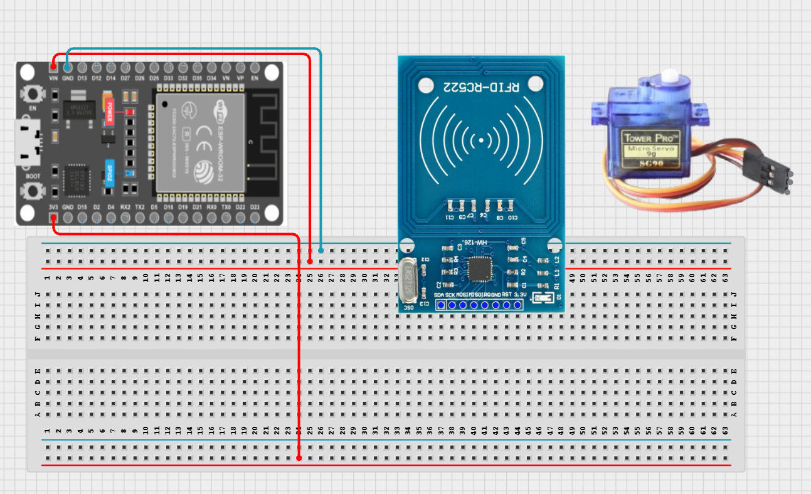
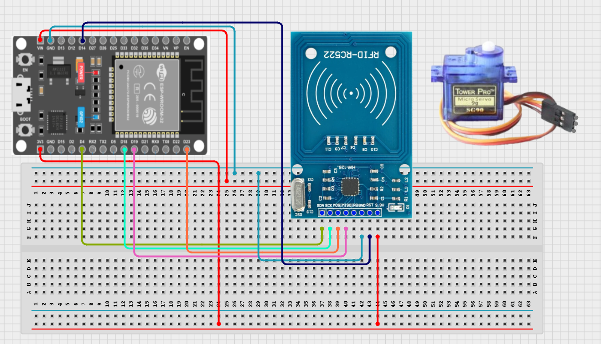
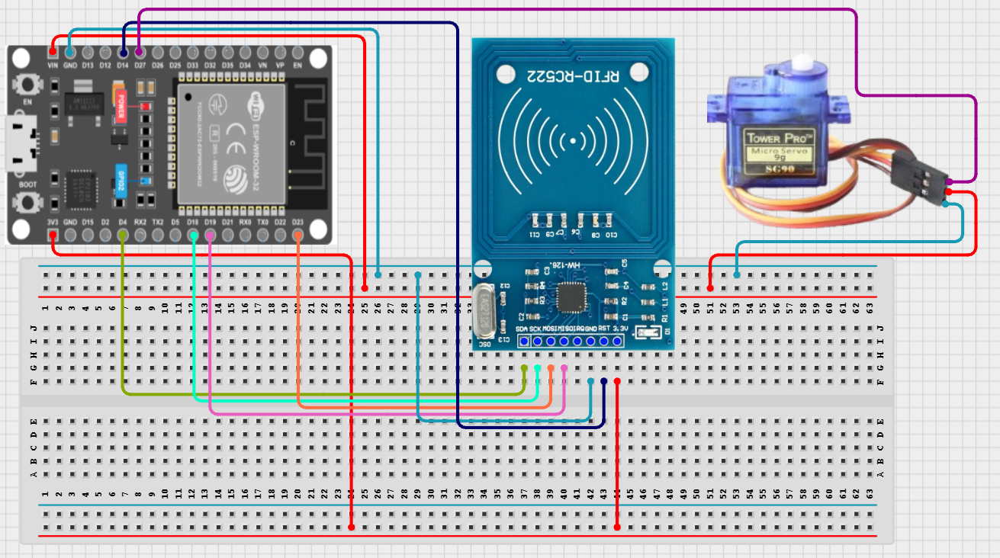

# 4.3.18. RFID Keycard Starter Lever Interlock

| **Description** | In Project 138, an authorized RFID card toggles an SG90 servo between **STOP** and **RUN** positions, demonstrating a keycard-controlled starter interlock. |
|------------------|-----------------------------------------------------------------------------------------------------------------------------------------------------------|
| **Use case**     | A classroom model of access-controlled machine operation. The servo moves a lightweight pointer or lever only; it does not switch or secure a real motor. |

## Components

|  |  |  |  |  |  |
| --- | --- | --- | --- | --- | --- |

Things Needed:

- ESP32 board = 1
- RC522 RFID reader = 1
- Kit RFID card or key fob = 1
- SG90 servo = 1
- Breadboard and jumper wires
- USB cable for the ESP32
- Separate regulated **5V, 1A or higher** supply for the servo (provided by the user; not included in the kit)

The L298N driver, DC motor, fan blade, relay, and RTC mentioned in the original draft are not used. The SG90 acts only as a visual starter lever. Do not connect this demonstration to a real motor, machine, or mains circuit.

## Building the circuit

> **Tip:** See the [ESP32 Pinout Guide](../../Components/ESP32%20Pinout%20and%20Pin%20Assignment%20Guide.md) to locate the correct GPIO pins.

## Mounting the components

**Step 1:** Disconnect the ESP32 and servo supply. Place the RC522 and ESP32 on the breadboard. Secure the servo so its horn can move freely without pinching wires or hitting other parts. Attach only a lightweight pointer or lever.



## Wiring the circuit

**Step 2:** Connect the RC522 RFID reader:

- Connect RC522 **3.3V / VCC** to ESP32 **3.3V**. Never connect the reader to 5V.
- Connect RC522 **GND** to ESP32 **GND**.
- Connect **SDA / SS** to **GPIO 4**. On this SPI reader, `SDA` is the chip-select pin, not I2C SDA.
- Connect **SCK** to **GPIO 18**.
- Connect **MOSI** to **GPIO 23**.
- Connect **MISO** to **GPIO 19**.
- Connect **RST** to **GPIO 14**.
- Leave **IRQ** unconnected.



**Step 3:** Connect the SG90 servo:

- Connect the servo **signal** wire (orange/yellow) to **GPIO 27**.
- Connect the servo **V+** wire (red) directly to the separate regulated **5V** supply.
- Connect the servo **GND** wire (brown/black) to the supply negative.
- Connect the 5V supply negative to ESP32 **GND** to provide a common signal reference.
- Do not connect the servo's 5V supply positive to ESP32 **3.3V**, **5V/VIN**, or a GPIO. Do not power the servo from the ESP32 board.



**Step 4:** With the servo unloaded, check the RC522 pin labels, common ground, and separate servo power wiring. Connect USB to the ESP32, then turn on the servo's 5V supply.

## PROGRAMMING

**Step 1:** Open Arduino IDE and select the ESP32 board and port. See [Getting Started](../../Getting%20Started/Arduino_IDE_Setup.md) for setup instructions.

**Step 2:** Install the **MFRC522** and **ESP32Servo** libraries through Arduino IDE's Library Manager. Upload this sketch first to read the UID of your card or key fob:

```cpp
#include <SPI.h>
#include <MFRC522.h>
#include <ESP32Servo.h>

constexpr uint8_t ssPin = 4;
constexpr uint8_t rstPin = 14;
constexpr uint8_t sckPin = 18;
constexpr uint8_t misoPin = 19;
constexpr uint8_t mosiPin = 23;
constexpr uint8_t servoPin = 27;
constexpr uint8_t stopAngle = 20;
constexpr uint8_t runAngle = 100;

// Replace this example UID with the UID printed for your authorized card.
const byte authorizedUID[] = {0xDE, 0xAD, 0xBE, 0xEF};

MFRC522 rfid(ssPin, rstPin);
Servo starterServo;
bool starterRunning = false;

bool isAuthorizedCard() {
  if (rfid.uid.size != sizeof(authorizedUID)) {
    return false;
  }

  for (byte i = 0; i < sizeof(authorizedUID); i++) {
    if (rfid.uid.uidByte[i] != authorizedUID[i]) {
      return false;
    }
  }

  return true;
}

void printCardUID() {
  Serial.print("Card UID: ");
  for (byte i = 0; i < rfid.uid.size; i++) {
    if (i > 0) {
      Serial.print(':');
    }
    Serial.printf("%02X", rfid.uid.uidByte[i]);
  }
  Serial.println();
}

void setup() {
  Serial.begin(115200);

  SPI.begin(sckPin, misoPin, mosiPin, ssPin);
  rfid.PCD_Init();

  starterServo.setPeriodHertz(50);
  starterServo.attach(servoPin, 500, 2400);
  starterServo.write(stopAngle);

  Serial.println("RFID starter lever ready. Scan a card or key fob.");
  Serial.println("Copy the printed authorized UID into authorizedUID before using the access check.");
}

void loop() {
  if (!rfid.PICC_IsNewCardPresent() || !rfid.PICC_ReadCardSerial()) {
    return;
  }

  printCardUID();

  if (isAuthorizedCard()) {
    starterRunning = !starterRunning;
    starterServo.write(starterRunning ? runAngle : stopAngle);
    Serial.println(starterRunning ? "Access granted: RUN position." : "Access granted: STOP position.");
  } else {
    Serial.println("Access denied: lever position unchanged.");
  }

  rfid.PICC_HaltA();
  rfid.PCD_StopCrypto1();
  delay(300);
}
```

**Step 3:** Open Serial Monitor at **115200 baud** and scan your card or key fob. Copy the printed UID bytes into `authorizedUID`, replacing the example values. Keep the number of bytes exactly as printed, then upload the sketch again.

**Step 4:** With the servo still unloaded, scan the authorized card once to move the pointer to **RUN**, then scan it again to return it to **STOP**. An unauthorized card should leave the servo in its current position. If the horn binds or strains, disconnect power and adjust `stopAngle` and `runAngle` so it can move freely.

## CONCLUSION

The RC522 checks the scanned card UID and the SG90 demonstrates the resulting STOP/RUN state with a lightweight lever. This is an educational demonstration only: a UID can be copied, and the servo is not a safety-rated machine interlock or motor switch.
