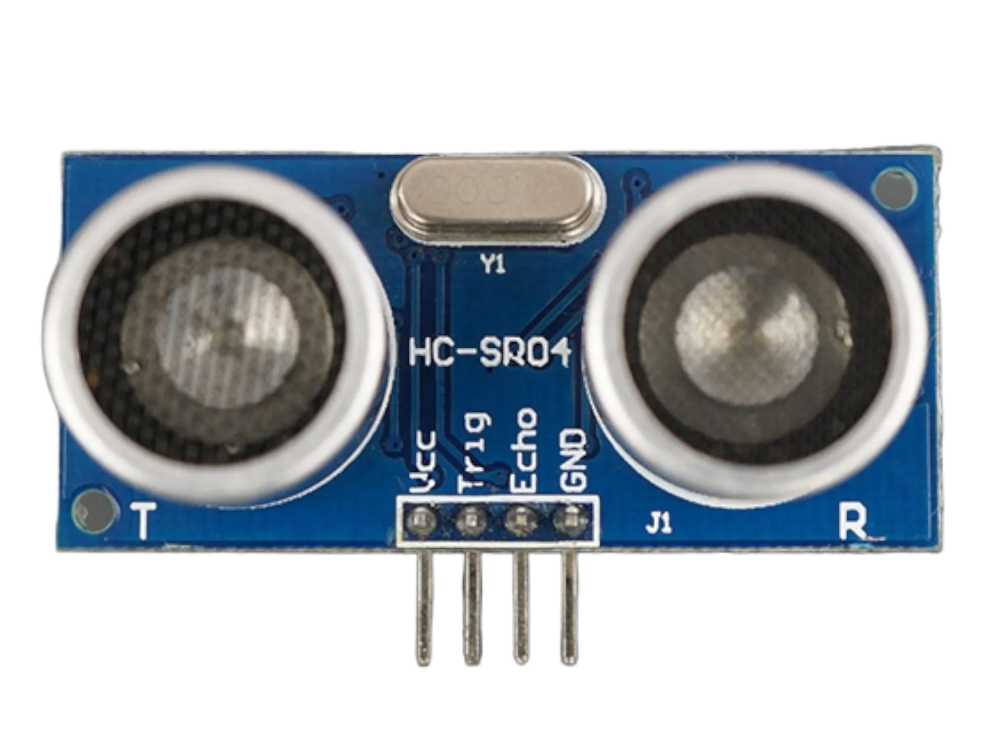
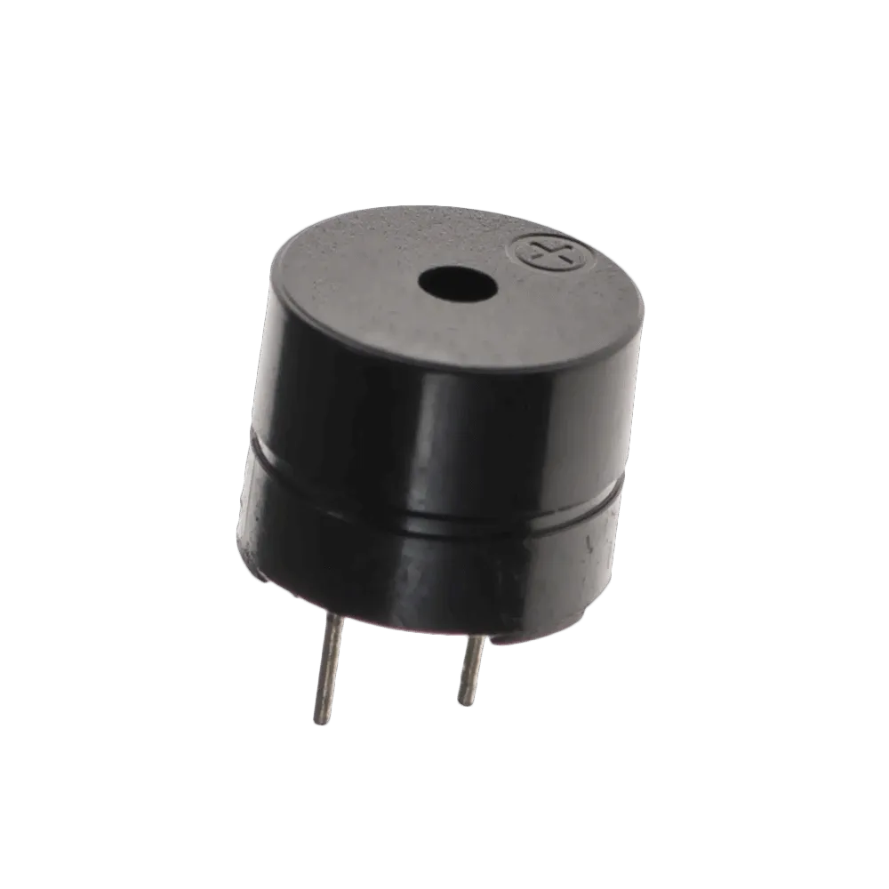
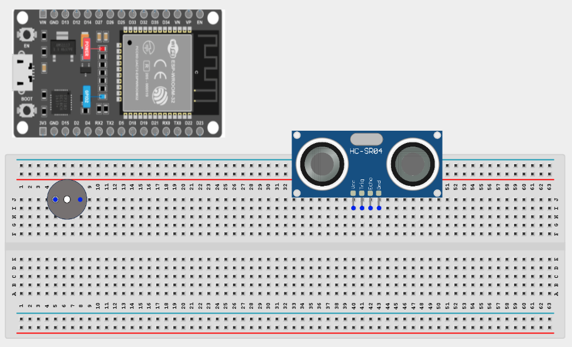
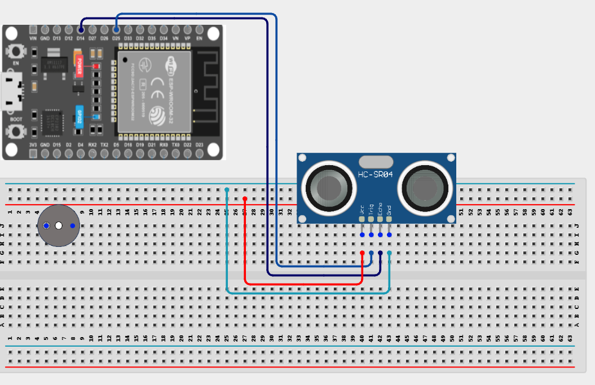
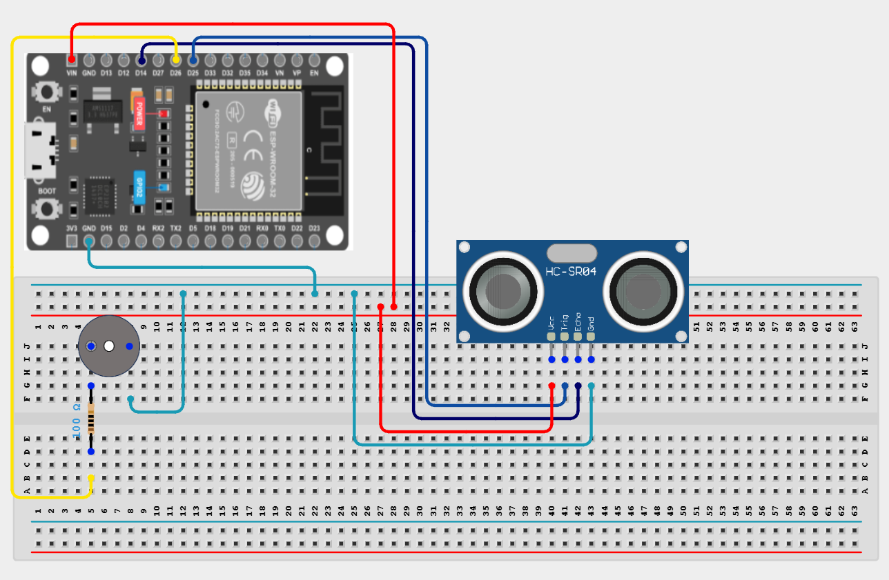

# 4.3.19. Bluetooth Wireless Proximity Alarm System

| **Description** | In Project 139, learners use the ESP32's built-in Bluetooth Classic to arm and disarm an ultrasonic proximity alarm. When an object is within range, the buzzer sounds and an alert is sent over Bluetooth. |
|------------------|----------------------------------------------------------------------------------------------------------------------------------------------------------------------------------------------------------|
| **Use case**     | A classroom demonstration of Bluetooth control, ultrasonic ranging, and local audio alerts. It is not a safety or security system. |

## Components

|  |  |  |  |  |  |
| --- | --- | --- | --- | --- | --- |

Things Needed:

- ESP32 board = 1
- HC-SR04 ultrasonic sensor = 1
- Active buzzer = 1
- 1 kΩ resistor = 1
- 2 kΩ resistor = 1
- 100 Ω resistor = 1
- Breadboard, jumper wires, and USB cable
- Phone or other Bluetooth Classic SPP terminal device

The ESP32-WROOM-32D has built-in Bluetooth Classic, so no HC-05 is required. The traffic-light module, relay, RTC, and RFID reader mentioned in the original draft are not used.

## Building the circuit

> **Tip:** See the [ESP32 Pinout Guide](../../Components/ESP32%20Pinout%20and%20Pin%20Assignment%20Guide.md) to locate the correct GPIO pins.

## Mounting the components

**Step 1:** Disconnect USB. Place the ESP32, HC-SR04, and active buzzer on the breadboard. Aim the sensor at a clear area where objects can approach without the sensor or wiring being disturbed.



## Wiring the circuit

**Step 2:** Connect the HC-SR04:

- Connect sensor **VCC** to ESP32 **5V/VIN** while the ESP32 is powered by USB.
- Connect sensor **GND** to ESP32 **GND**.
- Connect **TRIG** to **GPIO 25**.
- Connect **ECHO** through a resistor divider: connect **ECHO** to one end of the **1 kΩ** resistor; connect its other end to a junction and **GPIO 14**; connect a **2 kΩ** resistor from that junction to **GND**.
- The divider reduces the HC-SR04's 5V ECHO signal to about 3.3V. Never connect ECHO directly to an ESP32 GPIO.



**Step 3:** Connect the active buzzer:

- Connect buzzer **positive (+)** to **GPIO 26** through a **100 Ω** series resistor.
- Connect buzzer **negative (-)** to ESP32 **GND**.
- This drives the buzzer at 3.3V with its current limited for direct GPIO use. Do not connect its positive lead to 5V and directly to a GPIO.



**Step 4:** Check the ECHO divider connections, common ground, and buzzer polarity. Then connect USB to the ESP32.

## PROGRAMMING

**Step 1:** Open Arduino IDE and select the ESP32 board and port. See [Getting Started](../../Getting%20Started/Arduino_IDE_Setup.md) for setup instructions.

**Step 2:** Enter this sketch. `BluetoothSerial` is included with the ESP32 Arduino core; no external Bluetooth module or additional library is required.

```cpp
#include "BluetoothSerial.h"

BluetoothSerial SerialBT;

constexpr uint8_t trigPin = 25;
constexpr uint8_t echoPin = 14;
constexpr uint8_t buzzerPin = 26;
constexpr float alarmDistanceCm = 20.0f;
constexpr uint32_t echoTimeoutUs = 30000UL;

bool alarmArmed = false;
bool objectNear = false;
uint32_t lastReportAt = 0;

void reportMessage(const char* message) {
  Serial.println(message);
  SerialBT.println(message);
}

void setup() {
  Serial.begin(115200);

  digitalWrite(trigPin, LOW);
  digitalWrite(buzzerPin, LOW);
  pinMode(trigPin, OUTPUT);
  pinMode(echoPin, INPUT);
  pinMode(buzzerPin, OUTPUT);

  if (!SerialBT.begin("STEMAIDE Proximity Alarm")) {
    Serial.println("Bluetooth initialization failed.");
    while (true) {
      digitalWrite(buzzerPin, LOW);
      delay(1000);
    }
  }

  Serial.println("Proximity alarm ready. Send A to arm or D to disarm.");
  SerialBT.println("Proximity alarm ready. Send A to arm or D to disarm.");
}

void loop() {
  while (SerialBT.available() > 0) {
    char command = static_cast<char>(SerialBT.read());
    if (command >= 'a' && command <= 'z') {
      command = static_cast<char>(command - ('a' - 'A'));
    }

    if (command == 'A') {
      alarmArmed = true;
      reportMessage("Alarm armed.");
    } else if (command == 'D') {
      alarmArmed = false;
      objectNear = false;
      digitalWrite(buzzerPin, LOW);
      reportMessage("Alarm disarmed.");
    } else if (command != '\r' && command != '\n') {
      SerialBT.println("Unknown command. Send A to arm or D to disarm.");
    }
  }

  if (!alarmArmed) {
    digitalWrite(buzzerPin, LOW);
    delay(80);
    return;
  }

  digitalWrite(trigPin, LOW);
  delayMicroseconds(2);
  digitalWrite(trigPin, HIGH);
  delayMicroseconds(10);
  digitalWrite(trigPin, LOW);

  const unsigned long duration = pulseIn(echoPin, HIGH, echoTimeoutUs);
  float distanceCm = 0.0f;

  if (duration > 0) {
    distanceCm = duration / 58.3f;
  }

  const bool detectedNear = duration > 0 && distanceCm <= alarmDistanceCm;
  if (detectedNear != objectNear) {
    objectNear = detectedNear;
    if (objectNear) {
      reportMessage("ALERT: Object within the proximity threshold.");
    } else if (duration == 0) {
      reportMessage("No echo received; buzzer off.");
    } else {
      reportMessage("Area clear.");
    }
  }

  digitalWrite(buzzerPin, objectNear ? HIGH : LOW);

  if (millis() - lastReportAt >= 500UL) {
    lastReportAt = millis();
    if (duration == 0) {
      Serial.println("Armed | No echo received.");
    } else {
      Serial.printf("Armed | Distance: %.1f cm | Buzzer: %s\n",
                    distanceCm, objectNear ? "ON" : "OFF");
    }
  }

  delay(80);
}
```

**Step 3:** Upload the sketch. Pair a phone or other device that supports **Bluetooth Classic Serial Port Profile (SPP)** with **STEMAIDE Proximity Alarm**, then connect using a Bluetooth terminal app. A BLE-only terminal app will not work with `BluetoothSerial`.

**Step 4:** Send **A** to arm the alarm and **D** to disarm it. When armed, the buzzer sounds if the HC-SR04 detects an object at or closer than **20 cm**. Test with an object at least **2 cm** from the sensor, which is its approximate minimum measurement distance. Change `alarmDistanceCm` to set a different threshold. The Serial Monitor runs at **115200 baud** and reports the measured distance; a no-echo reading is treated as no detected object.

## CONCLUSION

The ESP32's built-in Bluetooth arms or disarms the HC-SR04 proximity alarm, and the buzzer reports nearby objects. The ECHO divider protects the ESP32 from the sensor's 5V output. This classroom project is not suitable for personnel protection, intrusion detection, or other safety-critical use.
