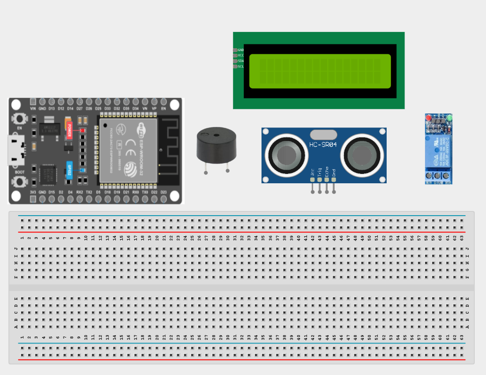
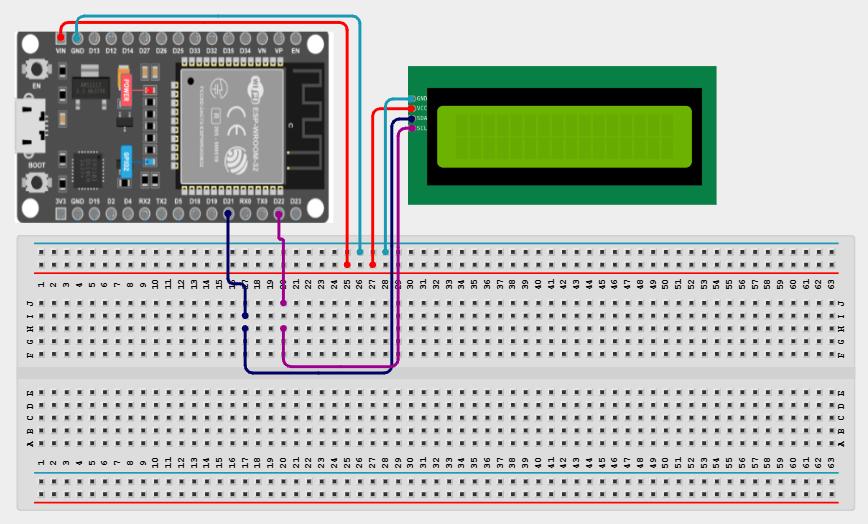
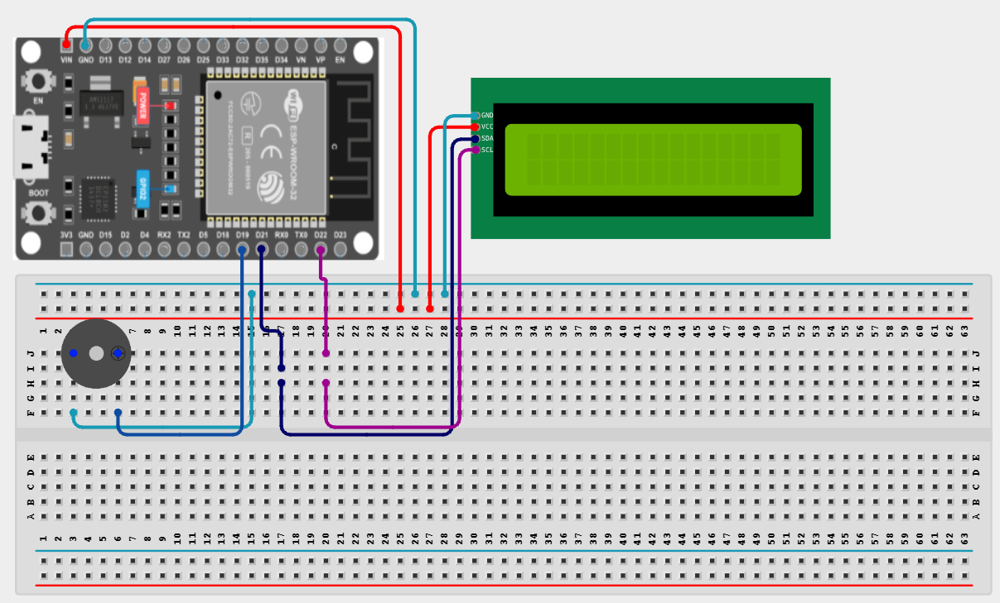
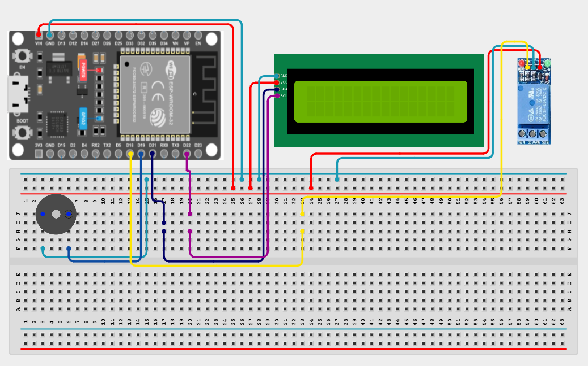

# 4.3.1. Bluetooth Smart Home Automation Hub

| **Description** | In Project 121, learners build a Bluetooth home automation hub using the ESP32's built-in Bluetooth, a 1-channel relay module, an IIC 1602 LCD, and an active buzzer. A smartphone terminal app sends a command to toggle one relay-controlled load while the LCD shows its status. |
|------------------|----------------------------------------------------------------|
| **Use case**     | This project demonstrates how an ESP32 can use its built-in Bluetooth Classic radio to control a single relay channel in a low-voltage smart-home prototype. |

## Components (Things You will need)

|  |  |  |  |  |  |  |
| --- | --- | --- | --- | --- | --- | --- |

## Building the circuit

> **Tip:** Use the [ESP32 Pinout Guide](../../Components/ESP32%20Pinout%20and%20Pin%20Assignment%20Guide.md) to locate the correct GPIO pins.


Things Needed:

- ESP32 board Core Board = 1

- 1-Channel Relay Module = 1

- IIC 1602 LCD Module = 1

- 5V Active Buzzer = 1

- USB Cable & Jumper Wires = 1

- Bread Board


## Mounting the components

**Step 1:** Place the ESP32, 1-channel relay module, I2C LCD, and active buzzer on an insulated surface. Keep the relay's load terminals separate from the breadboard.



## Wiring the circuit

**Step 2:** Verify the I2C LCD is safe to connect directly to the ESP32 before wiring it:

ESP32 GPIO pins use **3.3V logic** and are not 5V-tolerant. Before direct connection, verify from the exact LCD/backpack documentation that, while the LCD is powered at **5V**, its **SDA/SCL** signals never rise above **3.3V** and its I2C inputs recognize **3.3V** as HIGH. The kit's LCD documentation says its backpack pull-ups connect to 5V, so do **not** connect that version directly unless you confirm your actual module is different and 3.3V-I2C-compatible. If you cannot verify both requirements, stop and use a compatible LCD/interface or a level shifter.

- Once verified, connect LCD **VCC** to the ESP32 board's **5V** pin (called **VIN** on some board versions) and LCD **GND** to ESP32 **GND**.
- Connect LCD **SDA** to **GPIO 21 (SDA)**.
- Connect LCD **SCL** to **GPIO 22 (SCL)**.
- The sketch expects LCD I2C address **0x27**. If the backpack uses **0x3F**, change the address in the `LiquidCrystal_I2C` declaration.



**Step 3:** Connect the active buzzer:

- Connect buzzer **positive (+)** to **GPIO 19**.
- Connect buzzer **negative (-)** to ESP32 **GND**.
- The kit buzzer draws about **10mA at 3.3V**, which is suitable for direct GPIO drive. Do not connect its **5V** supply to a GPIO pin. It may be quieter at 3.3V than at its rated 5V.
- If your buzzer draws more than **12mA at 3.3V** or requires 5V to operate, do not connect it directly to the GPIO; use a transistor driver or a 3.3V-compatible buzzer.




**Step 4:** Connect the 1-channel relay module's control side:

- The kit's relay module has **VCC**, **GND**, and **IN** pins; it does not have a separate **JD-VCC** supply or jumper.
- If the relay is marked for a **5V coil**, connect its **VCC** to the ESP32 board's **5V** pin (called **VIN** on some board versions). Connect relay **GND** to ESP32 **GND**.
- Connect relay **IN** to **GPIO 18** only if the module accepts the ESP32's **3.3V** logic level.
- The sketch defaults to an active-LOW input. Confirm the module's trigger polarity before powering it; change `relayActiveLow` in the sketch if the module is active-HIGH.
- Keep the relay's **COM**, **NO**, and **NC** load terminals disconnected during the low-voltage test. Never place mains wiring on a breadboard; mains installation must be handled by a qualified person.



**Step 5:** Connect the USB programming cable:

- Connect USB to the ESP32 after checking the low-voltage wiring and confirming that the relay load terminals are disconnected.

## PROGRAMMING

**Step 1:** Open your Arduino IDE. See [Getting Started](<../../Getting Started/Arduino_IDE_Setup.md>) for setup instructions.

**Step 2:** Enter this program. It uses the ESP32's built-in Bluetooth Classic radio; sending `1` toggles the single relay channel.

```cpp
// Project 121: Bluetooth Smart Home Automation Hub
#include <BluetoothSerial.h>
#include <Wire.h>
#include <LiquidCrystal_I2C.h>

BluetoothSerial SerialBT;
LiquidCrystal_I2C lcd(0x27, 16, 2);

const int relayPin = 18;
const int buzzerPin = 19;
const bool relayActiveLow = true;
bool relayOn = false;

void setRelay(bool on) {
  digitalWrite(relayPin, (on != relayActiveLow) ? HIGH : LOW);
}

void setup() {
  digitalWrite(relayPin, relayActiveLow ? HIGH : LOW);
  pinMode(relayPin, OUTPUT);
  pinMode(buzzerPin, OUTPUT);
  digitalWrite(buzzerPin, LOW);

  Wire.begin(21, 22);
  lcd.init();
  lcd.backlight();
  lcd.print("Bluetooth Hub");
  lcd.setCursor(0, 1);
  lcd.print("Relay: OFF");

  SerialBT.begin("ESP32 Smart Home Hub");
}

void loop() {
  if (SerialBT.available()) {
    char cmd = SerialBT.read();
    if (cmd == '1') {
      relayOn = !relayOn;
      setRelay(relayOn);
    }

    digitalWrite(buzzerPin, HIGH);
    delay(50);
    digitalWrite(buzzerPin, LOW);

    lcd.setCursor(0, 1);
    lcd.print(relayOn ? "Relay: ON " : "Relay: OFF");
    SerialBT.println(relayOn ? "Relay: ON" : "Relay: OFF");
  }
}
```

**Step 3:** Save your code. _See the [Getting Started](../../Getting Started/Arduino_IDE_Setup.md) section._

**Step 4:** Select the ESP32 board and port. See [Selecting the ESP32 board and uploading code](../../Getting Started/Arduino_IDE_Setup.md).

**Step 5:** Upload your code. See [Selecting the ESP32 board and uploading code](../../Getting Started/Arduino_IDE_Setup.md).

**Step 6:** Pair your phone and test the Bluetooth connection:

- Wait for the upload to finish and the ESP32 to restart.
- Use a phone or other device that supports **Bluetooth Classic SPP**. This sketch uses `BluetoothSerial`; a BLE-only terminal app or a BLE-only ESP32 board will not work.
- In the device's Bluetooth settings or an SPP-compatible Bluetooth terminal app, scan for and select **ESP32 Smart Home Hub**. This is the device name set by `SerialBT.begin()` in the sketch.
- Connect to the device using the terminal app's **Bluetooth Classic / Serial Port Profile (SPP)** connection option. No external Bluetooth module or signal wires are needed.
- Send the single character `1`. Each `1` toggles the relay state; check that the LCD changes between **Relay: ON** and **Relay: OFF**, the buzzer beeps, and the terminal receives the status.
- If the device is not listed, confirm that both the ESP32 board and phone/app support Bluetooth Classic SPP. Keep the relay load disconnected while testing.

## CONCLUSION

The ESP32 receives Bluetooth Classic commands without an external Bluetooth module. Sending `1` toggles the single relay channel, while the LCD shows its state and the buzzer provides feedback. Set `relayActiveLow` to match the relay module's input polarity before testing; test only with a low-voltage load.
