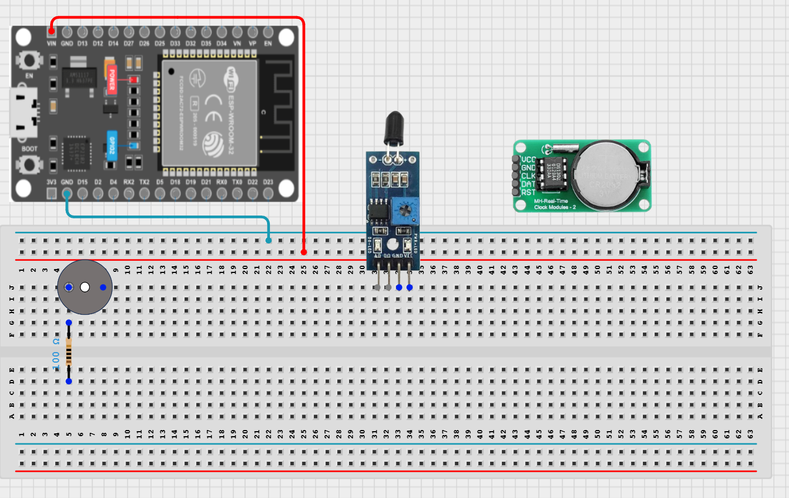
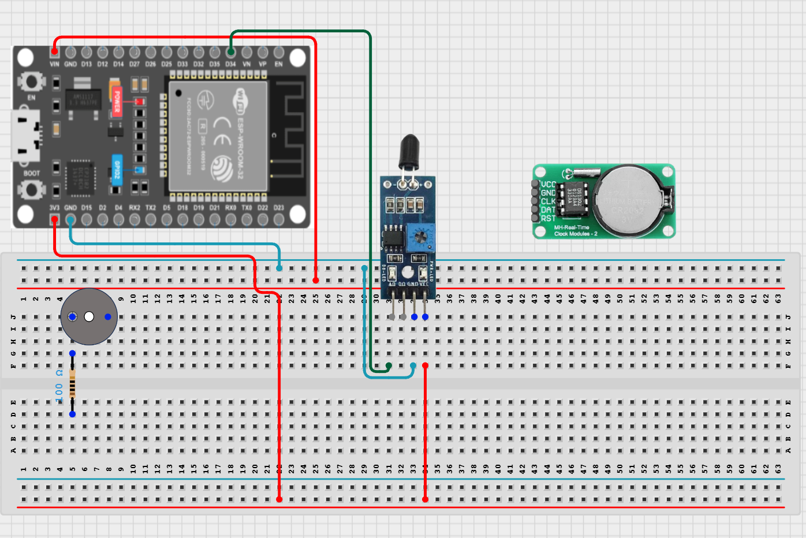
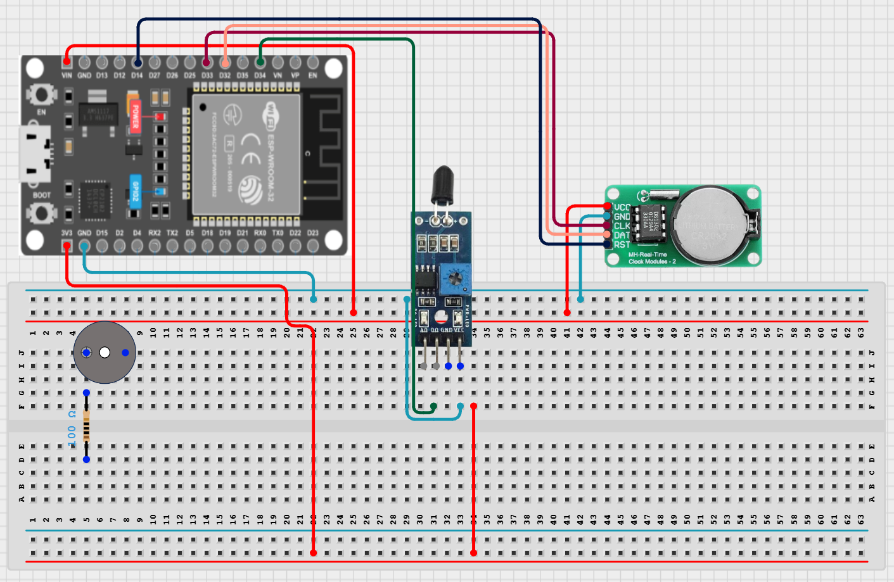
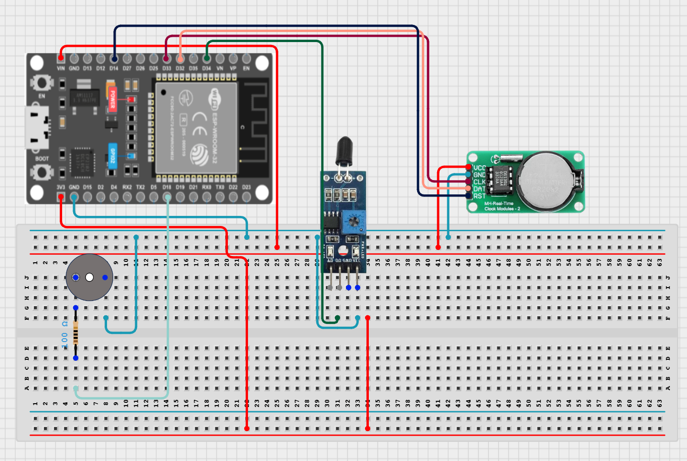

# 4.3.20. Real-Time Clock Fire Safeguard Logger

| **Description** | In Project 140, learners use a flame sensor and DS1302 real-time clock to log sensor alerts with timestamps. The ESP32 sounds the active buzzer while the sensor indicates a possible flame. |
|------------------|------------------------------------------------------------------------------------------------------------------------------------------------------------------------------|
| **Use case**     | A low-voltage classroom demonstration of infrared sensing, timekeeping, and event logging. It is not a certified fire detector or life-safety system. |

## Components

|  |  |  |  |  |  |  |  |
| --- | --- | --- | --- | --- | --- | --- | --- |

Things Needed:

- ESP32 board = 1
- DS1302 RTC module with backup battery = 1
- Flame sensor module with **AO** output = 1
- Active buzzer = 1
- 100 Ω resistor for the buzzer = 1
- Breadboard, jumper wires, and USB cable

> **RTC model note:** This guide uses the DS1302 module previously confirmed for your hardware. The published kit inventory lists DS1307/DS3231 modules instead; those use different wiring and libraries. Check the module label before wiring. Do not use the DS1302 sketch with a DS3231.

The LCD from the original description is omitted because its I2C backpack may pull the ESP32's I2C lines up to 5V. The relay and RFID reader are also unused. Events are logged to the Serial Monitor only; they are not saved after power is removed or the monitor session ends.

## Building the circuit

> **Tip:** See the [ESP32 Pinout Guide](../../Components/ESP32%20Pinout%20and%20Pin%20Assignment%20Guide.md) to locate the correct GPIO pins.

## Mounting the components

**Step 1:** Disconnect USB. Place the ESP32, flame sensor, DS1302 RTC, and active buzzer on the breadboard. Keep all wiring at low voltage and away from any flame or hot surface.



## Wiring the circuit

**Step 2:** Connect the flame sensor module:

- Connect module **VCC** to ESP32 **3.3V**.
- Connect module **GND** to ESP32 **GND**.
- Connect analog output **AO** to **GPIO 34 (ADC1)**.
- Leave **DO** unconnected; the sketch reads the analog output.
- Power the module from **3.3V**, not 5V, so its output remains within the ESP32's input-voltage range. The analog output decreases as detected infrared intensity increases.



**Step 3:** Connect the DS1302 RTC:

- Connect RTC **VCC** to **3.3V** only if the exact module supports 3.3V operation.
- Connect RTC **GND** to ESP32 **GND**.
- Connect RTC **DAT / I/O** to **GPIO 32**.
- Connect RTC **CLK / SCLK** to **GPIO 33**.
- Connect RTC **RST / CE** to **GPIO 14**.
- Match the labels on the RTC module. The DS1302 uses these three signal wires; it does not use I2C.
- If the module requires 5V or pulls its data pin above 3.3V, do not connect its signal pins directly to the ESP32.



**Step 4:** Connect the active buzzer:

- Connect ESP32 **GPIO 18** through a **100 Ω** resistor to buzzer **positive (+)**.
- Connect buzzer **negative (-)** to ESP32 **GND**.
- This direct connection is for the kit buzzer at 3.3V only. Do not connect a 5V buzzer supply to a GPIO pin.



**Step 5:** Check the RTC model and wiring, the flame sensor's 3.3V supply and AO connection, and the buzzer polarity and series resistor. Then connect USB to the ESP32.

## PROGRAMMING

**Step 1:** Open Arduino IDE and select the ESP32 board and port. See [Getting Started](../../Getting%20Started/Arduino_IDE_Setup.md) for setup instructions.

**Step 2:** Install **Rtc by Makuna** through Arduino IDE's Library Manager, then enter this sketch:

```cpp
#include <ThreeWire.h>
#include <RtcDS1302.h>

constexpr uint8_t flamePin = 34;
constexpr uint8_t buzzerPin = 18;
constexpr uint16_t flameOnThreshold = 1000;
constexpr uint16_t flameOffThreshold = 1200;
constexpr bool setRtcToCompileTime = false;

ThreeWire rtcWire(32, 33, 14);  // DAT, CLK, RST
RtcDS1302<ThreeWire> rtc(rtcWire);

bool flameDetected = false;
uint32_t lastReportAt = 0;

void logEvent(const char* eventName, int flameValue) {
  if (rtc.IsDateTimeValid()) {
    const RtcDateTime now = rtc.GetDateTime();
    Serial.printf("%s | %04d-%02d-%02d %02d:%02d:%02d | Flame ADC: %d\n",
                  eventName,
                  now.Year(), now.Month(), now.Day(),
                  now.Hour(), now.Minute(), now.Second(),
                  flameValue);
  } else {
    Serial.printf("%s | RTC time unavailable | Flame ADC: %d\n",
                  eventName, flameValue);
  }
}

void setup() {
  Serial.begin(115200);

  pinMode(flamePin, INPUT);
  pinMode(buzzerPin, OUTPUT);
  digitalWrite(buzzerPin, LOW);
  analogReadResolution(12);
  analogSetAttenuation(ADC_11db);

  rtc.Begin();
  rtc.SetIsWriteProtected(false);
  if (!rtc.GetIsRunning()) {
    rtc.SetIsRunning(true);
  }

  if (setRtcToCompileTime || !rtc.IsDateTimeValid()) {
    rtc.SetDateTime(RtcDateTime(__DATE__, __TIME__));
    Serial.println("RTC set to sketch compile time.");
  }

  if (!rtc.IsDateTimeValid()) {
    Serial.println("RTC time is invalid. Sensor monitoring will continue without timestamps.");
  }

  Serial.println("Flame sensor logger ready. Calibrate thresholds using the ADC readings.");
}

void loop() {
  const int flameValue = analogRead(flamePin);

  if (!flameDetected && flameValue <= flameOnThreshold) {
    flameDetected = true;
    logEvent("POSSIBLE FLAME DETECTED", flameValue);
  } else if (flameDetected && flameValue >= flameOffThreshold) {
    flameDetected = false;
    logEvent("SENSOR ALERT CLEARED", flameValue);
  }

  digitalWrite(buzzerPin, flameDetected ? HIGH : LOW);

  if (millis() - lastReportAt >= 1000UL) {
    lastReportAt = millis();
    Serial.printf("Flame ADC: %d | Alert: %s\n",
                  flameValue, flameDetected ? "ACTIVE" : "CLEAR");
  }

  delay(100);
}
```

**Step 3:** Upload the sketch and open Serial Monitor at **115200 baud**. To set the RTC to the computer's current time, temporarily change `setRtcToCompileTime` to `true`, upload, then set it back to `false` and upload again. Install the RTC backup battery so time is retained when USB power is removed.

**Step 4:** Calibrate the flame thresholds from the Serial Monitor readings. With no infrared source aimed at the sensor, note the normal ADC value. If using the kit's IR remote to check sensor response, aim it at the sensor and observe whether the ADC value drops. This checks infrared response only; it does not test fire detection. Set `flameOnThreshold` between the lower response and normal reading, then set `flameOffThreshold` higher than `flameOnThreshold` but still below the normal reading to reduce alarm chatter.

**Step 5:** Confirm that a lower reading than `flameOnThreshold` activates the buzzer and logs a timestamp, and that a reading at or above `flameOffThreshold` clears the alert. Do not use a candle or lighter near the electronics. If the RTC time is invalid, sensor monitoring and the buzzer still operate, but the event log reports that the timestamp is unavailable.

## CONCLUSION

This project uses the DS1302 to timestamp changes in the flame sensor's analog reading and sounds the buzzer while a possible flame signal is present. The log is available only in the Serial Monitor session. This kit sensor is not a certified fire alarm and must never be relied on to protect people or property.
