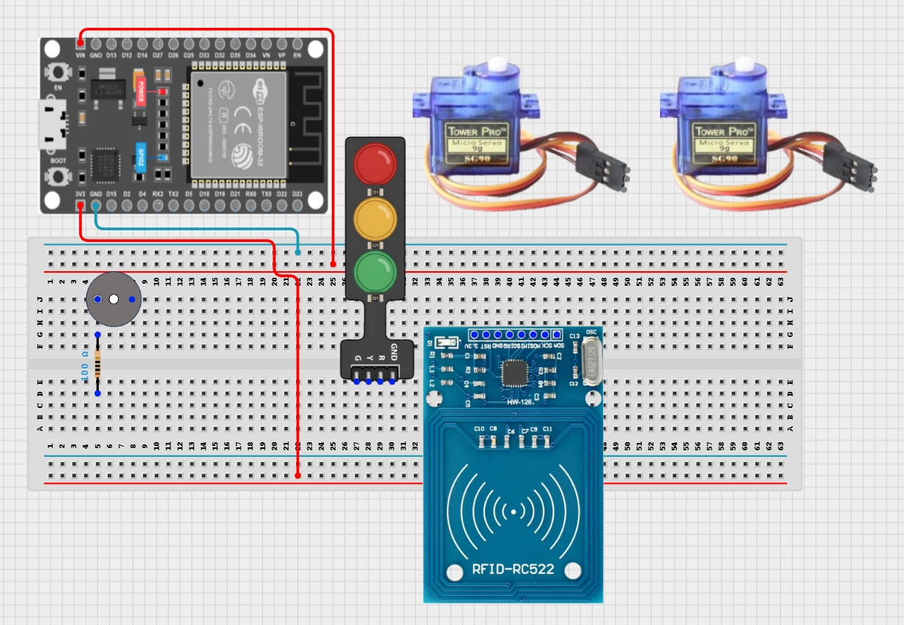
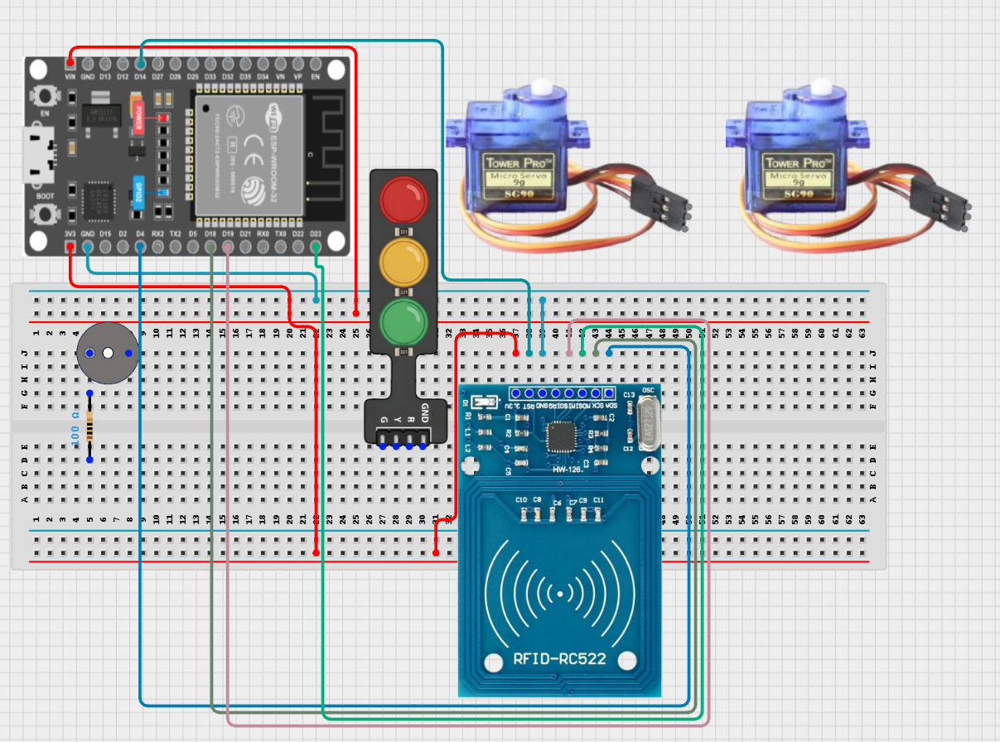
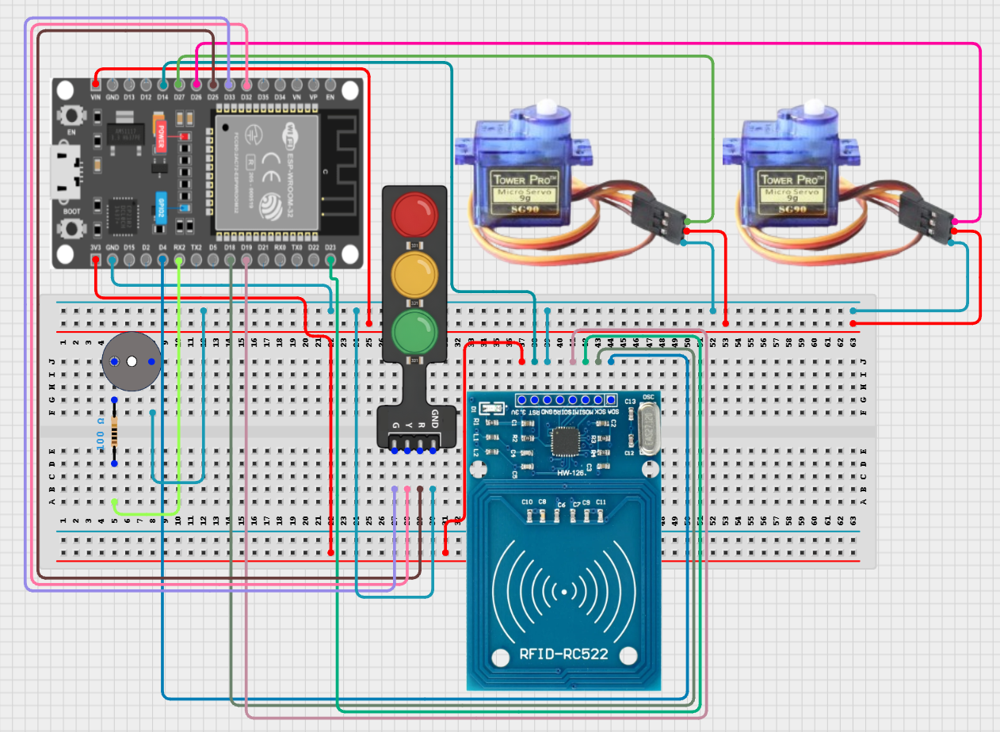

# 4.3.21. RFID Dual Barrier Access Gate

| **Description** | In Project 141, an authorized RFID card opens two SG90 model barriers. A traffic-light module shows the gate state, and an active buzzer signals denied cards. |
|------------------|--------------------------------------------------------------------------------------------------------------------------------------------------|
| **Use case**     | A low-voltage classroom model of card-controlled access. It is not a real vehicle barrier or security system. |

## Components

|  |  |  |  |  |  |  |  |  |
| --- | --- | --- | --- | --- | --- | --- | --- | --- |

Things Needed:

- ESP32 board = 1
- RC522 RFID reader = 1
- Kit RFID card or key fob = 1
- SG90 servo motors = 2
- Traffic-light module = 1
- Active buzzer = 1
- 100 Ω resistor for the buzzer = 1
- Breadboard, jumper wires, and USB cable
- Separate regulated **5V, 2A** supply for the two servos (not included in the kit)

The relay module and RTC mentioned in the original component list are not used. The traffic-light module has onboard current-limiting resistors, and the buzzer uses a 100 Ω series resistor for a 3.3V GPIO drive.

## Building the circuit

> **Tip:** See the [ESP32 Pinout Guide](../../Components/ESP32%20Pinout%20and%20Pin%20Assignment%20Guide.md) to locate the correct GPIO pins.


## Mounting the components

**Step 1:** Disconnect the ESP32 and servo supply. Place the RC522, ESP32, traffic-light module, and two servos on the breadboard. Keep the servo horns clear of wires and fingers; test them unloaded before attaching lightweight model barrier arms.




## Wiring the circuit

**Step 2:** Connect the RC522 RFID reader:

- Connect RC522 **3.3V / VCC** to ESP32 **3.3V**. Never connect the reader to 5V.
- Connect RC522 **GND** to ESP32 **GND**.
- Connect **SDA / SS** to **GPIO 4**. On this SPI reader, `SDA` is the chip-select pin, not I2C SDA.
- Connect **SCK** to **GPIO 18**.
- Connect **MOSI** to **GPIO 23**.
- Connect **MISO** to **GPIO 19**.
- Connect **RST** to **GPIO 14**.
- Leave **IRQ** unconnected.



**Step 3:** Connect the two SG90 servos:

- Connect the entry servo's **signal** wire (orange/yellow) to **GPIO 26**.
- Connect the exit servo's **signal** wire (orange/yellow) to **GPIO 27**.
- Connect both servo **V+** wires (red) directly to the separate regulated **5V** supply.
- Connect both servo **GND** wires (brown/black) to the supply negative.
- Connect the 5V supply negative to ESP32 **GND** to provide a common signal reference.
- Do not connect the servo supply positive to ESP32 **3.3V**, **5V/VIN**, or a GPIO. Do not power the servos from the ESP32 board or USB.


**Step 4:** Connect the traffic-light module:

- Connect module **R** to **GPIO 25**.
- Connect module **Y** to **GPIO 32**.
- Connect module **G** to **GPIO 33**.
- Connect module **GND** to ESP32 **GND**. The module is common-cathode and has onboard current-limiting resistors; do not connect its signal pins to 5V.


**Step 5:** Connect the active buzzer:

- Connect ESP32 **GPIO 16** through a **100 Ω** resistor to buzzer **positive (+)**.
- Connect buzzer **negative (-)** to ESP32 **GND**.
- This direct connection is for the kit buzzer at 3.3V only. Do not connect a 5V buzzer supply to a GPIO pin.



**Step 6:** Check the RC522 pin labels, traffic-light connections, common grounds, and separate servo power wiring. Connect USB to the ESP32, then turn on the servo's 5V supply.

## PROGRAMMING

**Step 1:** Open Arduino IDE and select the ESP32 board and port. See [Getting Started](../../Getting%20Started/Arduino_IDE_Setup.md) for setup instructions.

**Step 2:** Install the **MFRC522** and **ESP32Servo** libraries through Arduino IDE's Library Manager. Upload this sketch first with the example UID so the Serial Monitor can show your card's UID:

```cpp
#include <SPI.h>
#include <MFRC522.h>
#include <ESP32Servo.h>

constexpr uint8_t ssPin = 4;
constexpr uint8_t rstPin = 14;
constexpr uint8_t sckPin = 18;
constexpr uint8_t misoPin = 19;
constexpr uint8_t mosiPin = 23;
constexpr uint8_t entryServoPin = 26;
constexpr uint8_t exitServoPin = 27;
constexpr uint8_t redPin = 25;
constexpr uint8_t yellowPin = 32;
constexpr uint8_t greenPin = 33;
constexpr uint8_t buzzerPin = 16;
constexpr uint8_t entryClosedAngle = 0;
constexpr uint8_t entryOpenAngle = 90;
constexpr uint8_t exitClosedAngle = 0;
constexpr uint8_t exitOpenAngle = 90;

// Replace this example UID with the UID printed for the authorized card.
const byte authorizedUID[] = {0xDE, 0xAD, 0xBE, 0xEF};

MFRC522 rfid(ssPin, rstPin);
Servo entryGate;
Servo exitGate;

bool isAuthorizedCard() {
  if (rfid.uid.size != sizeof(authorizedUID)) {
    return false;
  }

  for (byte i = 0; i < sizeof(authorizedUID); i++) {
    if (rfid.uid.uidByte[i] != authorizedUID[i]) {
      return false;
    }
  }

  return true;
}

void printCardUID() {
  Serial.print("Card UID: ");
  for (byte i = 0; i < rfid.uid.size; i++) {
    if (i > 0) {
      Serial.print(':');
    }
    Serial.printf("%02X", rfid.uid.uidByte[i]);
  }
  Serial.println();
}

void setTrafficLight(bool red, bool yellow, bool green) {
  digitalWrite(redPin, red ? HIGH : LOW);
  digitalWrite(yellowPin, yellow ? HIGH : LOW);
  digitalWrite(greenPin, green ? HIGH : LOW);
}

void denyAccess() {
  Serial.println("Access denied. Barriers remain closed.");
  for (byte i = 0; i < 2; i++) {
    digitalWrite(buzzerPin, HIGH);
    delay(100);
    digitalWrite(buzzerPin, LOW);
    delay(100);
  }
}

void openAndCloseBarriers() {
  Serial.println("Access granted. Opening barriers.");
  setTrafficLight(false, true, false);
  entryGate.write(entryOpenAngle);
  exitGate.write(exitOpenAngle);
  delay(500);

  setTrafficLight(false, false, true);
  delay(2500);

  Serial.println("Closing barriers.");
  setTrafficLight(false, true, false);
  entryGate.write(entryClosedAngle);
  exitGate.write(exitClosedAngle);
  delay(500);

  setTrafficLight(true, false, false);
  Serial.println("Barriers closed.");
}

void setup() {
  Serial.begin(115200);

  pinMode(redPin, OUTPUT);
  pinMode(yellowPin, OUTPUT);
  pinMode(greenPin, OUTPUT);
  pinMode(buzzerPin, OUTPUT);
  digitalWrite(buzzerPin, LOW);
  setTrafficLight(true, false, false);

  ESP32PWM::allocateTimer(0);
  ESP32PWM::allocateTimer(1);
  entryGate.setPeriodHertz(50);
  exitGate.setPeriodHertz(50);
  entryGate.attach(entryServoPin, 500, 2400);
  exitGate.attach(exitServoPin, 500, 2400);
  entryGate.write(entryClosedAngle);
  exitGate.write(exitClosedAngle);

  SPI.begin(sckPin, misoPin, mosiPin, ssPin);
  rfid.PCD_Init();

  Serial.println("RFID dual barrier ready. Scan a card or key fob.");
  rfid.PCD_DumpVersionToSerial();
}

void loop() {
  if (!rfid.PICC_IsNewCardPresent() || !rfid.PICC_ReadCardSerial()) {
    return;
  }

  printCardUID();
  if (isAuthorizedCard()) {
    openAndCloseBarriers();
  } else {
    denyAccess();
  }

  rfid.PICC_HaltA();
  rfid.PCD_StopCrypto1();
  delay(500);
}
```

**Step 3:** Open Serial Monitor at **115200 baud** and scan your card or key fob. Copy the printed UID bytes into `authorizedUID`, replacing the example values. Keep the number of bytes exactly as printed, then upload the sketch again.

**Step 4:** Test with the servo horns unloaded. Scan the authorized card to open both gates; the traffic light changes from red to yellow to green and back as the gates close. An unauthorized card should leave the barriers closed and sound two short beeps. If either servo strains, binds, or moves in the wrong direction, disconnect its power and adjust that gate's `entryClosedAngle`/`entryOpenAngle` or `exitClosedAngle`/`exitOpenAngle` values.

## CONCLUSION

The RC522 checks the scanned card UID, the two SG90 servos move the model barriers, and the traffic-light module indicates the gate state. A UID-only check is not secure authentication because card UIDs can be copied. This is a classroom model, not a real vehicle gate or safety system.
