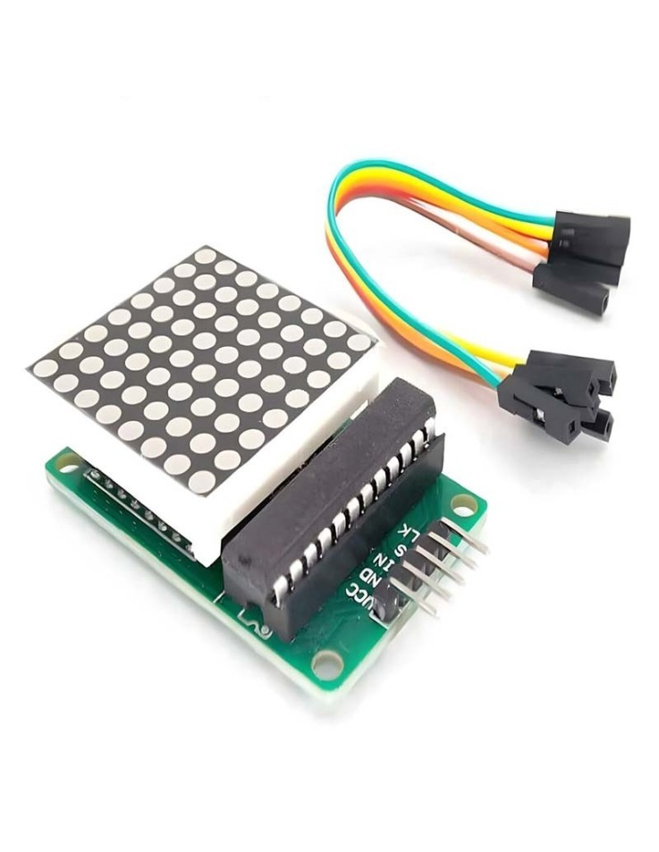
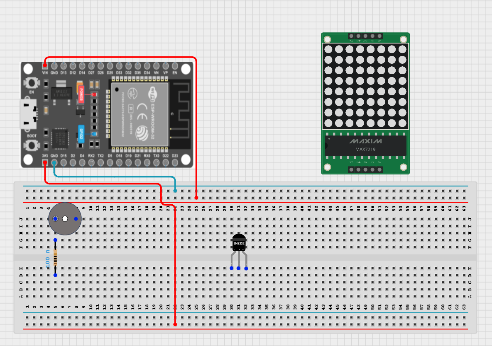
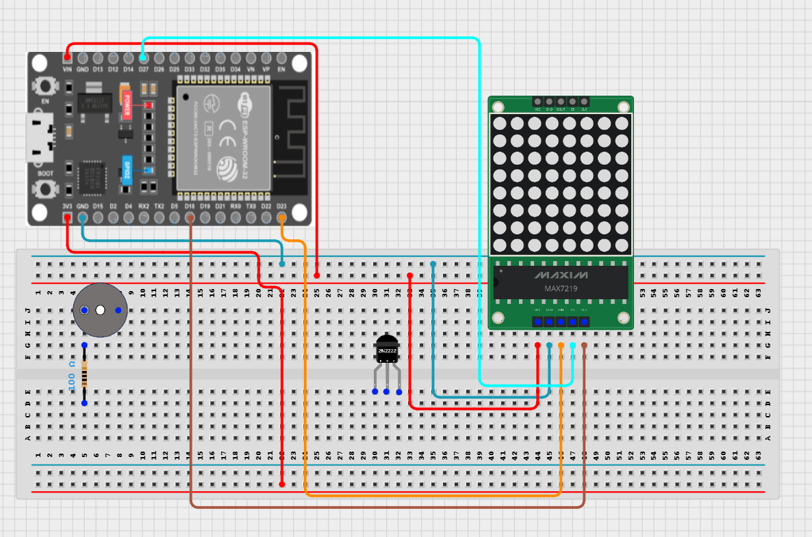
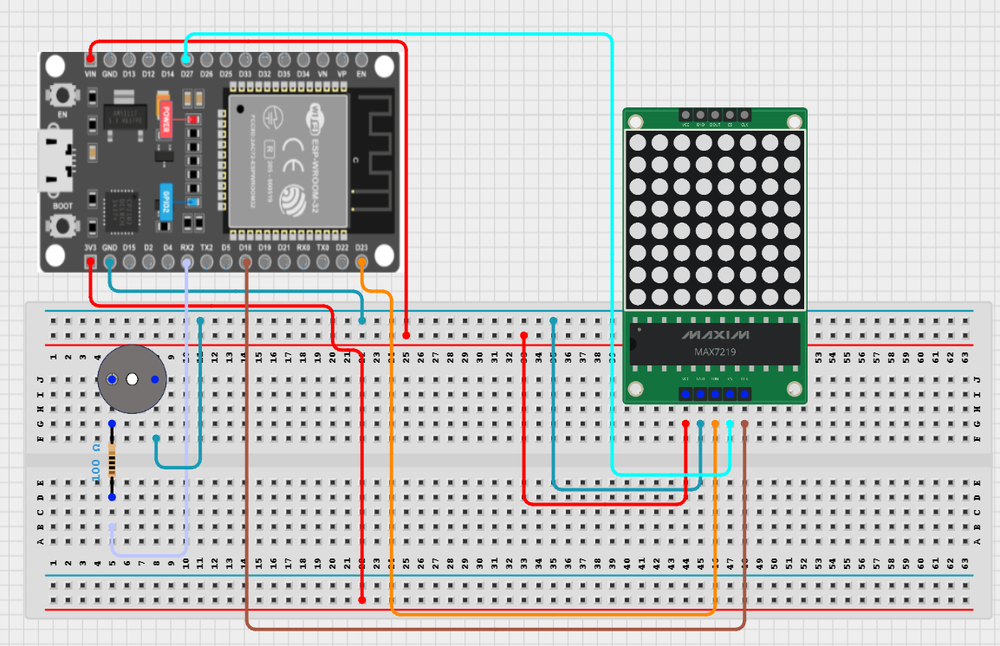

# 4.3.22. Bluetooth Remote Matrix Display Scroller

| **Description** | In Project 142, learners use the ESP32's built-in Bluetooth Classic to send text wirelessly to a MAX7219 8×8 LED matrix. The matrix scrolls each received message, and an active buzzer sounds briefly as confirmation. |
|-----------------|----------------------------------------------------------------------------------------------------------------------------------------------------------------------------------------------------------|
| **Use case** | Text scrollers are used for short notices, status messages, and demonstrations of wireless display control. |

## Components (Things You Will Need)

|  |  |  |  |  |  |
| --- | --- | --- | --- | --- | --- |

## Building the Circuit

> **Important:** Power the MAX7219 module from a regulated external 5V, 1A supply; it is not included in the kit. Do not power the matrix from ESP32 **VIN** when the board is powered by a computer USB port: the matrix can draw up to 330mA in addition to the ESP32 and buzzer, which may exceed what the USB port and board power path can reliably provide and cause resets or display problems. Connect the external supply ground to ESP32 **GND**, but do not connect its 5V positive wire to ESP32 **VIN/5V** while USB is connected. The active buzzer can be driven from an ESP32 GPIO at 3.3V through a **100Ω series resistor**; its current is about 10mA at that voltage. This guide shows the ESP32 signals connected directly to the matrix, but direct 3.3V signaling is **not guaranteed** by the MAX7219 specification: at 5V supply, the specified minimum logic-high input is 3.5V. Some module variants may work with 3.3V signals, while others may behave unreliably or not work. A 74HCT125 buffer is the reliable option if direct signaling fails or the module does not explicitly support 3.3V logic.

Things needed:

- ESP32 board = 1
- Micro USB cable = 1
- Breadboard and jumper wires
- 8×8 Dot Matrix Module (MAX7219) = 1
- Active buzzer = 1
- 100Ω resistor = 1
- Regulated 5V, 1A power supply = 1 (**required; not included in the kit**)
- Phone or other device with a Bluetooth Classic SPP terminal app

## Mounting the Components

**Step 1:** Place the ESP32, matrix module, and buzzer on the breadboard or an insulated work surface. Keep the external 5V supply disconnected while wiring.



## Wiring the Circuit

**Step 1: Connect the MAX7219 signals**

- Connect **ESP32 GPIO 23 (DIN data)** to the matrix **DIN** pin.
- Connect **ESP32 GPIO 18 (CLK)** to the matrix **CLK** pin.
- Connect **ESP32 GPIO 27 (CS/LOAD)** to the matrix **CS/LOAD** pin.
- If the matrix does not work reliably, disconnect power and add a **74HCT125 buffer** between these three ESP32 signal pins and the corresponding matrix pins.



**Step 2: Connect the active buzzer directly to the ESP32**

- Connect **ESP32 GPIO 16** through a **100Ω resistor** to the buzzer **positive (+)**.
- Connect the buzzer **negative (−)** to ESP32 **GND**.
- Do not connect the buzzer's positive pin to **5V** when it is connected directly to the ESP32 GPIO.



**Step 3:** Check the wiring, then connect the ESP32 to the computer with the USB cable. Connect the external supply only after checking polarity and the common ground.

## Programming

**Step 1:** Open the Arduino IDE. See [Getting Started](../../Getting%20Started/Arduino_IDE_Setup.md) for setup instructions.

**Step 2:** Install the **MD_Parola** and **MD_MAX72XX** libraries using Library Manager. `BluetoothSerial` is included with the ESP32 Arduino core. Enter and upload this program:

```cpp
#include <BluetoothSerial.h>
#include <MD_Parola.h>
#include <MD_MAX72xx.h>
#include <string.h>

#define HARDWARE_TYPE MD_MAX72XX::FC16_HW
#define MAX_DEVICES 1

const uint8_t matrixDataPin = 23;
const uint8_t matrixClockPin = 18;
const uint8_t matrixCsPin = 27;
const uint8_t buzzerPin = 16;
const size_t messageCapacity = 64;
const uint16_t scrollSpeed = 60;

BluetoothSerial SerialBT;
MD_Parola display(
  HARDWARE_TYPE,
  matrixDataPin,
  matrixClockPin,
  matrixCsPin,
  MAX_DEVICES
);

char incomingText[messageCapacity];
char scrollText[messageCapacity] = "READY";
size_t incomingLength = 0;
bool inputTooLong = false;
bool buzzerActive = false;
unsigned long buzzerStartedAt = 0;

void startScrollingMessage() {
  display.displayScroll(scrollText, PA_LEFT, PA_SCROLL_LEFT, scrollSpeed);
}

void handleBluetoothInput() {
  while (SerialBT.available()) {
    const char received = static_cast<char>(SerialBT.read());

    if (received == '\r') {
      continue;
    }

    if (received == '\n') {
      if (inputTooLong) {
        SerialBT.println("Message too long; send 63 characters or fewer.");
      } else if (incomingLength > 0) {
        incomingText[incomingLength] = '\0';
        memcpy(scrollText, incomingText, incomingLength + 1);
        startScrollingMessage();

        digitalWrite(buzzerPin, HIGH);
        buzzerActive = true;
        buzzerStartedAt = millis();
        SerialBT.println("Scrolling message.");
      }

      incomingLength = 0;
      inputTooLong = false;
      continue;
    }

    if (received < 32 || received > 126 || inputTooLong) {
      continue;
    }

    if (incomingLength < messageCapacity - 1) {
      incomingText[incomingLength++] = received;
    } else {
      inputTooLong = true;
    }
  }
}

void setup() {
  Serial.begin(115200);
  pinMode(buzzerPin, OUTPUT);
  digitalWrite(buzzerPin, LOW);

  display.begin();
  display.setIntensity(3);
  display.displayClear();
  startScrollingMessage();

  if (!SerialBT.begin("STEMAIDE Matrix Scroller")) {
    Serial.println("Bluetooth Classic startup failed.");
  } else {
    Serial.println("Bluetooth ready: STEMAIDE Matrix Scroller");
  }
}

void loop() {
  handleBluetoothInput();

  if (display.displayAnimate()) {
    display.displayReset();
  }

  if (buzzerActive && millis() - buzzerStartedAt >= 100) {
    digitalWrite(buzzerPin, LOW);
    buzzerActive = false;
  }
}
```

**Step 3:** Save the sketch, select the ESP32 board and port, then upload it.

**Step 4:** Power the matrix from the external 5V supply. Pair a phone with **STEMAIDE Matrix Scroller** and connect using a Bluetooth Classic SPP terminal app. A BLE-only terminal app will not work with `BluetoothSerial`. Send a printable ASCII message followed by a newline; messages are limited to 63 characters.

## Conclusion

Text sent from the Bluetooth terminal scrolls from right to left across the matrix. The buzzer sounds briefly when a new message is accepted. Direct ESP32-to-matrix signaling may depend on the exact MAX7219-compatible chip used on the module; the specified 74HCT125 buffer can be added if the module does not reliably recognize 3.3V signals.
