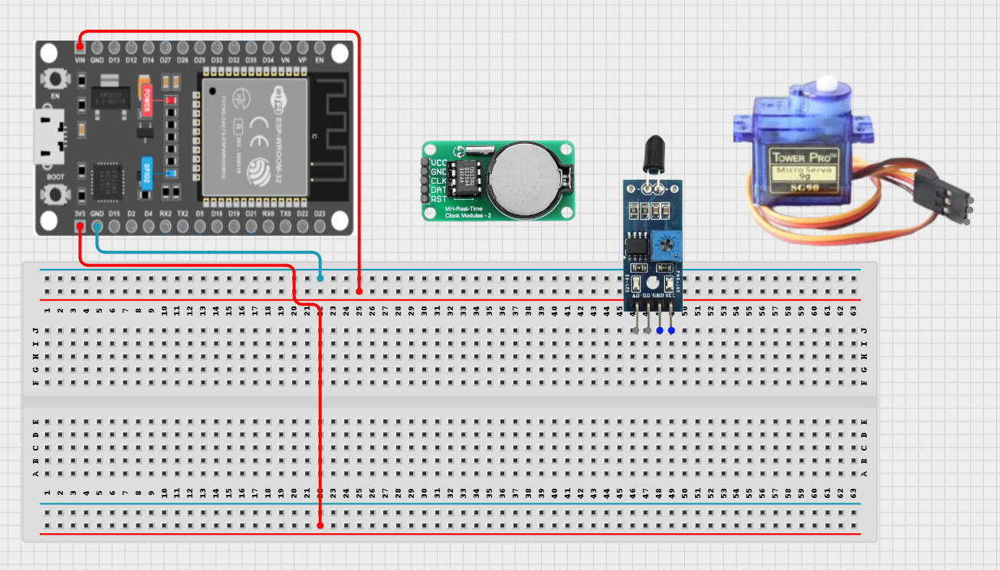
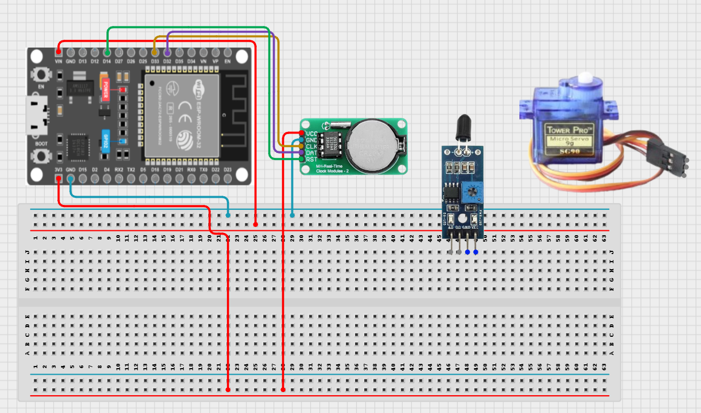
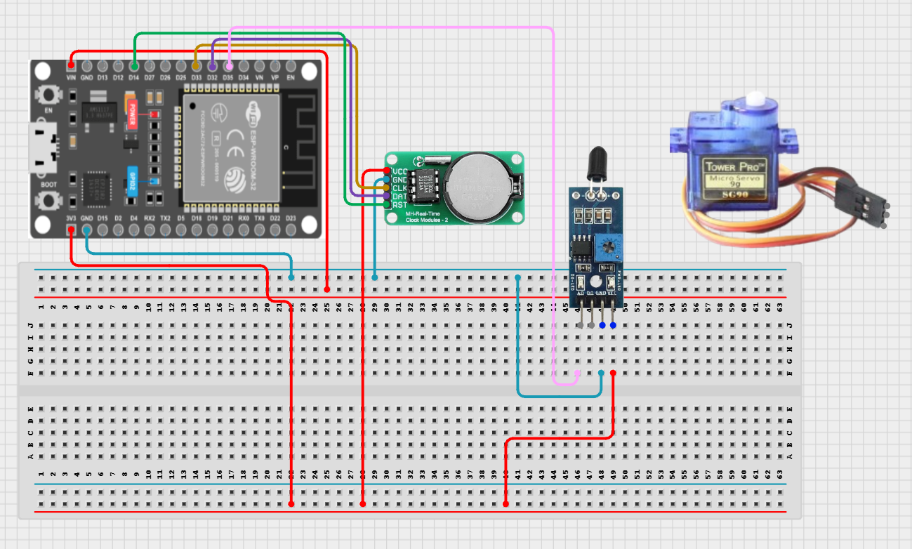
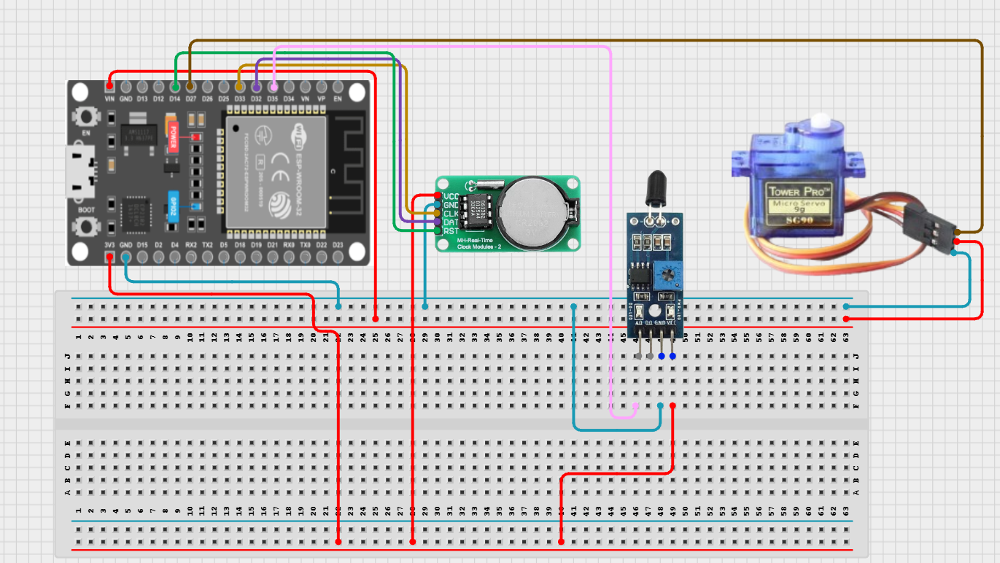

# 4.3.23. Smart RTC Solar Tracker Controller

| **Description** | In Project 143, the ESP32 uses a DS1302 real-time clock to select morning, midday, and afternoon servo positions. A 3-pin LDR module allows movement only when its adjustable light threshold indicates daylight. |
|-----------------|--------------------------------------------------------------------------------------------------------------------------------------------------------------------------------------------------------|
| **Use case** | A classroom demonstration of scheduled, light-gated positioning for a small solar-panel mock-up. One LDR cannot determine the sun's direction, so this is not a continuous or precision solar tracker. |

## Components

|  |  |  |  |  | **3-pin LDR module** |  |
| --- | --- | --- | --- | --- | --- | --- |

Things needed:

- ESP32 board = 1
- DS1302 RTC module with backup battery = 1
- 3-pin LDR module with **VCC**, **GND**, **OUT**, and an adjustable sensitivity trimmer = 1
- SG90 servo = 1
- Breadboard, jumper wires, and USB cable
- Regulated 5V, 1A supply for the servo = 1 (**required; not included in the kit**)
- Lightweight panel mock-up for the servo horn (optional; not included)

> **RTC model note:** This guide uses the DS1302 module previously confirmed for your hardware. The published kit inventory lists DS1307/DS3231 modules instead; those use different wiring and code. Check the chip/module label before wiring. Do not use this 3-wire sketch with a DS3231.
>
> The original I2C LCD is omitted because its backpack can pull the ESP32's I2C lines up to 5V. Using it safely requires an unlisted bidirectional level shifter. Read the clock and status in the Serial Monitor instead.

## Building the Circuit

> **Power:** Power the SG90 from the separate regulated 5V supply, not from an ESP32 GPIO or 3.3V pin. The servo can draw up to 650mA at stall. Connect the external supply ground to ESP32 **GND**, but do not connect its 5V positive wire to ESP32 **VIN/5V** while USB is connected.

> **Tip:** See the [ESP32 Pinout Guide](../../Components/ESP32%20Pinout%20and%20Pin%20Assignment%20Guide.md) to locate the correct GPIO pins.

## Mounting the Components

**Step 1:** Disconnect USB and the external supply. Place the ESP32, DS1302 RTC, 3-pin LDR module, and SG90 servo on the breadboard or a stable surface. Secure the servo and use only a lightweight panel mock-up.



## Wiring the Circuit

**Step 1: Connect the DS1302 RTC**

- Connect RTC **VCC** to ESP32 **3.3V**.
- Connect RTC **GND** to ESP32 **GND**.
- Connect RTC **DAT / I/O** to **GPIO 32**.
- Connect RTC **CLK / SCLK** to **GPIO 33**.
- Connect RTC **RST / CE** to **GPIO 14**.
- Match the labels on the RTC module. The DS1302 uses these three signal wires; it does not use I2C.



**Step 2: Connect the 3-pin LDR module**

- Connect module **VCC** to ESP32 **3.3V**.
- Connect module **GND** to ESP32 **GND**.
- Connect module **OUT** to **GPIO 35**.
- Power the module from **3.3V**, not 5V, so its output stays within the ESP32's logic-voltage range. This project reads the module's digital **OUT** pin; it does not use an analog LDR divider.
- Adjust the module's trimmer to set the light/dark threshold. Confirm the bright-light output level in the Serial Monitor and set `brightLevel` in the sketch to match.



**Step 3: Connect the SG90 servo**

- Connect the servo **signal** wire (orange/yellow) to **GPIO 27**.
- Connect the servo **V+** wire (red) to the external regulated **5V supply positive**.
- Connect the servo **GND** wire (brown/black) to the external supply **GND** and ESP32 **GND**.
- Do not connect the external supply's 5V positive wire to ESP32 **VIN/5V** while the ESP32 is powered over USB.



**Step 4:** Check the RTC model and wiring, LDR 3.3V supply and output, servo power polarity, and shared ground. Then connect USB to the ESP32 and power the servo supply.

## Programming

**Step 1:** Open Arduino IDE and select the ESP32 board and port. See [Getting Started](../../Getting%20Started/Arduino_IDE_Setup.md) for setup instructions.

**Step 2:** Install **Rtc by Makuna** and **ESP32Servo** from Arduino IDE Library Manager, then enter this sketch:

```cpp
#include <ThreeWire.h>
#include <RtcDS1302.h>
#include <ESP32Servo.h>

constexpr uint8_t rtcDatPin = 32;
constexpr uint8_t rtcClkPin = 33;
constexpr uint8_t rtcRstPin = 14;
constexpr uint8_t ldrOutPin = 35;
constexpr uint8_t servoPin = 27;

constexpr uint8_t brightLevel = LOW;
constexpr uint8_t parkAngle = 20;
constexpr uint8_t morningAngle = 40;
constexpr uint8_t middayAngle = 90;
constexpr uint8_t afternoonAngle = 140;
constexpr bool setRtcToCompileTime = false;

ThreeWire rtcWire(rtcDatPin, rtcClkPin, rtcRstPin);
RtcDS1302<ThreeWire> rtc(rtcWire);
Servo trackerServo;

bool stableBright = false;
bool pendingBright = false;
bool ldrInitialized = false;
uint32_t pendingSince = 0;
uint32_t lastReportAt = 0;
int lastCommandedAngle = -1;

uint8_t scheduledAngle(uint8_t hour) {
  if (hour < 6 || hour >= 18) {
    return parkAngle;
  }
  if (hour < 10) {
    return morningAngle;
  }
  if (hour < 14) {
    return middayAngle;
  }
  return afternoonAngle;
}

void setup() {
  Serial.begin(115200);
  pinMode(ldrOutPin, INPUT);

  trackerServo.setPeriodHertz(50);
  trackerServo.attach(servoPin, 500, 2400);
  trackerServo.write(parkAngle);

  rtc.Begin();
  rtc.SetIsWriteProtected(false);
  if (!rtc.GetIsRunning()) {
    rtc.SetIsRunning(true);
  }

  if (setRtcToCompileTime || !rtc.IsDateTimeValid()) {
    rtc.SetDateTime(RtcDateTime(__DATE__, __TIME__));
    Serial.println("RTC set to sketch compile time.");
  }

  if (!rtc.IsDateTimeValid()) {
    Serial.println("RTC time is invalid. Check the DS1302 wiring and backup battery.");
    while (true) {
      delay(1000);
    }
  }

  Serial.println("RTC solar-position controller ready.");
  Serial.println("Check LDR OUT in bright and dark conditions; adjust brightLevel if needed.");
}

void loop() {
  const uint32_t currentTime = millis();
  const uint8_t ldrOutput = digitalRead(ldrOutPin);
  const bool readingBright = ldrOutput == brightLevel;

  if (!ldrInitialized) {
    stableBright = readingBright;
    pendingBright = readingBright;
    pendingSince = currentTime;
    ldrInitialized = true;
  } else if (readingBright != pendingBright) {
    pendingBright = readingBright;
    pendingSince = currentTime;
  } else if (pendingBright != stableBright &&
             currentTime - pendingSince >= 300UL) {
    stableBright = pendingBright;
  }

  const RtcDateTime now = rtc.GetDateTime();
  const uint8_t targetAngle = stableBright ? scheduledAngle(now.Hour()) : parkAngle;

  if (targetAngle != lastCommandedAngle) {
    trackerServo.write(targetAngle);
    lastCommandedAngle = targetAngle;
  }

  if (currentTime - lastReportAt >= 1000UL) {
    lastReportAt = currentTime;
    Serial.printf("%02d:%02d:%02d | LDR OUT: %s | Bright: %s | Servo target: %d degrees\n",
                  now.Hour(), now.Minute(), now.Second(),
                  ldrOutput == HIGH ? "HIGH" : "LOW",
                  stableBright ? "YES" : "NO",
                  targetAngle);
  }

  delay(50);
}
```

**Step 3:** Save and upload the sketch. To set the RTC to the computer's current time, temporarily change `setRtcToCompileTime` to `true`, upload once, then set it back to `false` and upload again. Keep the RTC backup battery installed so the time is retained when USB power is removed.

**Step 4:** Open Serial Monitor at **115200 baud**. Check whether the LDR module's **OUT** pin is **HIGH** or **LOW** in bright light. Set `brightLevel` to that value, upload again, and adjust the module trimmer as needed. During daylight, the servo selects fixed morning, midday, or afternoon angles according to RTC time; in darkness or outside 06:00–18:00 it moves to the park angle.

## Conclusion

This project demonstrates RTC-scheduled servo positioning gated by a digital LDR module. The fixed angles simulate a simple one-axis tracker; they are not calculated from the sun's actual position, and the single LDR does not provide directional feedback.
