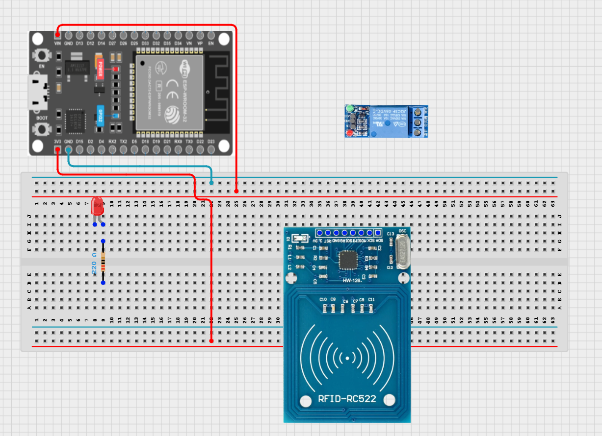
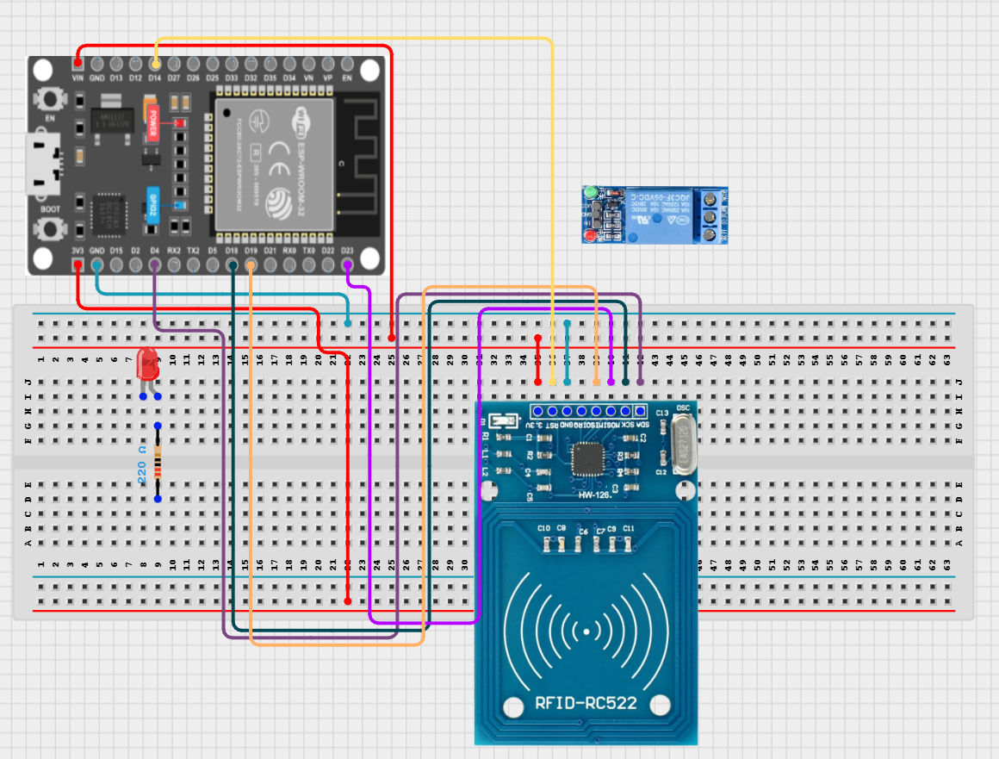
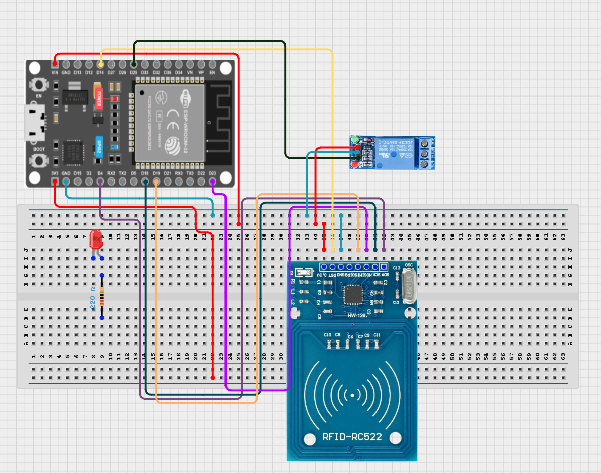
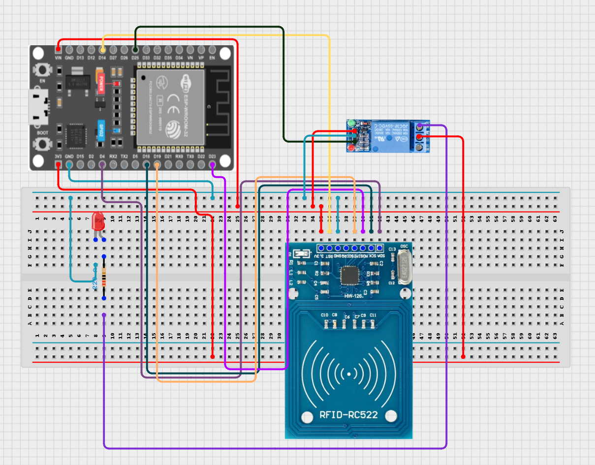

# 4.3.24. RFID Keycard Relay Switching Console

| **Description** | In Project 144, an ESP32 reads an RC522 card and toggles the kit's single-channel relay only when the scanned UID matches the configured keycard. The relay switches a low-voltage LED indicator. |
|-----------------|--------------------------------------------------------------------------------------------------------------------------------------------------------------------------------------------------------|
| **Use case** | A classroom demonstration of RFID identification and relay control. A card UID alone is not secure authentication and should not be used to protect real property. |

## Components

|  |  |  |  |  |  |  |  |
| --- | --- | --- | --- | --- | --- | --- | --- |

Things needed:

- ESP32 board = 1
- RC522 RFID reader = 1
- RFID card or key fob from the kit = 1
- 1-channel relay module with removable **VCC/JD-VCC** jumper = 1
- Red 5mm LED = 1
- 220 Ω resistor = 1
- Breadboard, jumper wires, and USB cable

> The original I2C LCD is omitted because its backpack can pull the ESP32's I2C lines up to 5V. Connecting it safely requires an unlisted bidirectional level shifter. This project uses the Serial Monitor for status instead.

## Building the Circuit

> **Safety:** Use only the kit's low-voltage LED as the relay load. Do not connect mains voltage or other hazardous loads to the relay contacts.

> **Tip:** See the [ESP32 Pinout Guide](../../Components/ESP32%20Pinout%20and%20Pin%20Assignment%20Guide.md) to locate the correct GPIO pins.

## Mounting the Components

**Step 1:** Disconnect USB. Place the ESP32, RC522 reader, 1-channel relay module, LED, and resistor on the breadboard. Keep the relay contacts away from the ESP32 signal wiring.



## Wiring the Circuit

**Step 1: Connect the RC522 RFID reader**

- Connect reader **3.3V/VCC** to ESP32 **3.3V**. Never connect the RC522 to 5V.
- Connect reader **GND** to ESP32 **GND**.
- Connect reader **SCK** to **GPIO 18 (SCK)**.
- Connect reader **MISO** to **GPIO 19 (MISO)**.
- Connect reader **MOSI** to **GPIO 23 (MOSI)**.
- Connect reader **SDA / SS** to **GPIO 4 (SS)**. On the RC522, **SDA / SS is the SPI chip-select pin, not I2C SDA**.
- Connect reader **RST** to **GPIO 14 (RST)**.
- Leave **IRQ** unconnected.



**Step 2: Connect the 1-channel relay module**

- Remove the jumper connecting relay **VCC** and **JD-VCC**.
- Connect relay **VCC** to ESP32 **3.3V**.
- Connect relay **JD-VCC** to ESP32 **5V/VIN** while the board is powered by USB.
- Connect relay **GND** to ESP32 **GND**.
- Connect relay **IN** to **GPIO 25**.
- The kit relay module is expected to be active-low: **LOW** turns the relay on and **HIGH** turns it off. With the LED load disconnected, verify the relay is off at startup. If your module revision is active-high, change the relay levels in the sketch before connecting the LED.
- If your relay board does not have the removable **VCC/JD-VCC** jumper, stop and verify its exact wiring requirements before powering it.



**Step 3: Connect the low-voltage LED load**

- Connect ESP32 **3.3V** to relay contact **COM**.
- Connect relay contact **NO** to one end of the **220 Ω resistor**.
- Connect the other end of the resistor to the red LED **anode (+)**.
- Connect the LED **cathode (−)** to ESP32 **GND**.
- Leave relay contact **NC** unused. Do not connect a mains-powered load.



**Step 4:** Check the RC522 3.3V supply and SPI wiring, relay jumper removal and supply wiring, LED polarity, and common ground. Then connect USB to the ESP32.

## Programming

**Step 1:** Open Arduino IDE and select the ESP32 board and port. See [Getting Started](../../Getting%20Started/Arduino_IDE_Setup.md) for setup instructions.

**Step 2:** Install the **MFRC522** library through Arduino IDE Library Manager, then enter this sketch:

```cpp
#include <SPI.h>
#include <MFRC522.h>

constexpr uint8_t ssPin = 4;
constexpr uint8_t rstPin = 14;
constexpr uint8_t relayPin = 25;
constexpr uint8_t relayOnLevel = LOW;
constexpr uint8_t relayOffLevel = HIGH;

// Replace these example bytes with the UID printed for your card.
const byte authorizedUid[] = {0xDE, 0xAD, 0xBE, 0xEF};

MFRC522 reader(ssPin, rstPin);
bool relayOn = false;

bool isAuthorizedCard() {
  if (reader.uid.size != sizeof(authorizedUid)) {
    return false;
  }

  for (byte i = 0; i < sizeof(authorizedUid); ++i) {
    if (reader.uid.uidByte[i] != authorizedUid[i]) {
      return false;
    }
  }
  return true;
}

void printScannedUid() {
  for (byte i = 0; i < reader.uid.size; ++i) {
    if (i > 0) {
      Serial.print(':');
    }
    if (reader.uid.uidByte[i] < 0x10) {
      Serial.print('0');
    }
    Serial.print(reader.uid.uidByte[i], HEX);
  }
}

void setRelay(bool on) {
  digitalWrite(relayPin, on ? relayOnLevel : relayOffLevel);
}

void setup() {
  Serial.begin(115200);

  digitalWrite(relayPin, relayOffLevel);
  pinMode(relayPin, OUTPUT);
  setRelay(false);

  SPI.begin(18, 19, 23, ssPin);
  reader.PCD_Init();
  delay(4);

  Serial.println("RFID keycard relay console ready.");
  Serial.println("Scan a card to print its UID. Replace authorizedUid and upload again.");
  Serial.println("The relay starts OFF; an authorized card toggles it.");
}

void loop() {
  if (!reader.PICC_IsNewCardPresent() || !reader.PICC_ReadCardSerial()) {
    return;
  }

  Serial.print("Scanned UID: ");
  printScannedUid();
  Serial.println();

  if (isAuthorizedCard()) {
    relayOn = !relayOn;
    setRelay(relayOn);
    Serial.printf("Authorized: relay %s\n", relayOn ? "ON" : "OFF");
  } else {
    Serial.println("Not authorized: relay state unchanged.");
  }

  reader.PICC_HaltA();
  reader.PCD_StopCrypto1();
  delay(300);
}
```

**Step 3:** Upload the sketch and open Serial Monitor at **115200 baud**. Scan your card and copy the printed UID bytes into `authorizedUid` (for example, `12:34:56:78` becomes `{0x12, 0x34, 0x56, 0x78}`). Upload again. The example UID will not authorize your card unless it happens to match.

**Step 4:** Scan the configured card to toggle the relay and LED. An unlisted card leaves the relay unchanged. The relay returns to OFF after the ESP32 restarts. The UID check is a teaching example only; card UIDs can be copied and are not a secure credential.

## Conclusion

This project uses the kit's RC522 reader and single-channel relay to demonstrate keycard-controlled switching of a low-voltage LED. It does not provide secure access control and must not be used with mains loads.
