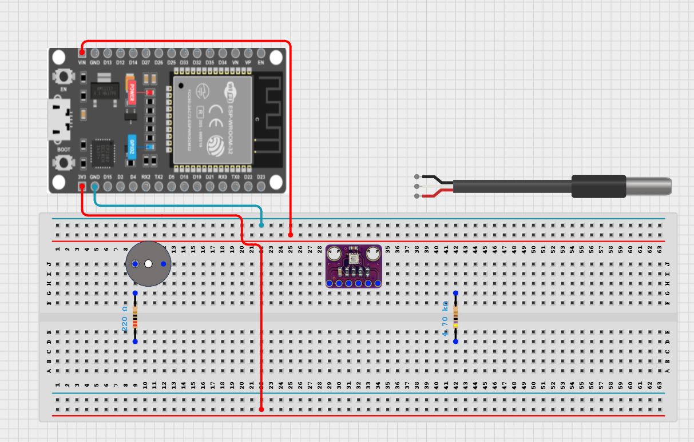
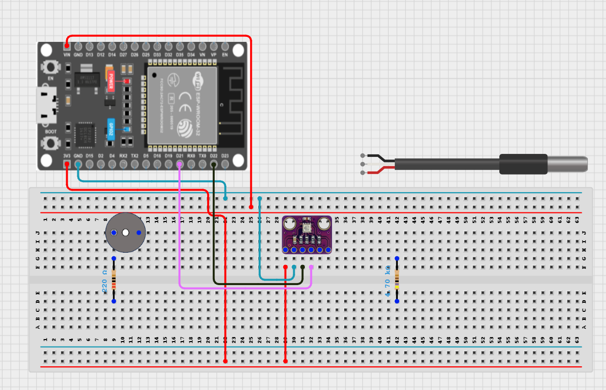
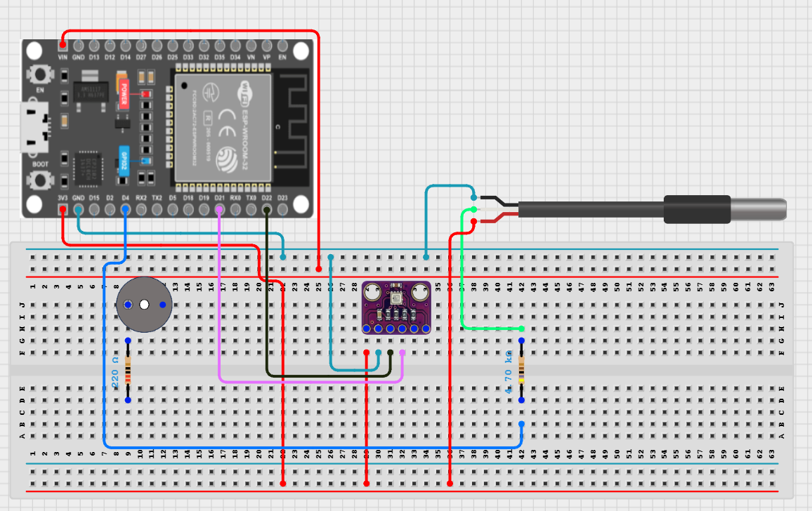
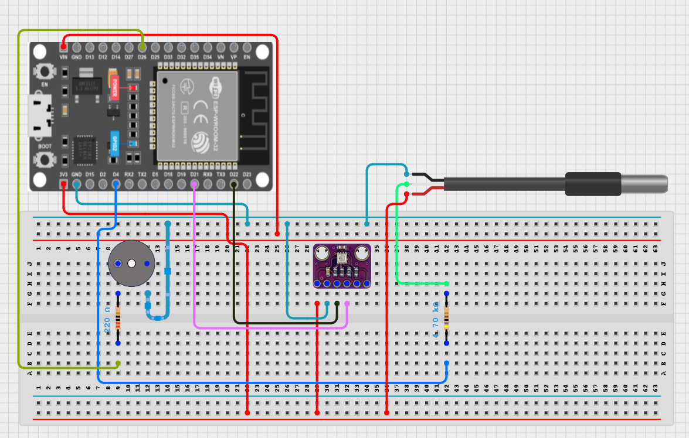

# 4.3.25. Bluetooth Telemetry Environmental Logger

| **Description** | In Project 145, the ESP32 reads temperature, humidity, and pressure from a BME280 and probe temperature from a DS18B20. It streams readings over built-in Bluetooth Classic and beeps when the DS18B20 temperature reaches the configurable high-temperature threshold. |
|-----------------|--------------------------------------------------------------------------------------------------------------------------------------------------------------------------------------------------------------------------------|
| **Use case** | A classroom prototype for live environmental telemetry and threshold alerts. Readings are streamed, not saved to persistent storage. |

## Components

|  |  |  |  |  |  |  |
| --- | --- | --- | --- | --- | --- | --- |

Things needed:

- ESP32 board = 1
- BME280 sensor module = 1
- DS18B20 temperature sensor = 1
- Active buzzer = 1
- 4.7 kΩ resistor for the DS18B20 data pull-up = 1
- 100 Ω resistor for the buzzer = 1
- Breadboard, jumper wires, and USB cable
- Phone or other device with a Bluetooth Classic SPP terminal app

## Building the Circuit

> **Tip:** See the [ESP32 Pinout Guide](../../Components/ESP32%20Pinout%20and%20Pin%20Assignment%20Guide.md) to locate the correct GPIO pins.

## Mounting the Components

**Step 1:** Disconnect USB. Place the ESP32, BME280, DS18B20, and active buzzer on the breadboard. Keep the BME280 away from direct heat from the ESP32 or buzzer.



## Wiring the Circuit

**Step 1: Connect the BME280 sensor**

- Connect sensor **VCC** to ESP32 **3.3V**.
- Connect sensor **GND** to ESP32 **GND**.
- Connect sensor **SDA** to **GPIO 21 (SDA)**.
- Connect sensor **SCL** to **GPIO 22 (SCL)**.
- Keep the BME280 breakout's I2C pull-ups at **3.3V**; do not connect 5V pull-ups directly to the ESP32.



**Step 2: Connect the DS18B20 temperature sensor**

- Connect sensor **VDD** to ESP32 **3.3V**.
- Connect sensor **GND** to ESP32 **GND**.
- Connect sensor **DATA / DQ** to **GPIO 4**.
- Connect a **4.7 kΩ resistor** between **DATA / DQ** and **3.3V**. Use this pull-up unless your sensor package already includes one.



**Step 3: Connect the active buzzer**

- Connect **GPIO 26** through a **100 Ω series resistor** to buzzer **positive (+)**.
- Connect buzzer **negative (−)** to ESP32 **GND**.
- This direct connection is for the kit's active buzzer at 3.3V, which draws about 10mA. Do not connect buzzer positive to 5V when it is connected to a GPIO.



**Step 4:** Check sensor supply voltages, the DS18B20 pull-up, buzzer polarity, and common ground. Then connect USB to the ESP32.

## Programming

**Step 1:** Open Arduino IDE and select the ESP32 board and port. See [Getting Started](../../Getting%20Started/Arduino_IDE_Setup.md) for setup instructions.

**Step 2:** Install **Adafruit BME280**, **Adafruit Unified Sensor**, **OneWire**, and **DallasTemperature** through Arduino IDE Library Manager. `BluetoothSerial` is included with the ESP32 Arduino core. Enter this sketch:

```cpp
#include <Wire.h>
#include <Adafruit_Sensor.h>
#include <Adafruit_BME280.h>
#include <OneWire.h>
#include <DallasTemperature.h>
#include <BluetoothSerial.h>
#include <math.h>

constexpr uint8_t sdaPin = 21;
constexpr uint8_t sclPin = 22;
constexpr uint8_t oneWirePin = 4;
constexpr uint8_t buzzerPin = 26;
constexpr uint8_t buzzerOnLevel = HIGH;
constexpr uint8_t buzzerOffLevel = LOW;
constexpr uint32_t reportIntervalMs = 2000UL;
constexpr float alarmOnC = 35.0F;
constexpr float alarmOffC = 33.0F;

Adafruit_BME280 bme;
OneWire oneWire(oneWirePin);
DallasTemperature ds18b20(&oneWire);
BluetoothSerial SerialBT;

uint32_t lastReportAt = 0;
bool temperatureAlarm = false;

void reportError(const char* message) {
  Serial.println(message);
  SerialBT.println(message);
  digitalWrite(buzzerPin, buzzerOffLevel);
}

void setup() {
  Serial.begin(115200);
  pinMode(buzzerPin, OUTPUT);
  digitalWrite(buzzerPin, buzzerOffLevel);

  Wire.begin(sdaPin, sclPin);
  if (!bme.begin(0x76, &Wire) && !bme.begin(0x77, &Wire)) {
    Serial.println("BME280 not found at I2C address 0x76 or 0x77.");
    while (true) {
      delay(1000);
    }
  }

  ds18b20.begin();
  if (ds18b20.getDeviceCount() == 0) {
    Serial.println("DS18B20 not found. Check its wiring and 4.7 kΩ pull-up.");
    while (true) {
      delay(1000);
    }
  }
  ds18b20.setResolution(10);

  if (!SerialBT.begin("STEMAIDE Env Logger")) {
    Serial.println("Bluetooth Classic startup failed.");
    while (true) {
      delay(1000);
    }
  }

  Serial.println("Environmental telemetry logger ready.");
}

void loop() {
  if (millis() - lastReportAt < reportIntervalMs) {
    return;
  }
  lastReportAt = millis();

  ds18b20.requestTemperatures();
  const float probeTempC = ds18b20.getTempCByIndex(0);
  const float bmeTempC = bme.readTemperature();
  const float humidity = bme.readHumidity();
  const float pressureHpa = bme.readPressure() / 100.0F;

  if (probeTempC == DEVICE_DISCONNECTED_C) {
    reportError("DS18B20 disconnected; telemetry sample skipped.");
    return;
  }
  if (isnan(bmeTempC) || isnan(humidity) || isnan(pressureHpa)) {
    reportError("BME280 returned an invalid reading; telemetry sample skipped.");
    return;
  }

  if (!temperatureAlarm && probeTempC >= alarmOnC) {
    temperatureAlarm = true;
  } else if (temperatureAlarm && probeTempC <= alarmOffC) {
    temperatureAlarm = false;
  }

  Serial.printf("BME280: %.2f C, %.1f %% RH, %.1f hPa | DS18B20: %.2f C | Alarm: %s\n",
                bmeTempC, humidity, pressureHpa, probeTempC,
                temperatureAlarm ? "ON" : "OFF");
  SerialBT.print("BME280: ");
  SerialBT.print(bmeTempC, 2);
  SerialBT.print(" C, ");
  SerialBT.print(humidity, 1);
  SerialBT.print(" % RH, ");
  SerialBT.print(pressureHpa, 1);
  SerialBT.print(" hPa | DS18B20: ");
  SerialBT.print(probeTempC, 2);
  SerialBT.print(" C | Alarm: ");
  SerialBT.println(temperatureAlarm ? "ON" : "OFF");

  if (temperatureAlarm) {
    digitalWrite(buzzerPin, buzzerOnLevel);
    delay(100);
    digitalWrite(buzzerPin, buzzerOffLevel);
  }
}
```

**Step 3:** Save and upload the sketch. Open Serial Monitor at **115200 baud** to check sensor readings and error messages.

**Step 4:** Pair a phone or other device that supports **Bluetooth Classic Serial Port Profile (SPP)** with **STEMAIDE Env Logger**, then connect using a Bluetooth terminal app. A BLE-only terminal app will not work with `BluetoothSerial`. The ESP32 sends a telemetry line every two seconds; the buzzer pulses when the DS18B20 reaches **35°C** and stops alerting after it cools to **33°C**. Change `alarmOnC` and `alarmOffC` for a different demonstration threshold.

## Conclusion

The BME280 reports ambient temperature, humidity, and pressure while the DS18B20 provides a separate probe temperature. The ESP32 streams the readings over its built-in Bluetooth Classic connection and provides a threshold buzzer alert. It does not store the telemetry after power is removed.
