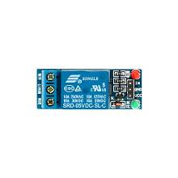
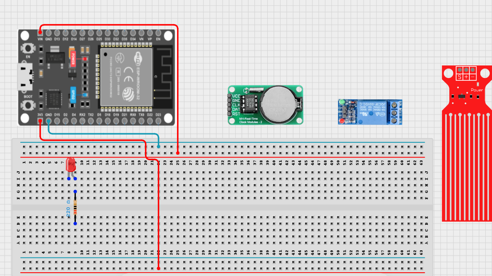
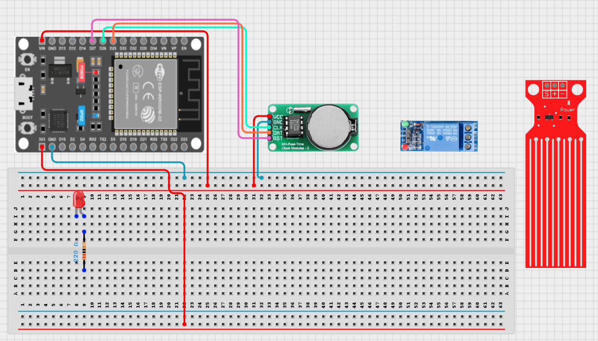
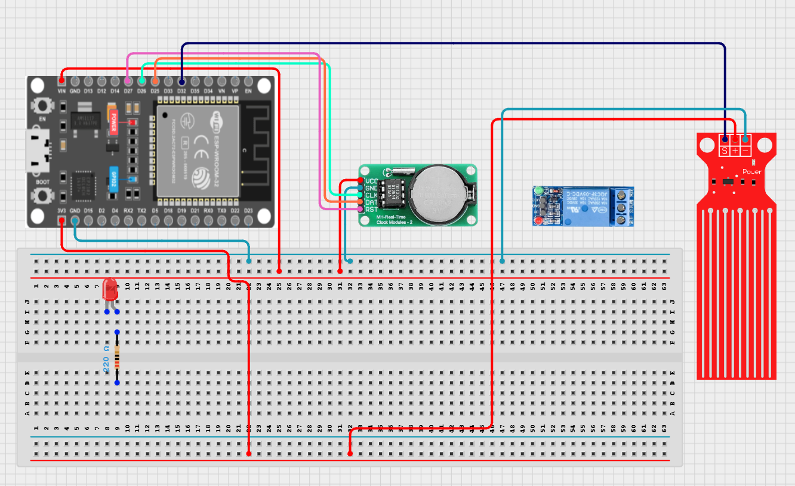
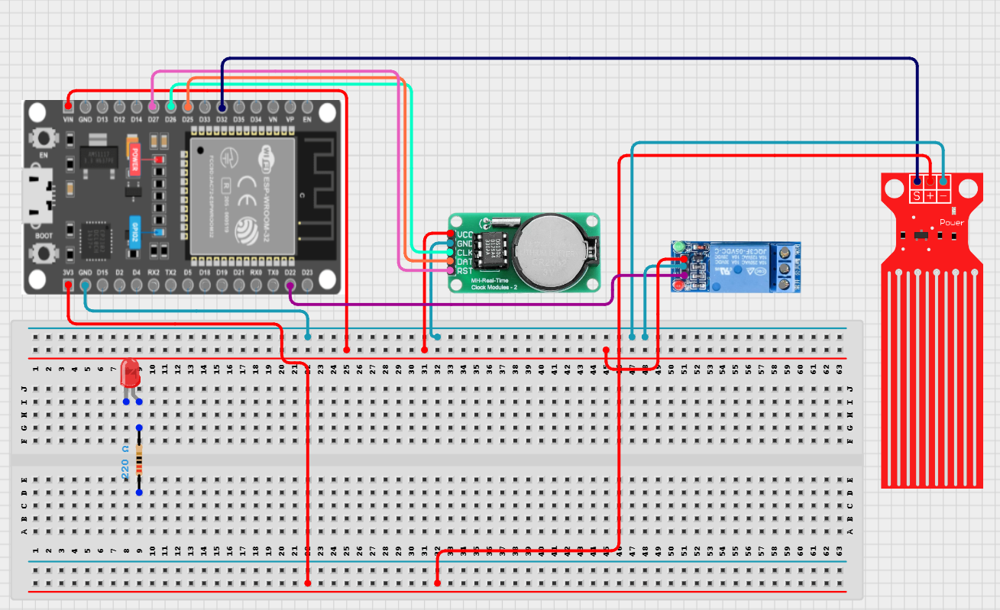
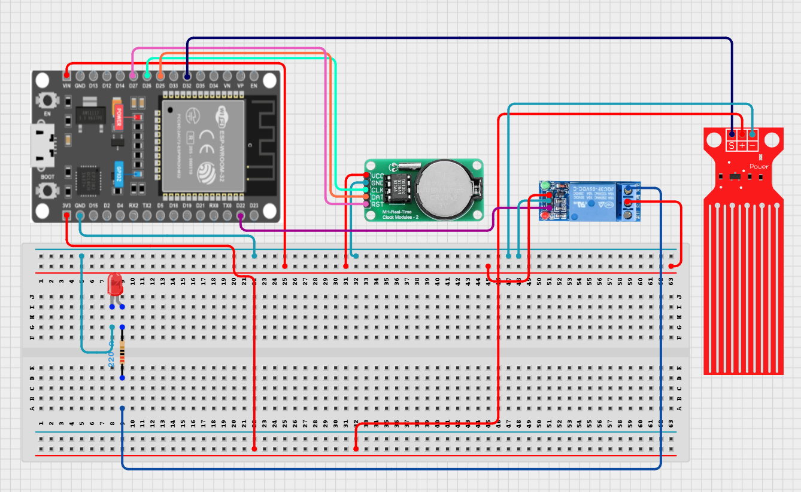

# 4.3.26. Real-Time Clock Liquid Tank Level Event Monitor

| **Description** | In Project 146, learners use a DS1302 RTC and the kit's water test module to detect when liquid reaches a chosen level in a tank. The ESP32 timestamps level changes and switches the kit's relay-controlled LED indicator. |
|------------------|-----------------------------------------------------------------------------------------------------------------------------------------------------------------------------------------------------|
| **Use case** | This project demonstrates single-point liquid-level monitoring and time-stamped event logging. It does not measure exact tank volume or control a pump. |

## Components (Things You Will Need)

|  |  |  |  |  |  |  |  |  |
| --- | --- | --- | --- | --- | --- | --- | --- | --- |

## Building the Circuit

> **Tip:** Use the [ESP32 Pinout Guide](../../Components/ESP32%20Pinout%20and%20Pin%20Assignment%20Guide.md) to locate the GPIO pins.

Things Needed:

- ESP32 board = 1
- DS1302 RTC module with backup battery = 1
- Water test module = 1
- 1-channel relay module = 1
- LED = 1
- 220 Ω resistor = 1
- Breadboard, jumper wires, and USB cable

## Mounting the Components

**Step 1:** With the ESP32 disconnected from USB, place the ESP32, RTC, water sensor, relay, LED, and resistor on an insulated surface. Keep the water sensor out of the tank until the control circuit has been checked.



## Wiring the Circuit

**Step 2:** Connect the DS1302 RTC:

- Connect RTC **VCC** to **3.3V** if supported by your module.
- Connect RTC **GND** to an ESP32 **GND** pin.
- Connect RTC **DAT** to **GPIO 25**.
- Connect RTC **CLK** to **GPIO 26**.
- Connect RTC **RST** to **GPIO 27**.
- The DS1302 uses a three-wire interface, not I2C. If your RTC module requires 5V, verify that its **DAT**, **CLK**, and **RST** signals never exceed 3.3V before connecting them to the ESP32.



**Step 3:** Connect the water test module:

- Connect sensor **VCC** to ESP32 **3.3V**.
- Connect sensor **GND** to ESP32 **GND**.
- Connect sensor **S/SIG** to **GPIO 32 (ADC1)**.
- Place the sensing traces at the tank level you want to detect. This resistive sensor is for demonstrations; prolonged immersion can corrode its exposed traces.



**Step 4:** Connect the 1-channel relay module:

- Remove the **VCC/JD-VCC** jumper, then connect relay **VCC** to ESP32 **3.3V** and **JD-VCC** to the board's **5V/VIN** pin.
- Connect relay **GND** to ESP32 **GND**.
- Connect relay **IN** to **GPIO 22**.
- This guide's sketch assumes an **active-low** relay. Verify the input polarity for your module before connecting the indicator.



**Step 5:** Wire the low-voltage LED indicator through the relay contacts:

- Connect ESP32 **3.3V** to relay **COM**.
- Connect relay **NO** to one end of the **220 Ω resistor**.
- Connect the resistor's other end to the LED's **anode** (long leg).
- Connect the LED's **cathode** (short leg) to ESP32 **GND**.
- The LED turns on when the relay is energized and the sensor reports that liquid has reached the selected level. Do not connect a pump, mains wiring, or another high-power load to this demonstration circuit.



**Step 6:** Check the RTC signal voltage, sensor wiring, relay jumper and LED polarity before connecting the USB cable.

## Programming

**Step 1:** Open the Arduino IDE. See [Getting Started](../../Getting%20Started/Arduino_IDE_Setup.md) for setup instructions.

**Step 2:** Install **Rtc by Makuna** from the Arduino IDE Library Manager, then enter this program:

```cpp
#include <ThreeWire.h>
#include <RtcDS1302.h>

constexpr uint8_t rtcDatPin = 25;
constexpr uint8_t rtcClkPin = 26;
constexpr uint8_t rtcRstPin = 27;
constexpr uint8_t waterSensorPin = 32;
constexpr uint8_t relayPin = 22;

constexpr uint16_t wetThresholdMv = 1000;
constexpr uint16_t dryThresholdMv = 700;
constexpr bool relayActiveLow = true;
constexpr bool setRtcToCompileTime = false;
constexpr uint32_t sampleIntervalMs = 1000;

ThreeWire rtcWire(rtcDatPin, rtcClkPin, rtcRstPin);
RtcDS1302<ThreeWire> rtc(rtcWire);

bool liquidAtSensor = false;
uint32_t lastSampleAt = 0;

uint32_t readWaterSensorMillivolts() {
  uint32_t totalMillivolts = 0;
  for (uint8_t sample = 0; sample < 8; ++sample) {
    totalMillivolts += analogReadMilliVolts(waterSensorPin);
    delay(5);
  }
  return totalMillivolts / 8;
}

void setLevelIndicator(bool on) {
  const bool outputHigh = (on != relayActiveLow);
  digitalWrite(relayPin, outputHigh ? HIGH : LOW);
}

void printTimestamp(const RtcDateTime& time) {
  Serial.printf("%04u-%02u-%02u %02u:%02u:%02u",
                static_cast<unsigned>(time.Year()),
                static_cast<unsigned>(time.Month()),
                static_cast<unsigned>(time.Day()),
                static_cast<unsigned>(time.Hour()),
                static_cast<unsigned>(time.Minute()),
                static_cast<unsigned>(time.Second()));
}

void logLevelState(const char* label, uint32_t sensorMillivolts) {
  printTimestamp(rtc.GetDateTime());
  Serial.printf(" | %s | sensor: %lu mV\n",
                label, static_cast<unsigned long>(sensorMillivolts));
}

void setup() {
  Serial.begin(115200);

  digitalWrite(relayPin, relayActiveLow ? HIGH : LOW);
  pinMode(relayPin, OUTPUT);
  setLevelIndicator(false);

  analogSetAttenuation(ADC_11db);

  rtc.Begin();
  if (!rtc.IsDateTimeValid() || setRtcToCompileTime) {
    rtc.SetDateTime(RtcDateTime(__DATE__, __TIME__));
    Serial.println("RTC time set from the sketch compile time.");
  }
  if (!rtc.GetIsRunning()) {
    rtc.SetIsRunning(true);
  }

  const uint32_t initialMillivolts = readWaterSensorMillivolts();
  liquidAtSensor = initialMillivolts >= wetThresholdMv;
  setLevelIndicator(liquidAtSensor);
  logLevelState(liquidAtSensor ? "Liquid at sensor" : "Sensor below level",
                initialMillivolts);
}

void loop() {
  const uint32_t now = millis();
  if (now - lastSampleAt < sampleIntervalMs) {
    return;
  }
  lastSampleAt = now;

  const uint32_t sensorMillivolts = readWaterSensorMillivolts();
  bool nextLiquidAtSensor = liquidAtSensor;

  if (!liquidAtSensor && sensorMillivolts >= wetThresholdMv) {
    nextLiquidAtSensor = true;
  } else if (liquidAtSensor && sensorMillivolts <= dryThresholdMv) {
    nextLiquidAtSensor = false;
  }

  const bool levelChanged = nextLiquidAtSensor != liquidAtSensor;
  if (levelChanged) {
    liquidAtSensor = nextLiquidAtSensor;
    setLevelIndicator(liquidAtSensor);
  }

  const char* status = levelChanged
      ? (liquidAtSensor ? "Level reached; indicator ON"
                        : "Level fell; indicator OFF")
      : (liquidAtSensor ? "Liquid at sensor" : "Sensor below level");
  logLevelState(status, sensorMillivolts);
}
```

**Step 3:** Save the sketch, select the ESP32 board and USB port, then upload it.

**Step 4:** Set and calibrate the system:

- To set the RTC to the computer's current time, temporarily change `setRtcToCompileTime` to `true`, upload the sketch, then set it back to `false` and upload again.
- Open the Serial Monitor at **115200 baud** and note the sensor reading with the sensor dry and at the chosen tank level.
- Adjust `wetThresholdMv` and `dryThresholdMv` so the wet reading is above the wet threshold and the dry reading is below the dry threshold. Keep the wet threshold higher than the dry threshold to prevent rapid relay switching near the transition.
- Verify that the relay-controlled LED turns on and off as the liquid passes the sensor. The sensor detects one level only; it does not report a calibrated tank volume.

## Conclusion

The ESP32 uses the DS1302 to timestamp changes at a selected liquid level and operates a low-voltage LED indicator through the relay. Unlike the scheduled irrigation project, this guide monitors tank-level events and does not schedule or run a pump.
