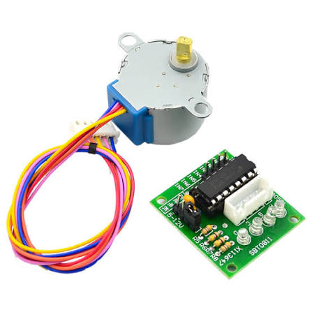
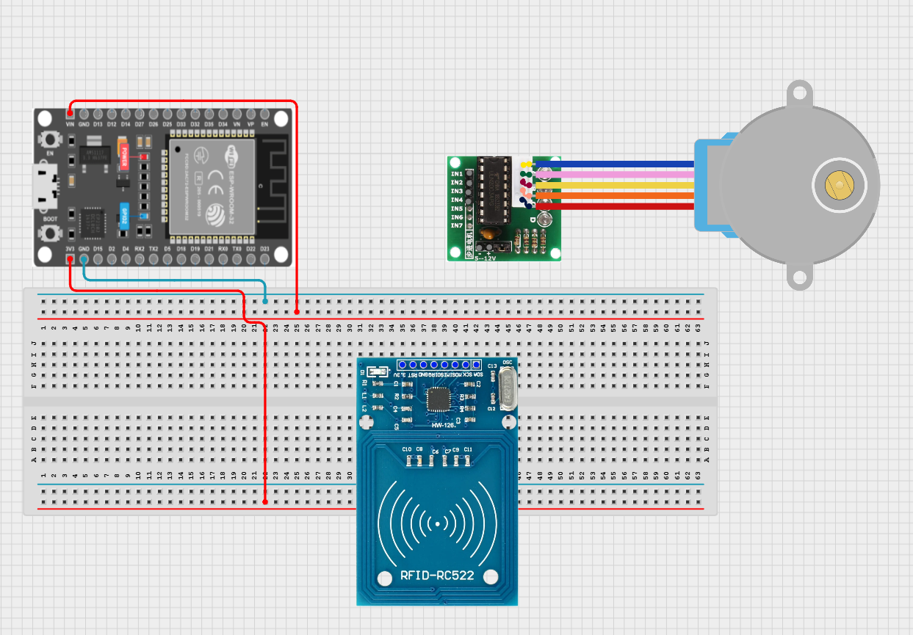
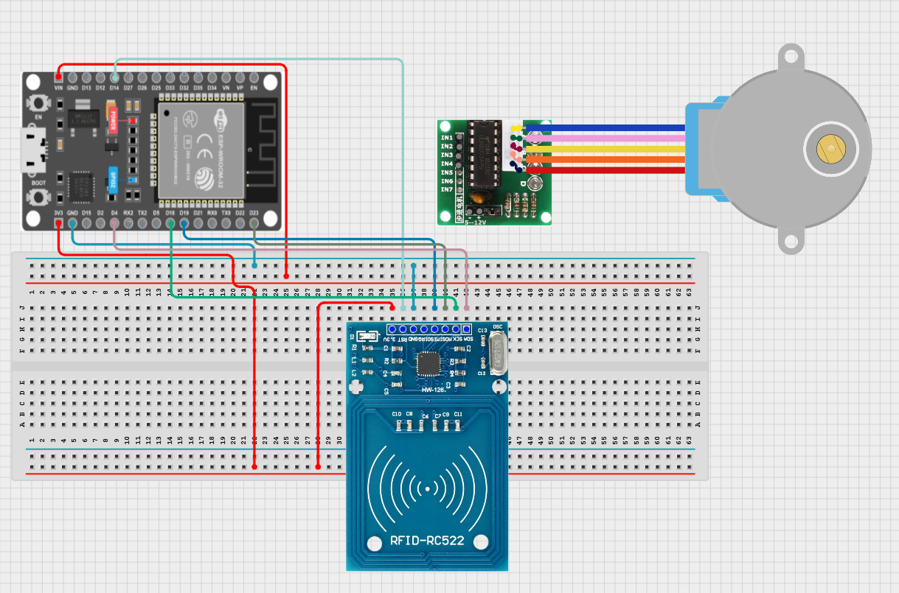
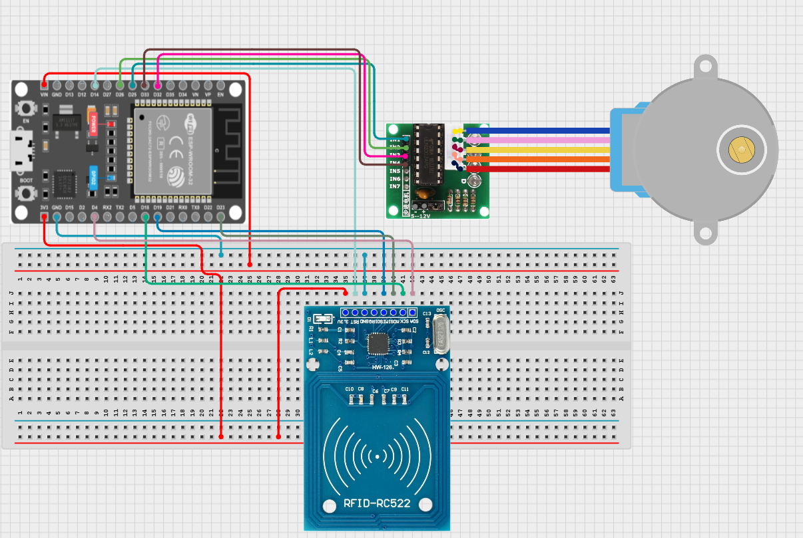

# 4.3.27. RFID Smart Warehouse Conveyor Indexer

| **Description** | In Project 147, an RC522 card scan triggers the kit's 28BYJ-48 stepper motor to rotate approximately 90 degrees. The ESP32 reports each commanded index and the scan count in the Serial Monitor. |
|------------------|------------------------------------------------------------------------------------------------------------------------------------------------------------------------------|
| **Use case** | This is a low-voltage indexing demonstrator, not an industrial conveyor or wireless IoT system. The kit does not include a belt or rollers, so this project demonstrates movement using the unloaded motor shaft. |

## Components (From the Kit Inventory)

|  |  |  |  |  |  |
| --- | --- | --- | --- | --- | --- |

Things Needed:

- ESP32 board = 1
- RC522 RFID reader = 1
- RFID card or key fob = 1
- 28BYJ-48 stepper motor = 1
- ULN2003 stepper driver board = 1
- Breadboard, jumper wires, and USB cable
- Separate regulated **5V power supply rated for at least 500mA** for the stepper motor (not included in the kit)

> The kit's 4-digit display is a bare multiplexed display, not a TM1637 module. This sketch reports the index count in the Serial Monitor instead of wiring the display without its required driver circuitry.

## Building the Circuit

> **Tip:** Use the [ESP32 Pinout Guide](../../Components/ESP32%20Pinout%20and%20Pin%20Assignment%20Guide.md) to locate the GPIO pins.

## Mounting the Components

**Step 1:** Disconnect the ESP32 from USB and leave the external motor supply off. Place the ESP32, RC522, and ULN2003 board on an insulated surface. Connect the 28BYJ-48 motor's keyed plug to the matching socket on the ULN2003 board. Keep the motor shaft clear.



## Wiring the Circuit

**Step 2:** Connect the RC522 RFID reader:

- Connect RC522 **3.3V/VCC** to ESP32 **3.3V**. Do not connect it to 5V.
- Connect RC522 **GND** to ESP32 **GND**.
- Connect RC522 **SDA/SS** to **GPIO 4**. On this SPI module, **SDA** is the chip-select pin, not I2C SDA.
- Connect RC522 **SCK** to **GPIO 18**.
- Connect RC522 **MISO** to **GPIO 19**.
- Connect RC522 **MOSI** to **GPIO 23**.
- Connect RC522 **RST** to **GPIO 14**.
- Leave **IRQ** unconnected.



**Step 3:** Connect the ULN2003 stepper driver:

- Connect driver **IN1** to **GPIO 25**.
- Connect driver **IN2** to **GPIO 26**.
- Connect driver **IN3** to **GPIO 32**.
- Connect driver **IN4** to **GPIO 33**.
- Connect driver motor-power **VCC/+** to the separate regulated **5V** supply positive.
- Connect driver **GND/-** to the external supply **GND** and to an ESP32 **GND** pin.
- Do not power the stepper motor from the ESP32 **3.3V**, **5V/VIN**, or USB rail. Do not connect the external supply's positive output to ESP32 **5V/VIN**.



**Step 4:** Recheck the RC522's 3.3V supply, all GPIO assignments, and the shared ground. Keep the motor supply off while connecting USB and uploading the sketch.

## Programming

**Step 1:** Open the Arduino IDE and select the ESP32 board and port. See [Getting Started](../../Getting%20Started/Arduino_IDE_Setup.md) for setup instructions.

**Step 2:** Install the **MFRC522** library from the Arduino IDE Library Manager, then enter this sketch:

```cpp
#include <SPI.h>
#include <MFRC522.h>

constexpr uint8_t rfidSsPin = 4;
constexpr uint8_t rfidRstPin = 14;
constexpr uint8_t motorPins[4] = {25, 26, 32, 33};
constexpr uint8_t stepSequence[8][4] = {
  {1, 0, 0, 0},
  {1, 1, 0, 0},
  {0, 1, 0, 0},
  {0, 1, 1, 0},
  {0, 0, 1, 0},
  {0, 0, 1, 1},
  {0, 0, 0, 1},
  {1, 0, 0, 1}
};
constexpr uint16_t stepsPerIndex = 1024;
constexpr uint16_t stepDelayUs = 1200;

MFRC522 rfid(rfidSsPin, rfidRstPin);
uint8_t currentStep = 0;
uint16_t indexCount = 0;

void writeCurrentStep() {
  for (uint8_t pin = 0; pin < 4; ++pin) {
    digitalWrite(motorPins[pin], stepSequence[currentStep][pin]);
  }
}

void releaseMotorCoils() {
  for (uint8_t pin = 0; pin < 4; ++pin) {
    digitalWrite(motorPins[pin], LOW);
  }
}

void indexMotorOnce() {
  for (uint16_t step = 0; step < stepsPerIndex; ++step) {
    currentStep = (currentStep + 1) % 8;
    writeCurrentStep();
    delayMicroseconds(stepDelayUs);
  }
  releaseMotorCoils();
}

void printCardUid() {
  Serial.print("Card UID: ");
  for (byte i = 0; i < rfid.uid.size; ++i) {
    if (rfid.uid.uidByte[i] < 0x10) {
      Serial.print('0');
    }
    Serial.print(rfid.uid.uidByte[i], HEX);
    if (i + 1 < rfid.uid.size) {
      Serial.print(' ');
    }
  }
  Serial.println();
}

void setup() {
  Serial.begin(115200);

  for (uint8_t pin = 0; pin < 4; ++pin) {
    pinMode(motorPins[pin], OUTPUT);
  }
  releaseMotorCoils();

  SPI.begin(18, 19, 23, rfidSsPin);
  rfid.PCD_Init();

  Serial.println("RFID indexer ready. Tap and remove an RFID card to index.");
  Serial.println("The count records commanded motor indexes, not verified belt movement.");
}

void loop() {
  if (!rfid.PICC_IsNewCardPresent() || !rfid.PICC_ReadCardSerial()) {
    return;
  }

  printCardUid();
  rfid.PICC_HaltA();
  rfid.PCD_StopCrypto1();

  indexMotorOnce();
  indexCount = (indexCount + 1) % 10000;

  Serial.print("Index commanded. Count: ");
  Serial.println(indexCount);
}
```

**Step 3:** Save and upload the sketch while the external motor supply is off.

**Step 4:** Open the Serial Monitor at **115200 baud**. Turn on the separate 5V motor supply, then tap and remove a supported RFID card or key fob. Each read should rotate the unloaded motor shaft approximately 90 degrees and increment the displayed Serial Monitor count. The count rolls over to 0 after 9999.

## Conclusion

The RC522 scan triggers one approximate quarter-turn of the kit's stepper motor and records the commanded index count in the Serial Monitor. The kit does not include conveyor mechanics, and the small stepper is not suitable for driving a loaded industrial conveyor. Add a properly engineered belt, frame, and motor system before attempting to move goods.
