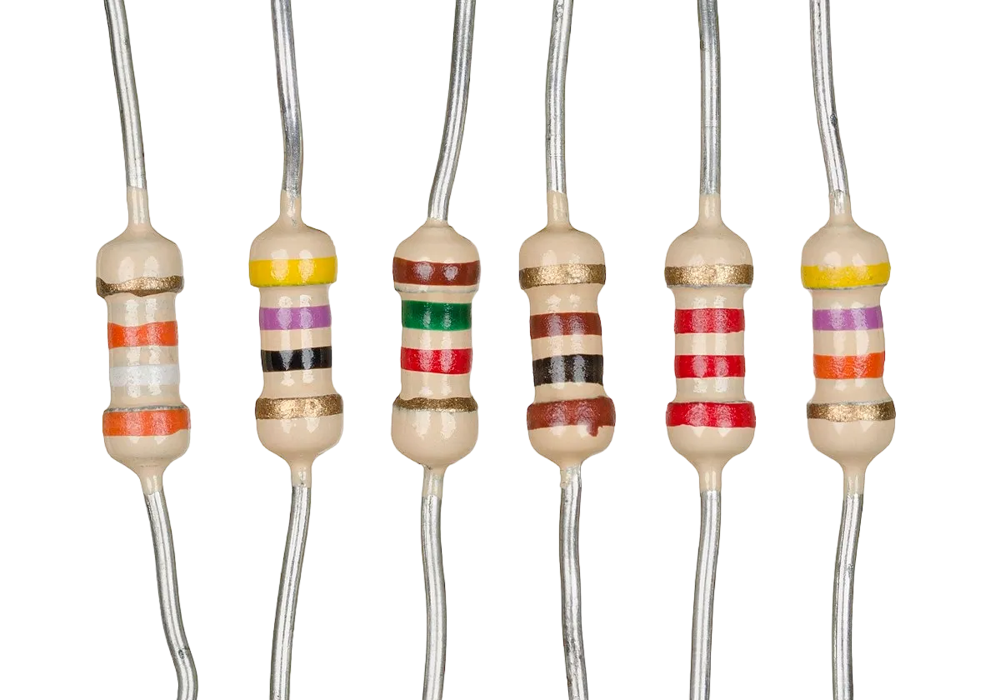
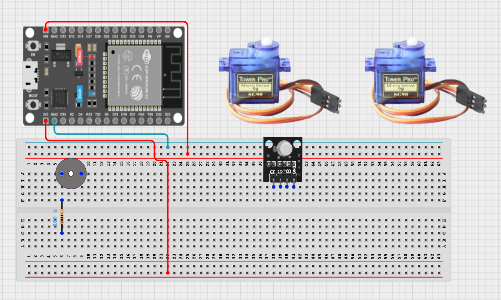
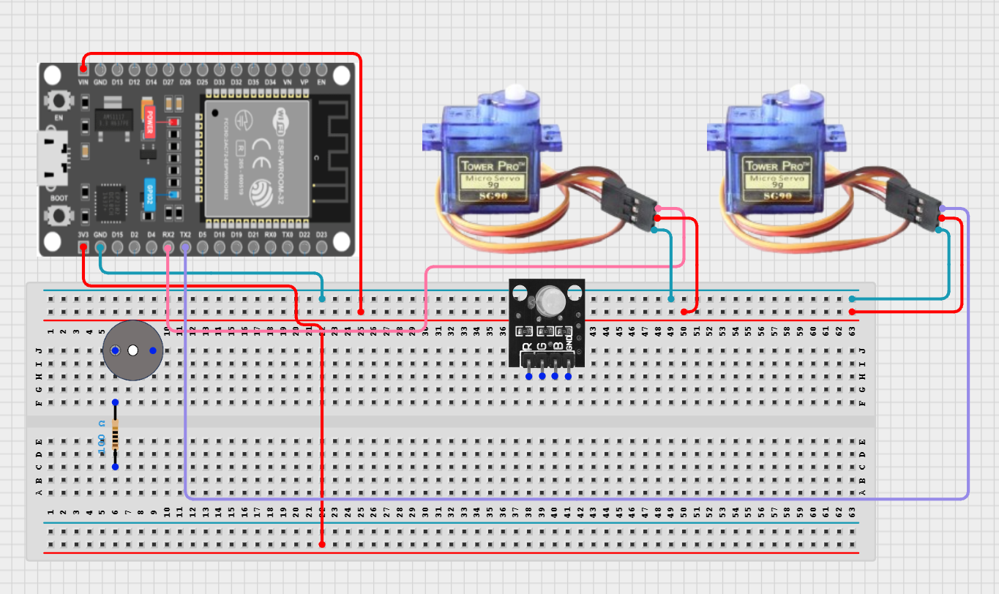
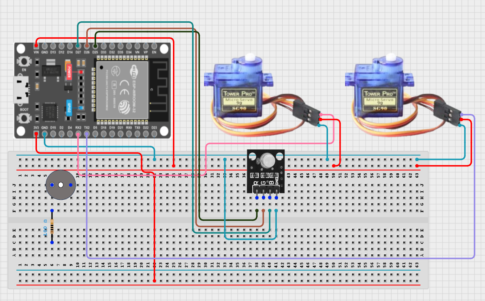
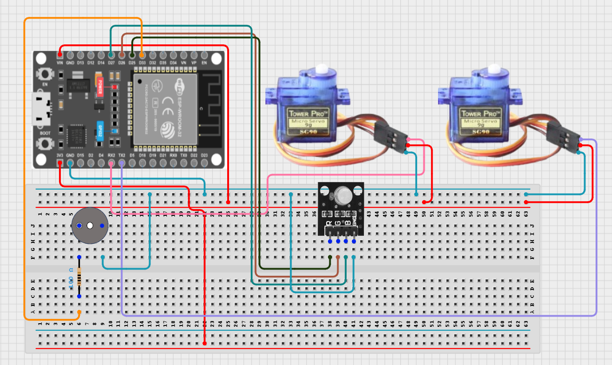

# 4.3.28. Bluetooth-Controlled Pan-Tilt Camera Mount

| **Description** | In Project 148, a phone sends Bluetooth Classic commands to the ESP32's built-in radio to move two SG90 servos for pan and tilt. An RGB LED shows command status, and an active buzzer gives a short confirmation beep. |
|------------------|----------------------------------------------------------------------------------------------------------------------------------------------------------------------------------------------------------------|
| **Use case** | This is a low-voltage servo-positioning demonstration. The kit does not include a camera or pan-tilt bracket, and the sketch does not capture or stream video. Use only a lightweight camera or mock load if you supply a mount. |

## Components (From the Kit Inventory)

|  |  |  |  |  |  |  |  |
| --- | --- | --- | --- | --- | --- | --- | --- |

Things Needed:

- ESP32 board = 1
- SG90 servo motors = 2
- RGB LED module = 1
- Active buzzer = 1
- 100 Ω resistor for the buzzer = 1
- 220 Ω resistors for RGB channels if they are not built into the module = up to 3
- Breadboard, jumper wires, and USB cable
- Separate regulated **5V, 2A power supply** for the servos (required; not included in the kit)
- Lightweight pan-tilt bracket and camera or mock load (optional; not included in the kit)

## Building the Circuit

> **Bluetooth:** The ESP32-WROOM-32D has built-in Bluetooth Classic. This project does not use the external HC-05 module.
>
> **Servo power:** Each SG90 can draw up to about 650 mA at stall. Power both servos from the separate regulated 5V supply, not from ESP32 **3.3V**, **5V/VIN**, or USB. Connect the supply ground to ESP32 **GND**, but do not connect its 5V positive wire to ESP32 **VIN/5V** while USB is connected.

> **Tip:** Use the [ESP32 Pinout Guide](../../Components/ESP32%20Pinout%20and%20Pin%20Assignment%20Guide.md) to locate the GPIO pins.

## Mounting the Components

**Step 1:** Disconnect USB and the external supply. Place the ESP32, two servos, RGB module, and buzzer on a stable surface. Secure the pan-tilt bracket if you have one, remove heavy loads, and keep both servo arms clear.



## Wiring the Circuit

**Step 2:** Connect the two SG90 servos:

- Connect the pan servo **signal** wire (orange/yellow) to **GPIO 16**.
- Connect the tilt servo **signal** wire (orange/yellow) to **GPIO 17**.
- Connect both servo **V+** wires (red) to the separate regulated **5V supply positive**.
- Connect both servo **GND** wires (brown/black) to the external supply **GND** and an ESP32 **GND** pin.
- Do not connect the external supply's 5V positive wire to ESP32 **VIN/5V** while USB is connected.



**Step 3:** Connect the RGB LED module:

- Connect module **−/GND** to ESP32 **GND**.
- Connect module **R** to **GPIO 25**.
- Connect module **G** to **GPIO 26**.
- Connect module **B** to **GPIO 27**.
- Check that each color channel has a current-limiting resistor. Add a **220 Ω resistor** in series with any channel that does not have one built in. This guide assumes a common-cathode module.



**Step 4:** Connect the active buzzer:

- Connect buzzer **positive (+)** to **GPIO 33** through a **100 Ω resistor**.
- Connect buzzer **negative (−)** to ESP32 **GND**.



**Step 5:** Recheck the GPIO assignments and the separate servo supply. Connect USB for programming; connect the external 5V supply only after checking polarity and the common ground.

## Programming

**Step 1:** Open the Arduino IDE and select the ESP32 board and port. See [Getting Started](../../Getting%20Started/Arduino_IDE_Setup.md) for setup instructions.

**Step 2:** Install **ESP32Servo** from Arduino IDE Library Manager. `BluetoothSerial` is included with the ESP32 Arduino core. Enter this sketch:

```cpp
#include <BluetoothSerial.h>
#include <ESP32Servo.h>

constexpr uint8_t panServoPin = 16;
constexpr uint8_t tiltServoPin = 17;
constexpr uint8_t redPin = 25;
constexpr uint8_t greenPin = 26;
constexpr uint8_t bluePin = 27;
constexpr uint8_t buzzerPin = 33;

constexpr int minAngle = 20;
constexpr int maxAngle = 160;
constexpr int angleStep = 5;
constexpr uint32_t beepDurationMs = 80;

BluetoothSerial SerialBT;
Servo panServo;
Servo tiltServo;

int panAngle = 90;
int tiltAngle = 90;
bool buzzerActive = false;
uint32_t buzzerStartedAt = 0;

void setStatusColor(bool red, bool green, bool blue) {
  digitalWrite(redPin, red ? HIGH : LOW);
  digitalWrite(greenPin, green ? HIGH : LOW);
  digitalWrite(bluePin, blue ? HIGH : LOW);
}

void startBeep() {
  digitalWrite(buzzerPin, HIGH);
  buzzerActive = true;
  buzzerStartedAt = millis();
}

void serviceBuzzer() {
  if (buzzerActive && millis() - buzzerStartedAt >= beepDurationMs) {
    digitalWrite(buzzerPin, LOW);
    buzzerActive = false;
  }
}

bool changeAngle(Servo& servo, int& angle, int change) {
  const int nextAngle = angle + change;
  if (nextAngle < minAngle || nextAngle > maxAngle) {
    return false;
  }
  angle = nextAngle;
  servo.write(angle);
  return true;
}

void reportPosition() {
  Serial.print("Pan: ");
  Serial.print(panAngle);
  Serial.print(" deg, tilt: ");
  Serial.print(tiltAngle);
  Serial.println(" deg");

  SerialBT.print("Pan: ");
  SerialBT.print(panAngle);
  SerialBT.print(" deg, tilt: ");
  SerialBT.print(tiltAngle);
  SerialBT.println(" deg");
}

void printHelp() {
  SerialBT.println("Commands: L=pan left, R=pan right, U=tilt up, D=tilt down, C=center, ?=help");
}

void handleCommand(char command) {
  bool moved = false;

  switch (command) {
    case 'L':
    case 'l':
      moved = changeAngle(panServo, panAngle, -angleStep);
      setStatusColor(false, false, true);
      break;
    case 'R':
    case 'r':
      moved = changeAngle(panServo, panAngle, angleStep);
      setStatusColor(false, false, true);
      break;
    case 'U':
    case 'u':
      moved = changeAngle(tiltServo, tiltAngle, angleStep);
      setStatusColor(true, false, false);
      break;
    case 'D':
    case 'd':
      moved = changeAngle(tiltServo, tiltAngle, -angleStep);
      setStatusColor(true, false, false);
      break;
    case 'C':
    case 'c':
      panAngle = 90;
      tiltAngle = 90;
      panServo.write(panAngle);
      tiltServo.write(tiltAngle);
      moved = true;
      setStatusColor(false, true, false);
      break;
    case '?':
      printHelp();
      return;
    default:
      SerialBT.println("Unknown command. Send ? for help.");
      return;
  }

  if (!moved) {
    setStatusColor(true, false, false);
    SerialBT.println("Servo limit reached.");
    return;
  }

  startBeep();
  reportPosition();
}

void setup() {
  Serial.begin(115200);

  pinMode(redPin, OUTPUT);
  pinMode(greenPin, OUTPUT);
  pinMode(bluePin, OUTPUT);
  pinMode(buzzerPin, OUTPUT);
  digitalWrite(buzzerPin, LOW);
  setStatusColor(false, true, false);

  panServo.setPeriodHertz(50);
  tiltServo.setPeriodHertz(50);
  panServo.attach(panServoPin, 600, 2300);
  tiltServo.attach(tiltServoPin, 600, 2300);
  panServo.write(panAngle);
  tiltServo.write(tiltAngle);

  if (!SerialBT.begin("STEMAIDE Pan Tilt")) {
    Serial.println("Bluetooth Classic startup failed.");
    while (true) {
      delay(1000);
    }
  }

  Serial.println("Pan-tilt controller ready. Send L, R, U, D, C, or ? over Bluetooth.");
  SerialBT.println("Pan-tilt controller ready.");
  printHelp();
}

void loop() {
  while (SerialBT.available() > 0) {
    const char command = static_cast<char>(SerialBT.read());
    if (command != '\r' && command != '\n') {
      handleCommand(command);
    }
  }
  serviceBuzzer();
}
```

**Step 3:** Save and upload the sketch with the external servo supply disconnected.

**Step 4:** Open the Serial Monitor at **115200 baud**. Turn on the separate servo supply, then pair a phone or other device that supports **Bluetooth Classic Serial Port Profile (SPP)** with **STEMAIDE Pan Tilt**. A BLE-only terminal app will not work with `BluetoothSerial`. Send **L**, **R**, **U**, or **D** to move in 5-degree steps, **C** to center, or **?** for help. Servo limits are set to **20°–160°**; change them only after checking your mount's clearances. Reversing the mount orientation may require reversing the direction for a command.

## Conclusion

The ESP32's built-in Bluetooth Classic controls two SG90 servos, with RGB and buzzer feedback. The project positions servos only; it does not include a camera, capture images, or stream video.
