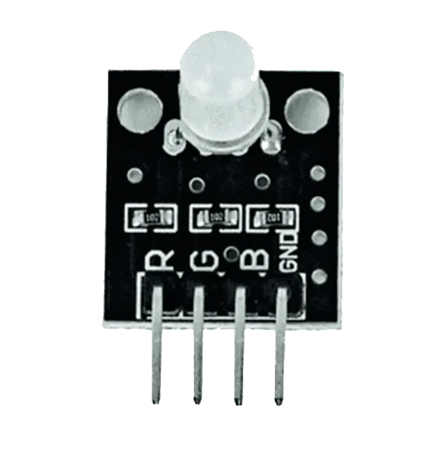
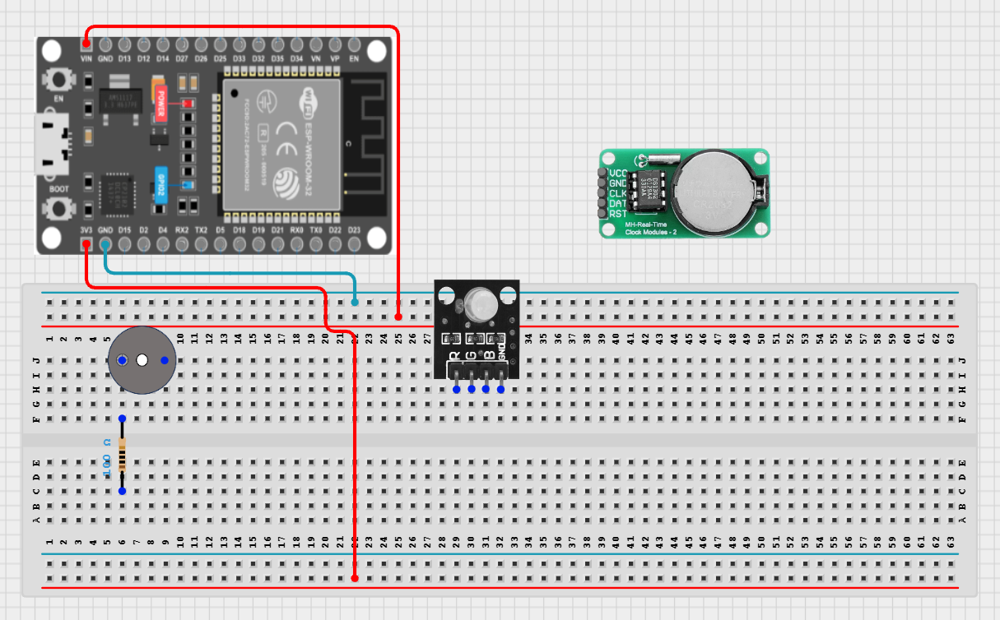
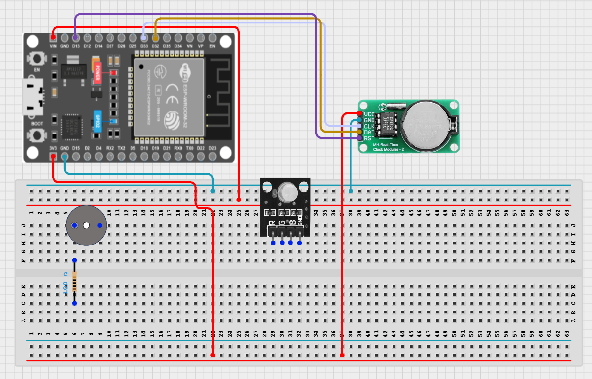
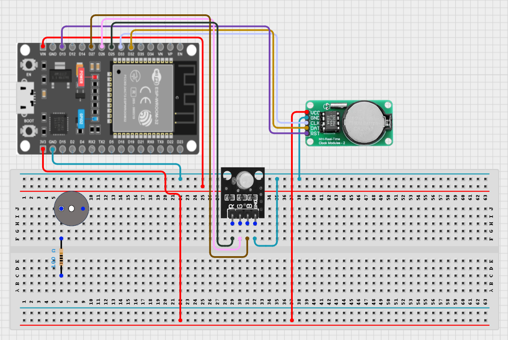
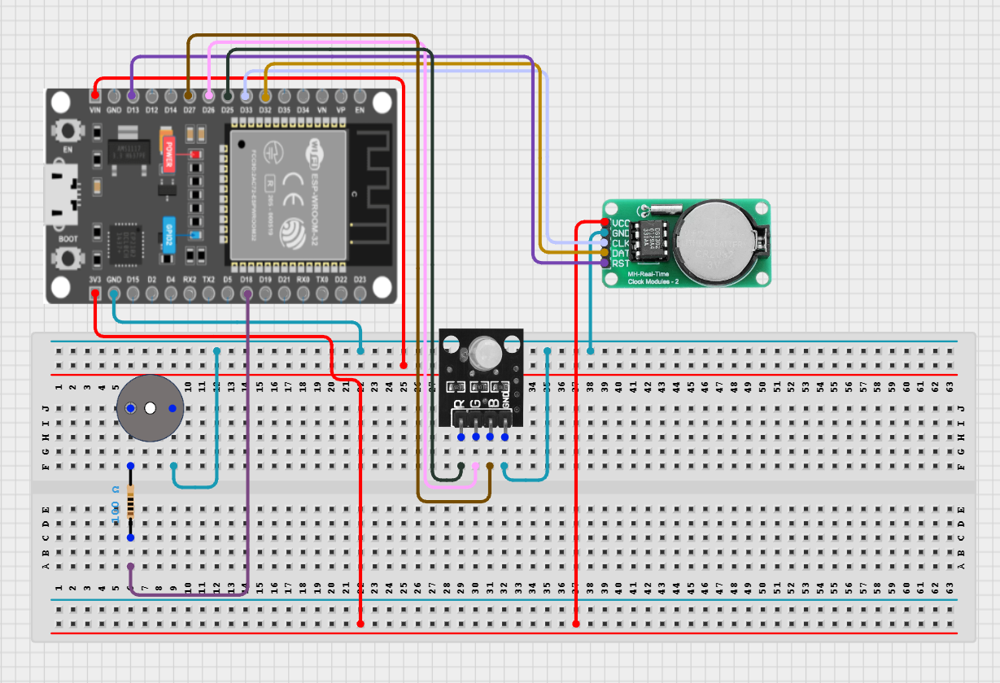

# 4.3.29. Real-Time Clock Multi-Stage School Bell

| **Description** | In Project 149, an ESP32 and DS1302 RTC run a configurable daily schedule of class-start, period-change, break, lunch, and dismissal alerts. The active buzzer uses different pulse patterns for each event, while an RGB LED indicates ready, sounding, and pause states. |
|------------------|--------------------------------------------------------------------------------------------------------------------------------------------------------------------------------------------------------------------------------------------|
| **Use case** | This is a low-voltage classroom demonstration of scheduled alerts. It is not a full-volume school bell, public-warning system, or safety device. |

## Components (From the Kit Inventory)

|  |  |  |  |  |  |  |  |
| --- | --- | --- | --- | --- | --- | --- | --- |

Things Needed:

- ESP32 board = 1
- DS1302 RTC module with backup battery = 1
- Active buzzer = 1
- RGB LED module = 1
- 100 Ω resistor for the buzzer = 1
- Breadboard, jumper wires, and USB cable

> **RTC model note:** This guide uses the DS1302 previously confirmed for your hardware. The published kit inventory lists other RTC models; check the chip/module label before wiring. This sketch is for the DS1302's three-wire interface, not a DS3231 or DS1307.
>
> The kit's 4-digit display is a bare multiplexed display, not a TM1637 module. It is omitted; the Serial Monitor reports time and scheduled events instead. The relay and RFID reader are also not used.

## Building the Circuit

> **Tip:** Use the [ESP32 Pinout Guide](../../Components/ESP32%20Pinout%20and%20Pin%20Assignment%20Guide.md) to locate the GPIO pins.

## Mounting the Components

**Step 1:** Disconnect USB. Place the ESP32, DS1302 RTC, RGB module, and buzzer on the breadboard. Keep all wiring within the 3.3V logic system.



## Wiring the Circuit

**Step 2:** Connect the DS1302 RTC using its three-wire interface:

- Connect RTC **VCC** to ESP32 **3.3V** if supported by your module.
- Connect RTC **GND** to ESP32 **GND**.
- Connect RTC **DAT / I/O** to **GPIO 32**.
- Connect RTC **CLK / SCLK** to **GPIO 33**.
- Connect RTC **RST / CE** to **GPIO 13**.
- Match the labels on the RTC module; the DS1302 does not use I2C. If your module requires 5V, do not connect its signal pins directly until you have verified that their voltage never exceeds 3.3V.



**Step 3:** Connect the RGB LED module:

- Connect module **R** to **GPIO 25**.
- Connect module **G** to **GPIO 26**.
- Connect module **B** to **GPIO 27**.
- Connect module **− / GND** (common cathode) to ESP32 **GND**.
- The kit's RGB module has onboard current-limiting resistors. If your module does not, add a suitable series resistor to each color channel.



**Step 4:** Connect the active buzzer:

- Connect buzzer **positive (+)** through the kit's **100 Ω resistor** to **GPIO 18**.
- Connect buzzer **negative (−)** to ESP32 **GND**.
- This direct GPIO connection is only for the kit buzzer operated at 3.3V with current no greater than 12mA. Do not connect a 5V buzzer supply to an ESP32 GPIO.



**Step 5:** Check the RTC model and wiring, RGB polarity, and buzzer resistor. Then connect USB to the ESP32.

## Programming

**Step 1:** Open the Arduino IDE and select the ESP32 board and port. See [Getting Started](../../Getting%20Started/Arduino_IDE_Setup.md) for setup instructions.

**Step 2:** Install **Rtc by Makuna** through the Arduino IDE Library Manager, then enter this sketch:

```cpp
#include <ThreeWire.h>
#include <RtcDS1302.h>

struct BellEvent {
  uint16_t minuteOfDay;
  uint8_t pulses;
  uint16_t onTimeMs;
  uint16_t offTimeMs;
  const char* label;
};

constexpr uint8_t rtcDatPin = 32;
constexpr uint8_t rtcClkPin = 33;
constexpr uint8_t rtcRstPin = 13;
constexpr uint8_t redPin = 25;
constexpr uint8_t greenPin = 26;
constexpr uint8_t bluePin = 27;
constexpr uint8_t buzzerPin = 18;
constexpr bool setRtcToCompileTime = false;
constexpr uint32_t reportIntervalMs = 1000;

constexpr BellEvent bellSchedule[] = {
  {8 * 60,       1, 1500,   0, "School day starts"},
  {8 * 60 + 45,  1,  350,   0, "Period change"},
  {9 * 60 + 30,  2,  500, 300, "Break"},
  {9 * 60 + 45,  1, 1500,   0, "Return from break"},
  {12 * 60,      3,  300, 250, "Lunch"},
  {12 * 60 + 30, 1, 1500,   0, "Return from lunch"},
  {15 * 60,      2, 1000, 300, "Dismissal"}
};
constexpr uint8_t bellEventCount =
    sizeof(bellSchedule) / sizeof(bellSchedule[0]);

ThreeWire rtcWire(rtcDatPin, rtcClkPin, rtcRstPin);
RtcDS1302<ThreeWire> rtc(rtcWire);

uint32_t lastTriggeredDate[bellEventCount] = {};
uint32_t lastReportAt = 0;
uint32_t phaseStartedAt = 0;
uint16_t phaseDurationMs = 0;
uint16_t currentOnTimeMs = 0;
uint16_t currentOffTimeMs = 0;
uint8_t pulsesRemaining = 0;
bool bellActive = false;
bool buzzerOn = false;

void setIndicator(bool red, bool green, bool blue) {
  digitalWrite(redPin, red ? HIGH : LOW);
  digitalWrite(greenPin, green ? HIGH : LOW);
  digitalWrite(bluePin, blue ? HIGH : LOW);
}

uint32_t dateKey(const RtcDateTime& time) {
  return static_cast<uint32_t>(time.Year()) * 10000UL
       + static_cast<uint32_t>(time.Month()) * 100UL
       + time.Day();
}

void startBell(const BellEvent& event, uint32_t nowMs) {
  bellActive = true;
  buzzerOn = true;
  pulsesRemaining = event.pulses;
  currentOnTimeMs = event.onTimeMs;
  phaseDurationMs = currentOnTimeMs;
  currentOffTimeMs = event.offTimeMs;
  phaseStartedAt = nowMs;
  digitalWrite(buzzerPin, HIGH);
  setIndicator(true, false, false);
  Serial.print("Bell event: ");
  Serial.println(event.label);
}

void serviceBell(uint32_t nowMs) {
  if (!bellActive || nowMs - phaseStartedAt < phaseDurationMs) {
    return;
  }

  phaseStartedAt = nowMs;
  if (buzzerOn) {
    digitalWrite(buzzerPin, LOW);
    buzzerOn = false;
    --pulsesRemaining;
    if (pulsesRemaining == 0) {
      bellActive = false;
      setIndicator(false, true, false);
      return;
    }
    phaseDurationMs = currentOffTimeMs;
    setIndicator(false, false, true);
  } else {
    digitalWrite(buzzerPin, HIGH);
    buzzerOn = true;
    phaseDurationMs = currentOnTimeMs;
    setIndicator(true, false, false);
  }
}

void checkSchedule(const RtcDateTime& now, uint32_t nowMs) {
  const uint8_t dayOfWeek = now.DayOfWeek();
  if (dayOfWeek == 0 || dayOfWeek == 6) {
    return;
  }

  const uint16_t currentMinute =
      static_cast<uint16_t>(now.Hour()) * 60U + now.Minute();
  const uint32_t today = dateKey(now);

  for (uint8_t i = 0; i < bellEventCount; ++i) {
    if (currentMinute == bellSchedule[i].minuteOfDay &&
        lastTriggeredDate[i] != today) {
      lastTriggeredDate[i] = today;
      startBell(bellSchedule[i], nowMs);
      return;
    }
  }
}

void setup() {
  Serial.begin(115200);

  pinMode(redPin, OUTPUT);
  pinMode(greenPin, OUTPUT);
  pinMode(bluePin, OUTPUT);
  pinMode(buzzerPin, OUTPUT);
  digitalWrite(buzzerPin, LOW);
  setIndicator(false, true, false);

  rtc.Begin();
  rtc.SetIsWriteProtected(false);
  if (!rtc.GetIsRunning()) {
    rtc.SetIsRunning(true);
  }
  if (setRtcToCompileTime || !rtc.IsDateTimeValid()) {
    rtc.SetDateTime(RtcDateTime(__DATE__, __TIME__));
    Serial.println("RTC set to sketch compile time.");
  }
  if (!rtc.IsDateTimeValid()) {
    Serial.println("RTC time is invalid. Check the DS1302 wiring and backup battery.");
    while (true) {
      delay(1000);
    }
  }

  Serial.println("School bell schedule ready; times are local RTC time.");
}

void loop() {
  const uint32_t nowMs = millis();
  serviceBell(nowMs);

  const RtcDateTime now = rtc.GetDateTime();
  checkSchedule(now, nowMs);

  if (nowMs - lastReportAt >= reportIntervalMs) {
    lastReportAt = nowMs;
    Serial.printf("%04u-%02u-%02u %02u:%02u:%02u | %s\n",
                  static_cast<unsigned>(now.Year()),
                  static_cast<unsigned>(now.Month()),
                  static_cast<unsigned>(now.Day()),
                  static_cast<unsigned>(now.Hour()),
                  static_cast<unsigned>(now.Minute()),
                  static_cast<unsigned>(now.Second()),
                  bellActive ? "BELL ACTIVE" : "READY");
  }

  delay(20);
}
```

**Step 3:** Save and upload the sketch. Install the RTC backup battery. To set the clock to the computer's current time, temporarily change `setRtcToCompileTime` to `true`, upload, then set it back to `false` and upload again.

**Step 4:** Open the Serial Monitor at **115200 baud** and verify that the RTC time is correct. The example schedule uses local RTC time and runs Monday through Friday; Saturdays and Sundays are skipped. Change the `bellSchedule` entries to match your timetable; each entry specifies minutes after midnight, pulse count, tone duration, gap duration, and event label.

**Step 5:** For a safe test, temporarily change one schedule entry to a time one or two minutes ahead, upload the sketch, and confirm the buzzer pattern and RGB indicator. Restore the desired schedule after testing. Each event triggers once per calendar date while the controller remains running; restarting during a scheduled minute can trigger that event again.

## Conclusion

The DS1302 runs multiple daily alert stages with distinct buzzer patterns, while the RGB module shows ready, sounding, and between-pulse states. The Serial Monitor provides the current time and event labels. This is a classroom prototype, not an actual school-wide bell or emergency alert system.
