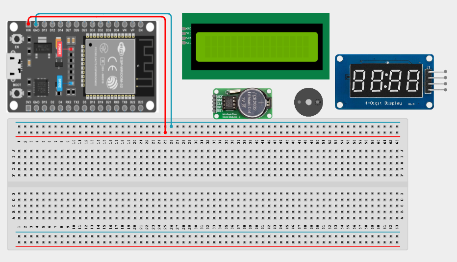
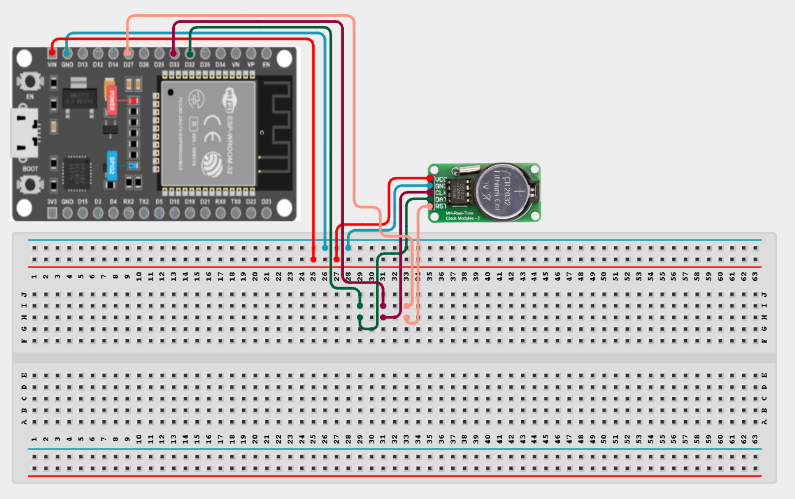
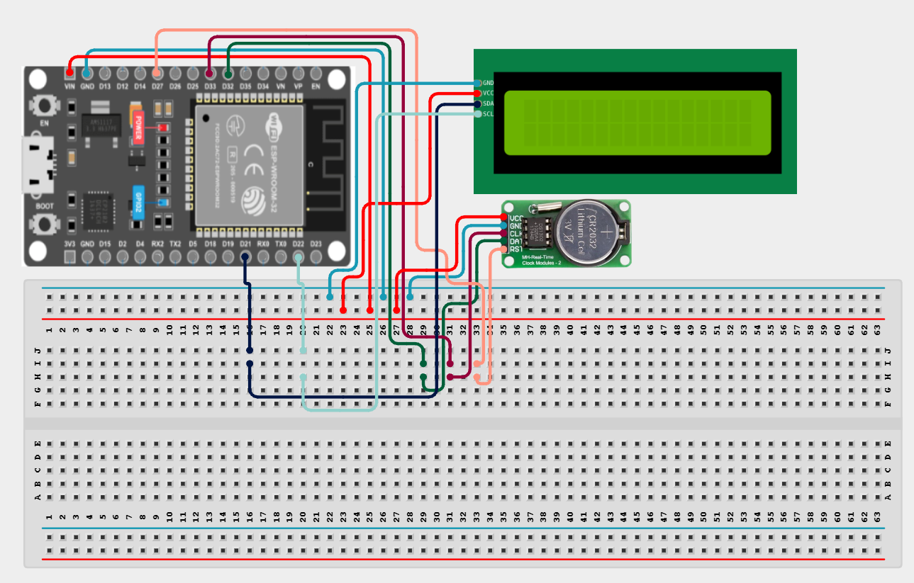
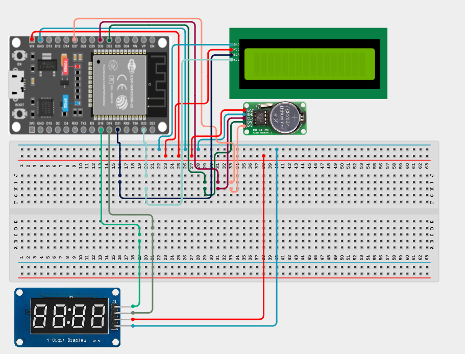
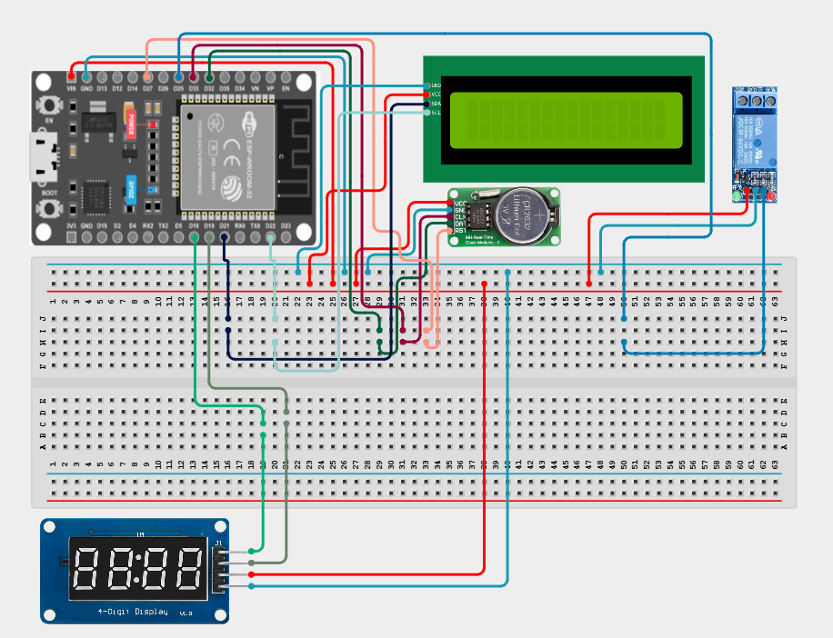
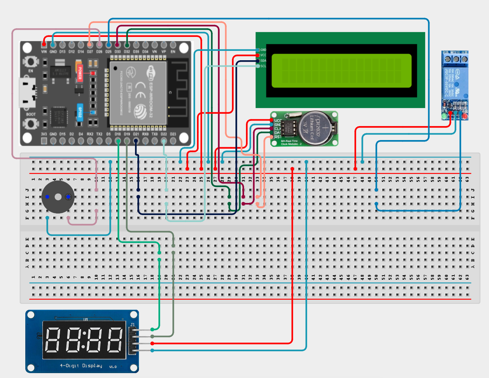

# 4.3.2. Smart Clock Schedule Alarm Controller

| **Description** | In Project 122, learners build a scheduled alarm clock using a DS1302 real-time clock, a TM1637 4-digit display module, an I2C 16x2 LCD, a 1-channel relay module, and an active buzzer. The alarm runs every day at 07:00 and activates the relay and buzzer for 60 seconds. |
|------------------|----------------------------------------------------------------|
| **Use case**     | This low-voltage classroom prototype demonstrates RTC timekeeping, scheduled output control, and displaying the current time and date. |

## Components (Things You Will Need)

|  |  |  |  |  |  |  |  | TM1637 4-digit module (additional part; photo not available) |
| --- | --- | --- | --- | --- | --- | --- | --- | --- |

The kit's 4-digit display image shows a bare 12-pin display, not a TM1637 module. This project uses a separate 4-pin TM1637 module as requested.

## Building the Circuit

Things Needed:

- ESP32 board = 1
- DS1302 RTC module with backup battery = 1
- TM1637 4-digit display module = 1
- I2C 16x2 LCD = 1
- 1-channel relay module with a documented ESP32-compatible input = 1
- 2-pin active buzzer that can operate from 3.3V and draws no more than 12mA at that voltage = 1
- Breadboard, jumper wires, and USB cable

## Mounting the Components

**Step 1:** With the ESP32 disconnected from USB, place the ESP32, DS1302 RTC, TM1637 display, I2C LCD, relay module, and buzzer on an insulated work surface. Keep the relay's load terminals disconnected during assembly and testing.



## Wiring the Circuit

**Step 2:** Connect the DS1302 RTC using its 3-wire interface. The RTC does **not** connect to the LCD's I2C bus:

- Connect RTC **VCC** to **3.3V** if supported by the module, and connect RTC **GND** to ESP32 **GND**.
- If the module requires **5V**, connect **VCC** to the ESP32 board's **5V** pin (called **VIN** on some board versions). Verify that its **DAT**, **CLK**, and **RST** signals remain at **3.3V or below**; use appropriate level shifting if necessary.
- Connect RTC **DAT** to **GPIO 32**.
- Connect RTC **CLK** to **GPIO 33**.
- Connect RTC **RST** to **GPIO 27**.
- Match the module labels exactly. These RTC signal wires are separate from the LCD's **SDA/SCL** wires.



**Step 3:** Verify the I2C LCD is safe to connect directly to the ESP32 before wiring it:

ESP32 GPIO pins use **3.3V logic** and are not 5V-tolerant. Before direct connection, verify from the exact LCD/backpack documentation that, while the LCD is powered at **5V**, its **SDA/SCL** signals never rise above **3.3V** and its I2C inputs recognize **3.3V** as HIGH. The kit's LCD documentation says its backpack pull-ups connect to 5V, so do **not** connect that version directly unless you confirm your actual module is different and 3.3V-I2C-compatible. If you cannot verify both requirements, stop and use a compatible LCD/interface or a level shifter. The LCD needs 5V power, but powering it from the ESP32's **5V/VIN** pin does not make its I2C signals safe; the kit's ESP32-DevKitC V4 labels this power pin **5V**.

- Once verified, connect LCD **VCC** to the ESP32 board's **5V** pin (called **VIN** on some board versions) and LCD **GND** to ESP32 **GND**.
- Connect LCD **SDA** to **GPIO 21 (SDA)**.
- Connect LCD **SCL** to **GPIO 22 (SCL)**.
- The DS1302 does not use either I2C line.
- The sketch expects LCD I2C address **0x27**. If the backpack uses **0x3F**, change the address in the `LiquidCrystal_I2C` declaration.



**Step 4:** Connect the TM1637 4-digit display module:

- Connect **VCC** to **3.3V** if supported by the module; otherwise follow its specified supply and logic-level requirements.
- If the module requires **5V**, connect **VCC** to the ESP32 board's **5V** pin (called **VIN** on some board versions), and verify its **CLK/DIO** pins are compatible with 3.3V ESP32 logic before connecting them.
- Connect **GND** to ESP32 **GND**.
- Connect **CLK** to **GPIO 18**.
- Connect **DIO** to **GPIO 19**.



**Step 5:** Connect the relay module's control side:

- Your relay board has **VCC**, **GND**, and **IN** control pins; it does not have a separate **JD-VCC** supply or jumper.
- Connect relay **VCC** to the ESP32 board's **5V** pin (called **VIN** on some board versions) if the module is marked for a 5V coil. Connect relay **GND** to ESP32 **GND**.
- Connect relay **IN** to **GPIO 25** only if the module accepts 3.3V ESP32 logic.
- The sketch assumes an active-low input. Confirm the module's trigger polarity before powering it; change `relayActiveLow` in the sketch if the module is active-high.
- Keep **COM**, **NO**, and **NC** disconnected for the initial test. Do not wire mains voltage on a breadboard; any mains installation must be performed by a qualified person.



**Step 6:** Connect the 2-pin active buzzer directly to the ESP32:

- Connect buzzer **positive (+)** to **GPIO 26**.
- Connect buzzer **negative (-)** to ESP32 **GND**.
- This direct connection is safe only when the buzzer operates at **3.3V** and draws **12mA or less**. The kit buzzer specification is approximately **10mA at 3.3V**; do not connect the buzzer's **5V** supply to an ESP32 GPIO.
- If your buzzer requires 5V or draws more than 12mA at 3.3V, do not connect it directly; use a transistor driver or a low-current 3.3V buzzer.



**Step 7:** Check the RTC's 3-wire connections, verified LCD logic levels, any 5V-powered modules, shared ground, and relay polarity. Leave the relay load disconnected, then connect the USB cable to the ESP32.

## Programming

**Step 1:** Open the Arduino IDE. See [Getting Started](<../../Getting Started/Arduino_IDE_Setup.md>) for setup instructions.

**Step 2:** Install **Rtc by Makuna**, **LiquidCrystal_I2C** by Frank de Brabander, and **TM1637Display** from the Arduino IDE Library Manager. Enter the following program:

```cpp
#include <Wire.h>
#include <ThreeWire.h>
#include <RtcDS1302.h>
#include <LiquidCrystal_I2C.h>
#include <TM1637Display.h>

constexpr uint8_t rtcDatPin = 32;
constexpr uint8_t rtcClkPin = 33;
constexpr uint8_t rtcRstPin = 27;
constexpr uint8_t displayClkPin = 18;
constexpr uint8_t displayDioPin = 19;
constexpr uint8_t relayPin = 25;
constexpr uint8_t buzzerDriverPin = 26;
constexpr uint8_t alarmHour = 7;
constexpr uint8_t alarmMinute = 0;
constexpr bool relayActiveLow = true;
constexpr bool setRtcToCompileTime = false;
constexpr uint32_t alarmDurationMs = 60000UL;
constexpr uint32_t buzzerToggleIntervalMs = 250UL;
constexpr uint32_t displayRefreshIntervalMs = 200UL;

ThreeWire rtcWire(rtcDatPin, rtcClkPin, rtcRstPin);
RtcDS1302<ThreeWire> rtc(rtcWire);
LiquidCrystal_I2C lcd(0x27, 16, 2);
TM1637Display clockDisplay(displayClkPin, displayDioPin);

bool alarmActive = false;
bool buzzerOn = false;
uint32_t alarmStartedAt = 0;
uint32_t lastBuzzerToggleAt = 0;
uint32_t lastDisplayUpdateAt = 0;
int32_t lastAlarmDate = -1;

void setRelay(bool on) {
  digitalWrite(relayPin, (on != relayActiveLow) ? HIGH : LOW);
}

void setBuzzer(bool on) {
  buzzerOn = on;
  digitalWrite(buzzerDriverPin, on ? HIGH : LOW);
}

void updateDisplays(const RtcDateTime &now) {
  char timeText[9];
  char dateText[11];

  snprintf(timeText, sizeof(timeText), "%02d:%02d:%02d",
           now.Hour(), now.Minute(), now.Second());
  snprintf(dateText, sizeof(dateText), "%04d-%02d-%02d",
           now.Year(), now.Month(), now.Day());

  lcd.setCursor(0, 0);
  lcd.print("Time: ");
  lcd.print(timeText);
  lcd.print(" ");
  lcd.setCursor(0, 1);
  lcd.print("Date: ");
  lcd.print(dateText);

  const int timeValue = now.Hour() * 100 + now.Minute();
  clockDisplay.showNumberDecEx(timeValue, 0x40, true, 4, 0);
}

void setup() {
  digitalWrite(relayPin, HIGH);
  pinMode(relayPin, OUTPUT);
  digitalWrite(buzzerDriverPin, LOW);
  pinMode(buzzerDriverPin, OUTPUT);

  Serial.begin(115200);
  Wire.begin(21, 22);

  lcd.init();
  lcd.backlight();
  clockDisplay.setBrightness(5);
  clockDisplay.clear();

  rtc.Begin();
  if (!rtc.IsDateTimeValid() || setRtcToCompileTime) {
    rtc.SetDateTime(RtcDateTime(__DATE__, __TIME__));
    Serial.println("RTC set to sketch compile time.");
  }
  if (!rtc.GetIsRunning()) {
    rtc.SetIsRunning(true);
  }

  setRelay(false);
  setBuzzer(false);
}

void loop() {
  const uint32_t nowMs = millis();
  const RtcDateTime now = rtc.GetDateTime();
  const int32_t today = static_cast<int32_t>(now.Year()) * 10000
                      + static_cast<int32_t>(now.Month()) * 100
                      + now.Day();

  if (!alarmActive && now.Hour() == alarmHour &&
      now.Minute() == alarmMinute && today != lastAlarmDate) {
    alarmActive = true;
    alarmStartedAt = nowMs;
    lastAlarmDate = today;
    setRelay(true);
    setBuzzer(true);
    lastBuzzerToggleAt = nowMs;
  }

  if (alarmActive && nowMs - alarmStartedAt >= alarmDurationMs) {
    alarmActive = false;
    setRelay(false);
    setBuzzer(false);
  } else if (alarmActive &&
             nowMs - lastBuzzerToggleAt >= buzzerToggleIntervalMs) {
    setBuzzer(!buzzerOn);
    lastBuzzerToggleAt = nowMs;
  }

  if (nowMs - lastDisplayUpdateAt >= displayRefreshIntervalMs) {
    lastDisplayUpdateAt = nowMs;
    updateDisplays(now);
  }

  delay(10);
}
```

**Step 3:** Save the sketch.

**Step 4:** Select the ESP32 board and its USB port in the Arduino IDE.

**Step 5:** Upload the sketch.

**Step 6:** Set and verify the clock:

- Install the DS1302 module's backup battery. To set the RTC to your computer's current local time, temporarily change `setRtcToCompileTime` to `true`, compile and upload the sketch, then change it back to `false` and upload again. The RTC keeps that time between resets.
- If the RTC reports an invalid date/time while `setRtcToCompileTime` is `false`, the sketch sets it to the date and time when it was compiled. Check the displayed time before relying on the alarm.
- The alarm time is set by `alarmHour` and `alarmMinute` near the top of the sketch. It repeats every day at **07:00** and switches the relay and buzzer off automatically after **60 seconds**.
- Confirm that the LCD shows the current date and time, the 4-digit display shows `HH:MM`, and the relay and buzzer remain off before 07:00. Keep the relay load disconnected during this test.

## Conclusion

The DS1302 keeps the time using its separate DAT/CLK/RST connections. The LCD shows the date and seconds, and the TM1637 displays hours and minutes. At 07:00 each day, the relay activates and the buzzer beeps for 60 seconds, after which both outputs turn off automatically.
