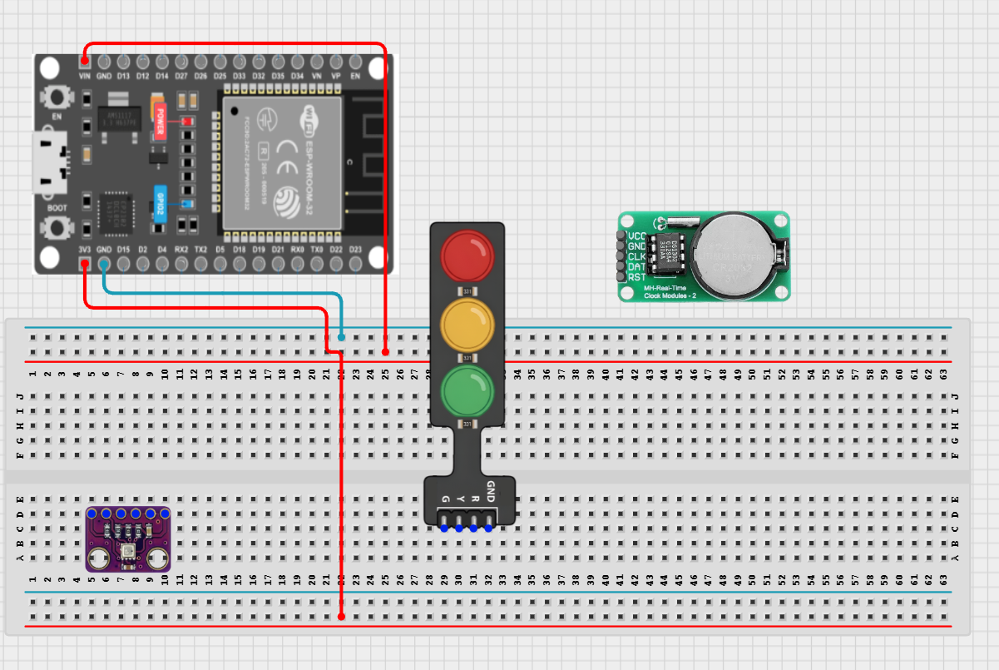
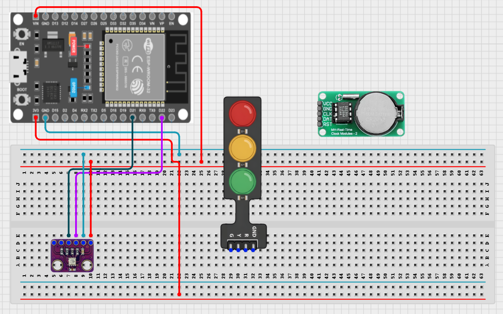
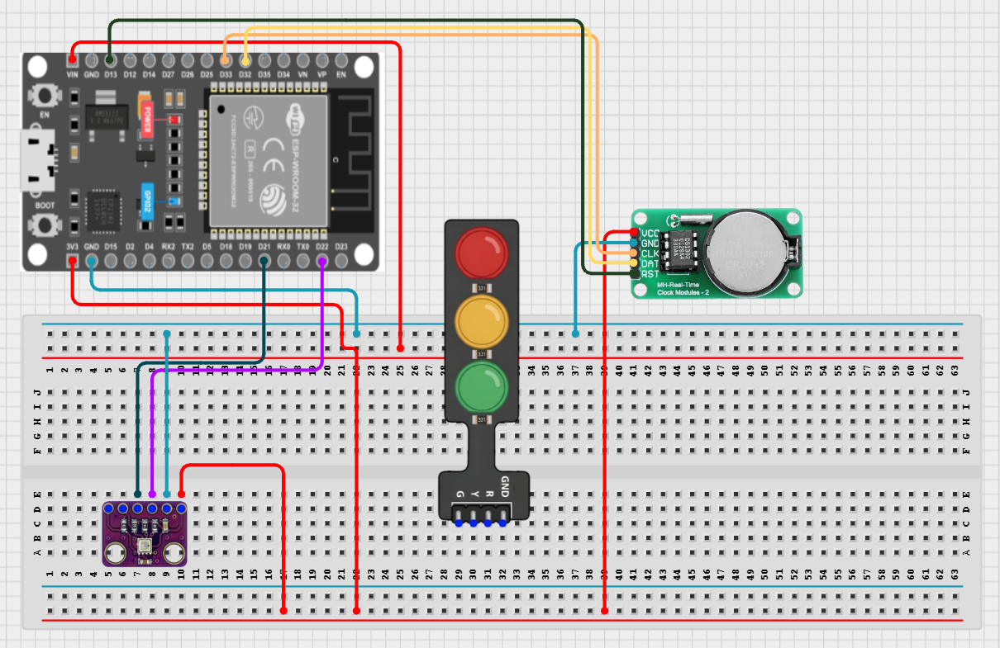
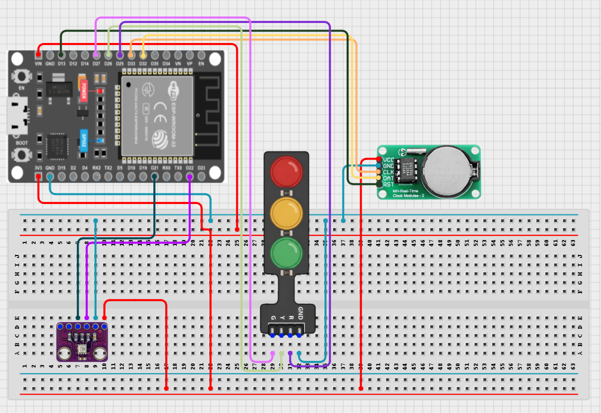

# 4.3.30. Grand Master Wireless IoT Smart City Controller

| **Description** | In Project 150, the ESP32 uses a DS1302 RTC to run a model traffic signal by time of day, reads local temperature, humidity, and pressure from a BME280, and streams status over its built-in Bluetooth Classic radio. |
|------------------|----------------------------------------------------------------------------------------------------------------------------------------------------------------------------------------------------------------|
| **Use case** | This is an educational smart-city intersection and weather telemetry demonstrator. It is not a real traffic-control, weather-warning, or municipal safety system. |

## Components (From the Kit Inventory)

|  |  |  |  |  |  |  |
| --- | --- | --- | --- | --- | --- | --- |

Things Needed:

- ESP32 board = 1
- BME280 sensor module = 1
- DS1302 RTC module with backup battery = 1
- Traffic light module = 1
- Breadboard, jumper wires, and USB cable
- Phone or other device with a Bluetooth Classic SPP terminal app

> **RTC model note:** This guide uses the DS1302 previously confirmed for your hardware. The published kit inventory lists other RTC models; check the chip/module label before wiring. This sketch is for the DS1302's three-wire interface, not a DS3231 or DS1307.
>
> The ESP32-WROOM-32D provides Bluetooth Classic, so no HC-05 is used. The relay, RFID reader, buzzer, and LCD from the original draft are not part of this design. The kit's I2C LCD has 5V pull-ups and would require an unlisted level shifter; the bare 4-digit display is also not a TM1637 module.

## Building the Circuit

> **Tip:** Use the [ESP32 Pinout Guide](../../Components/ESP32%20Pinout%20and%20Pin%20Assignment%20Guide.md) to locate the GPIO pins.

## Mounting the Components

**Step 1:** Disconnect USB. Place the ESP32, BME280, DS1302 RTC, and traffic light module on the breadboard. This is a low-voltage model; do not connect it to real traffic signals or roadway equipment.



## Wiring the Circuit

**Step 2:** Connect the BME280 sensor:

- Connect sensor **VCC** to ESP32 **3.3V**.
- Connect sensor **GND** to ESP32 **GND**.
- Connect sensor **SDA** to **GPIO 21 (SDA)**.
- Connect sensor **SCL** to **GPIO 22 (SCL)**.
- Use a breakout with I2C pull-ups at **3.3V**. Do not connect 5V pull-ups directly to the ESP32.



**Step 3:** Connect the DS1302 RTC:

- Connect RTC **VCC** to ESP32 **3.3V** if supported by your module.
- Connect RTC **GND** to ESP32 **GND**.
- Connect RTC **DAT / I/O** to **GPIO 32**.
- Connect RTC **CLK / SCLK** to **GPIO 33**.
- Connect RTC **RST / CE** to **GPIO 13**.
- The DS1302 uses a three-wire interface, not I2C. If the module requires 5V, do not connect its signal pins directly until you have verified that their voltage never exceeds 3.3V.



**Step 4:** Connect the traffic light module:

- Connect module **R** to **GPIO 25**.
- Connect module **Y** to **GPIO 26**.
- Connect module **G** to **GPIO 27**.
- Connect module **GND** to ESP32 **GND**.
- The kit traffic light module has onboard current-limiting resistors and uses 3.3V-compatible logic.



**Step 5:** Check the RTC model, BME280 supply and I2C voltage, traffic-light pin labels, and common ground. Then connect USB to the ESP32. No external load or separate power supply is used.

## Programming

**Step 1:** Open the Arduino IDE and select the ESP32 board and port. See [Getting Started](../../Getting%20Started/Arduino_IDE_Setup.md) for setup instructions.

**Step 2:** Install **Rtc by Makuna**, **Adafruit BME280**, and **Adafruit Unified Sensor** through the Arduino IDE Library Manager. `BluetoothSerial` is included with the ESP32 Arduino core. Enter this sketch:

```cpp
#include <Wire.h>
#include <ThreeWire.h>
#include <RtcDS1302.h>
#include <Adafruit_Sensor.h>
#include <Adafruit_BME280.h>
#include <BluetoothSerial.h>
#include <math.h>

enum class SignalPhase : uint8_t {
  Red,
  RedYellow,
  Green,
  Yellow,
  NightYellowOn,
  NightYellowOff
};

constexpr uint8_t sdaPin = 21;
constexpr uint8_t sclPin = 22;
constexpr uint8_t rtcDatPin = 32;
constexpr uint8_t rtcClkPin = 33;
constexpr uint8_t rtcRstPin = 13;
constexpr uint8_t redPin = 25;
constexpr uint8_t yellowPin = 26;
constexpr uint8_t greenPin = 27;
constexpr bool setRtcToCompileTime = false;
constexpr uint32_t telemetryIntervalMs = 5000;

constexpr uint32_t redDurationMs = 5000;
constexpr uint32_t redYellowDurationMs = 1000;
constexpr uint32_t greenDurationMs = 5000;
constexpr uint32_t yellowDurationMs = 2000;
constexpr uint32_t nightFlashDurationMs = 500;

ThreeWire rtcWire(rtcDatPin, rtcClkPin, rtcRstPin);
RtcDS1302<ThreeWire> rtc(rtcWire);
Adafruit_BME280 bme;
BluetoothSerial SerialBT;

SignalPhase currentPhase = SignalPhase::Red;
bool signalModeInitialized = false;
bool nightMode = false;
uint32_t phaseStartedAt = 0;
uint32_t lastTelemetryAt = 0;

void applySignalPhase(SignalPhase phase) {
  digitalWrite(redPin, phase == SignalPhase::Red ||
                       phase == SignalPhase::RedYellow ? HIGH : LOW);
  digitalWrite(yellowPin, phase == SignalPhase::RedYellow ||
                          phase == SignalPhase::Yellow ||
                          phase == SignalPhase::NightYellowOn ? HIGH : LOW);
  digitalWrite(greenPin, phase == SignalPhase::Green ? HIGH : LOW);
}

const char* phaseName(SignalPhase phase) {
  switch (phase) {
    case SignalPhase::Red: return "RED";
    case SignalPhase::RedYellow: return "RED + YELLOW";
    case SignalPhase::Green: return "GREEN";
    case SignalPhase::Yellow: return "YELLOW";
    case SignalPhase::NightYellowOn: return "NIGHT FLASH ON";
    case SignalPhase::NightYellowOff: return "NIGHT FLASH OFF";
  }
  return "UNKNOWN";
}

uint32_t phaseDuration(SignalPhase phase) {
  switch (phase) {
    case SignalPhase::Red: return redDurationMs;
    case SignalPhase::RedYellow: return redYellowDurationMs;
    case SignalPhase::Green: return greenDurationMs;
    case SignalPhase::Yellow: return yellowDurationMs;
    case SignalPhase::NightYellowOn:
    case SignalPhase::NightYellowOff:
      return nightFlashDurationMs;
  }
  return nightFlashDurationMs;
}

SignalPhase nextDayPhase(SignalPhase phase) {
  switch (phase) {
    case SignalPhase::Red: return SignalPhase::RedYellow;
    case SignalPhase::RedYellow: return SignalPhase::Green;
    case SignalPhase::Green: return SignalPhase::Yellow;
    case SignalPhase::Yellow: return SignalPhase::Red;
    case SignalPhase::NightYellowOn:
    case SignalPhase::NightYellowOff:
      return SignalPhase::Red;
  }
  return SignalPhase::Red;
}

void reportSignalPhase() {
  Serial.print("Traffic signal: ");
  Serial.println(phaseName(currentPhase));
  SerialBT.print("Traffic signal: ");
  SerialBT.println(phaseName(currentPhase));
}

bool updateSignal(const RtcDateTime& now, uint32_t nowMs) {
  const bool shouldBeNight = now.Hour() >= 22 || now.Hour() < 6;

  if (!signalModeInitialized || shouldBeNight != nightMode) {
    signalModeInitialized = true;
    nightMode = shouldBeNight;
    currentPhase = nightMode ? SignalPhase::NightYellowOn : SignalPhase::Red;
    phaseStartedAt = nowMs;
    applySignalPhase(currentPhase);
    return true;
  }

  if (nowMs - phaseStartedAt < phaseDuration(currentPhase)) {
    return false;
  }

  phaseStartedAt = nowMs;
  if (nightMode) {
    currentPhase = currentPhase == SignalPhase::NightYellowOn
        ? SignalPhase::NightYellowOff
        : SignalPhase::NightYellowOn;
  } else {
    currentPhase = nextDayPhase(currentPhase);
  }
  applySignalPhase(currentPhase);
  return true;
}

void printTwoDigits(Print& output, uint8_t value) {
  if (value < 10) {
    output.print('0');
  }
  output.print(value);
}

void printTelemetry(Print& output, const RtcDateTime& now,
                    float temperatureC, float humidity,
                    float pressureHpa) {
  output.print(now.Year());
  output.print('-');
  printTwoDigits(output, now.Month());
  output.print('-');
  printTwoDigits(output, now.Day());
  output.print(' ');
  printTwoDigits(output, now.Hour());
  output.print(':');
  printTwoDigits(output, now.Minute());
  output.print(':');
  printTwoDigits(output, now.Second());
  output.print(" | Mode: ");
  output.print(nightMode ? "NIGHT" : "DAY");
  output.print(" | Signal: ");
  output.print(phaseName(currentPhase));
  output.print(" | Temperature: ");
  output.print(temperatureC, 1);
  output.print(" C | Humidity: ");
  output.print(humidity, 1);
  output.print(" % | Pressure: ");
  output.print(pressureHpa, 1);
  output.println(" hPa");
}

void haltWithRed(const char* message) {
  digitalWrite(redPin, HIGH);
  digitalWrite(yellowPin, LOW);
  digitalWrite(greenPin, LOW);
  Serial.println(message);
  while (true) {
    delay(1000);
  }
}

void setup() {
  Serial.begin(115200);

  pinMode(redPin, OUTPUT);
  pinMode(yellowPin, OUTPUT);
  pinMode(greenPin, OUTPUT);
  applySignalPhase(SignalPhase::Red);

  Wire.begin(sdaPin, sclPin);
  rtc.Begin();
  rtc.SetIsWriteProtected(false);
  if (!rtc.GetIsRunning()) {
    rtc.SetIsRunning(true);
  }
  if (setRtcToCompileTime || !rtc.IsDateTimeValid()) {
    rtc.SetDateTime(RtcDateTime(__DATE__, __TIME__));
    Serial.println("RTC set to sketch compile time.");
  }
  if (!rtc.IsDateTimeValid()) {
    haltWithRed("RTC time invalid. Check the DS1302 wiring and backup battery.");
  }

  if (!bme.begin(0x76, &Wire) && !bme.begin(0x77, &Wire)) {
    haltWithRed("BME280 not found at I2C address 0x76 or 0x77.");
  }

  if (!SerialBT.begin("STEMAIDE Smart City")) {
    haltWithRed("Bluetooth Classic startup failed.");
  }

  Serial.println("Smart city controller ready. Bluetooth Classic SPP telemetry starts shortly.");
  SerialBT.println("Smart city controller ready.");
}

void loop() {
  const uint32_t nowMs = millis();
  const RtcDateTime now = rtc.GetDateTime();

  if (updateSignal(now, nowMs)) {
    reportSignalPhase();
  }

  if (nowMs - lastTelemetryAt >= telemetryIntervalMs) {
    lastTelemetryAt = nowMs;

    const float temperatureC = bme.readTemperature();
    const float humidity = bme.readHumidity();
    const float pressureHpa = bme.readPressure() / 100.0F;

    if (isnan(temperatureC) || isnan(humidity) ||
        isnan(pressureHpa) || pressureHpa <= 0.0F) {
      Serial.println("BME280 returned an invalid reading; telemetry sample skipped.");
      SerialBT.println("BME280 returned an invalid reading; sample skipped.");
    } else {
      printTelemetry(Serial, now, temperatureC, humidity, pressureHpa);
      printTelemetry(SerialBT, now, temperatureC, humidity, pressureHpa);
    }
  }

  delay(10);
}
```

**Step 3:** Save and upload the sketch. Install the RTC backup battery. To set the DS1302 to the computer's current time, temporarily change `setRtcToCompileTime` to `true`, upload, then set it back to `false` and upload again.

**Step 4:** Open the Serial Monitor at **115200 baud** and verify the RTC time, traffic phase, and BME280 readings. The model runs a red → red/yellow → green → yellow cycle from **06:00 to 21:59**. From **22:00 to 05:59**, it flashes yellow.

**Step 5:** Pair a phone or other device that supports **Bluetooth Classic Serial Port Profile (SPP)** with **STEMAIDE Smart City**, then connect using a Bluetooth terminal app. A BLE-only terminal app will not work with `BluetoothSerial`. The ESP32 sends time, signal phase, temperature, humidity, and pressure every **5 seconds**. The signal schedule is a fixed demonstration; BME280 readings are telemetry and do not control the lights.

## Conclusion

This capstone combines RTC-controlled day/night traffic-signal phases with BME280 weather readings sent over the ESP32's built-in Bluetooth Classic connection. It uses only a model traffic light and is not suitable for controlling real traffic or making safety decisions.
