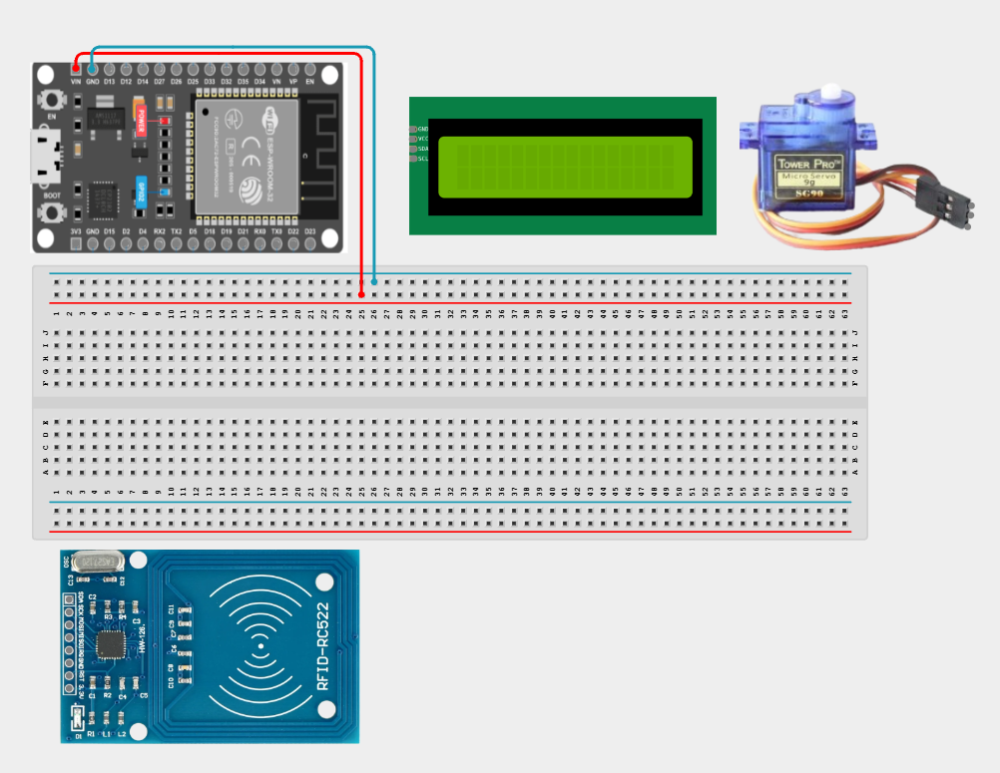
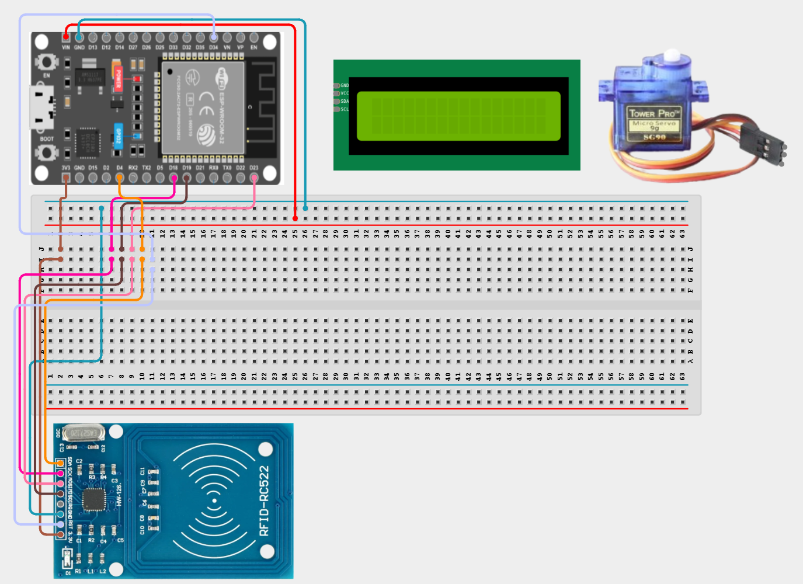
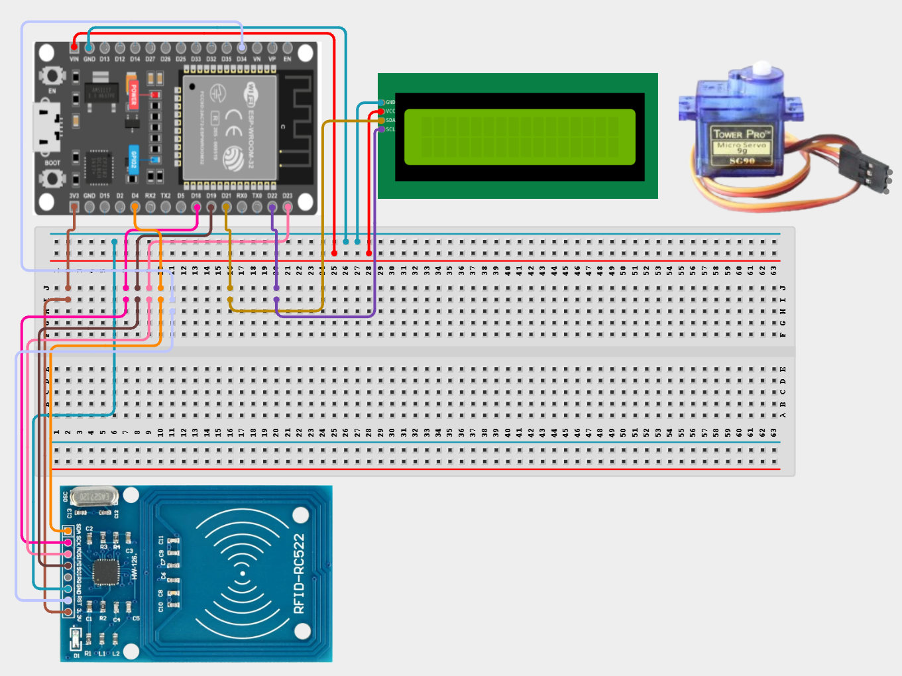
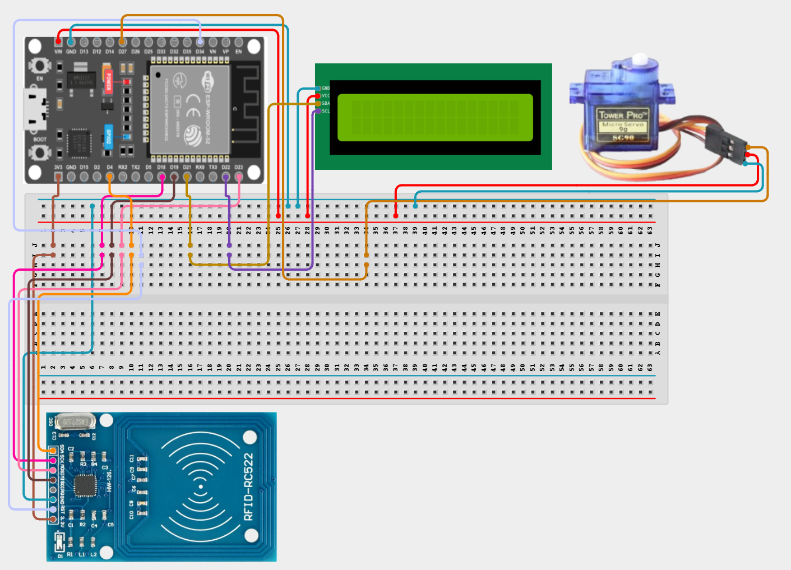

# 4.3.3. RFID Automated Garage Barrier System

| **Description** | In Project 123, learners build an RFID-controlled garage barrier using an RC522 reader, an SG90 servo, and an I2C 16x2 LCD. An authorized card opens the barrier briefly; the LCD reports whether access was granted. |
|------------------|----------------------------------------------------------------|
| **Use case**     | This project demonstrates SPI-based RFID access control, servo positioning, and local status display in a low-voltage prototype. |

## Components (Things You will need)

|  |  |  |  |  |  |  |
| --- | --- | --- | --- | --- | --- | --- |

## Building the circuit

> **Tip:** Use the [ESP32 Pinout Guide](../../Components/ESP32%20Pinout%20and%20Pin%20Assignment%20Guide.md) to locate the correct GPIO pins.


Things Needed:

- ESP32 board Core Board = 1

- RFID RC522 = 1

- Servo Motor SG90 = 1

- IIC 1602 LCD = 1

- USB Cable & Jumper Wires = 1

- Bread Board

- Regulated external **5V** supply for the servo, rated for at least **1A** (not included in the ESP32 USB cable)


## Mounting the components

**Step 1:** With the ESP32 disconnected from USB, place the ESP32, RC522 reader, SG90 servo, and I2C LCD on an insulated surface. Connect the barrier arm securely and keep its movement clear.



## Wiring the circuit

**Step 2:** Connect the RC522 RFID reader:

- Connect **VCC** to **3.3V** on the ESP32 board; do not use 5V.
- Connect **GND** to a **GND** pin on the ESP32 board.
- Connect RC522 **SCK** to **GPIO 18 (SCK)**.
- Connect RC522 **MISO** to **GPIO 19 (MISO)**.
- Connect RC522 **MOSI** to **GPIO 23 (MOSI)**.
- Connect RC522 **SDA/SS** to **GPIO 4 (SS)**. On the RC522, **SDA/SS is the SPI chip-select pin, not I2C SDA**.
- Connect RC522 **RST** to **GPIO 14 (RST)**.
- Leave **IRQ** unconnected.



**Step 3:** Verify the I2C LCD is safe to connect directly to the ESP32 before wiring it:

ESP32 GPIO pins use **3.3V logic** and are not 5V-tolerant. Before direct connection, verify from the exact LCD/backpack documentation that, while the LCD is powered at **5V**, its **SDA/SCL** signals never rise above **3.3V** and its I2C inputs recognize **3.3V** as HIGH. The kit's LCD documentation says its backpack pull-ups connect to 5V, so do **not** connect that version directly unless you confirm your actual module is different and 3.3V-I2C-compatible. If you cannot verify both requirements, stop and use a compatible LCD/interface or a level shifter.

- Once verified, connect LCD **VCC** to the ESP32 board's **5V** pin (called **VIN** on some board versions) and LCD **GND** to ESP32 **GND**.
- Connect LCD **SDA** to **GPIO 21 (SDA)**.
- Connect LCD **SCL** to **GPIO 22 (SCL)**.
- The sketch expects LCD I2C address **0x27**. If the backpack uses **0x3F**, change the address in the `LiquidCrystal_I2C` declaration.



**Step 4:** Connect the SG90 servo:

- Connect the servo **signal** lead (orange/yellow) to **GPIO 27**.
- Connect servo **V+** (red) to the positive output of a separate regulated **5V** supply rated for at least **1A**.
- Connect servo **GND** (brown/black) to the external supply's **GND**.
- Connect the external supply's **GND** to ESP32 **GND** so the signal has a common reference.
- Do not power the servo from an ESP32 GPIO, the **3.3V** pin, or the ESP32 **5V/VIN** pin; the servo can draw up to about **650mA** at stall.



**Step 5:** Connect the USB programming cable:

- Connect USB only after checking the RC522 pin mapping, LCD logic-level compatibility, and the servo's separate power and common ground.

## PROGRAMMING

**Step 1:** Open your Arduino IDE. See [Getting Started](<../../Getting Started/Arduino_IDE_Setup.md>) for setup instructions.

**Step 2:** Install the **MFRC522**, **ESP32Servo**, and **LiquidCrystal_I2C** libraries from the Arduino IDE Library Manager. Enter the following program:

```cpp
#include <SPI.h>
#include <MFRC522.h>
#include <ESP32Servo.h>
#include <Wire.h> 
#include <LiquidCrystal_I2C.h>

// Pin Definitions
#define SS_PIN 4
#define RST_PIN 14
#define SERVO_PIN 27

MFRC522 mfrc522(SS_PIN, RST_PIN);
Servo garageServo;
LiquidCrystal_I2C lcd(0x27, 16, 2); // Verify your I2C address (often 0x27 or 0x3F)

void setup() {
  Serial.begin(9600);
  SPI.begin(18, 19, 23, SS_PIN);
  mfrc522.PCD_Init();
  garageServo.attach(SERVO_PIN);
  garageServo.write(0); // Initial barrier closed position

  lcd.init();
  lcd.backlight();
  lcd.setCursor(0, 0);
  lcd.print("Garage System");
  lcd.setCursor(0, 1);
  lcd.print("Ready...");
  
  Serial.println("Project 123: RFID Automated Garage Barrier System Online");
}

void loop() {
  // Look for new cards
  if (!mfrc522.PICC_IsNewCardPresent()) return;
  if (!mfrc522.PICC_ReadCardSerial()) return;

  // Show UID on Serial Monitor
  Serial.print("UID tag :");
  String content= "";
  for (byte i = 0; i < mfrc522.uid.size; i++) {
     content.concat(String(mfrc522.uid.uidByte[i] < 0x10 ? " 0" : " "));
     content.concat(String(mfrc522.uid.uidByte[i], HEX));
  }
  content.toUpperCase();

  // Authentication Logic
  if (content.substring(1) == "YOUR_TAG_UID_HERE") { // Replace with your tag's UID
    lcd.clear();
    lcd.print("Access Granted");
    garageServo.write(90); // Open barrier
    delay(3000); // Keep open for 3 seconds
    garageServo.write(0);  // Close barrier
    lcd.clear();
    lcd.print("Garage System");
  } else {
    lcd.clear();
    lcd.print("Access Denied");
    delay(2000);
    lcd.clear();
    lcd.print("Garage System");
  }
}
```

**Step 3:** Save the sketch.

**Step 4:** Select the ESP32 board and its USB port in the Arduino IDE.

**Step 5:** Upload the sketch.

## CONCLUSION

An authorized RFID card opens the SG90 barrier for three seconds. The LCD displays whether access is granted or denied.
