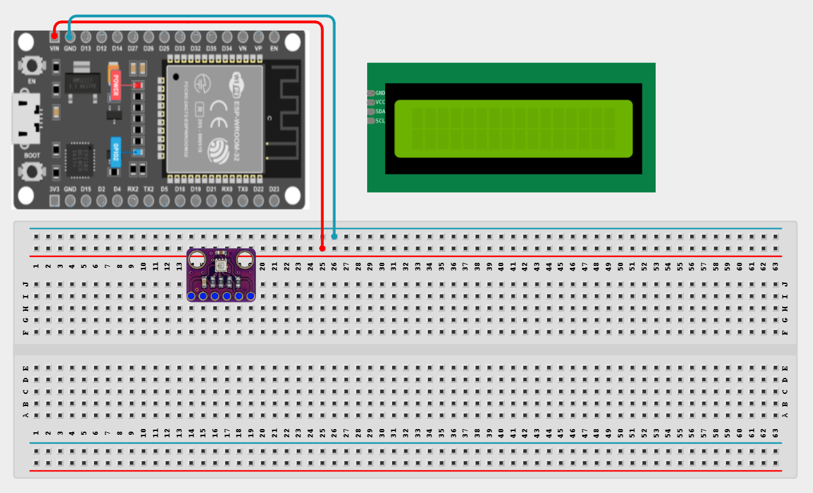
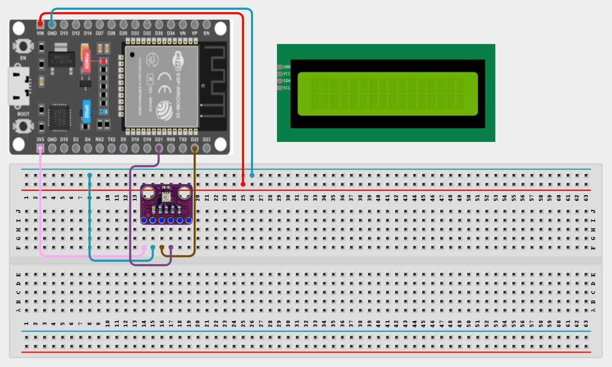
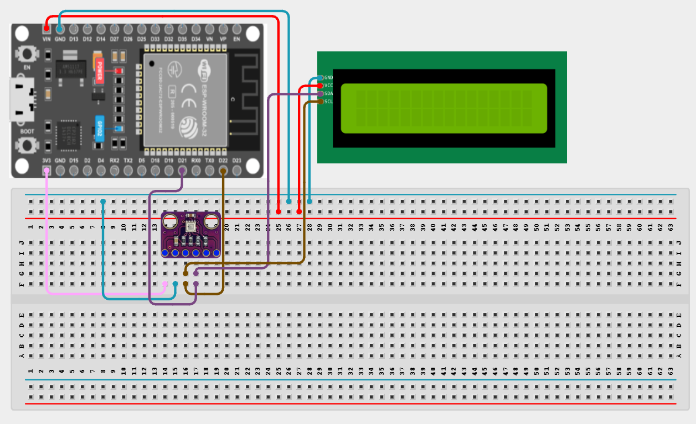

# 4.3.4. Bluetooth Wireless Weather Telemetry Node

| **Description** | In Project 124, learners build a wireless weather telemetry node using the ESP32's built-in Bluetooth, a BME280 sensor, and an I2C 16x2 LCD. The ESP32 displays temperature, humidity, and pressure locally and sends the readings to a paired Bluetooth Classic terminal. |
|------------------|----------------------------------------------------------------|
| **Use case**     | This project demonstrates local weather measurements and short-range wireless telemetry for classroom and environmental-monitoring prototypes. |

## Components (Things You will need)

|  |  |  |  |  |  |
| --- | --- | --- | --- | --- | --- |

## Building the circuit

> **Tip:** See the [ESP32 Pinout Guide](../../Components/ESP32%20Pinout%20and%20Pin%20Assignment%20Guide.md) to locate the correct GPIO pins.


Things Needed:

- ESP32 board Core Board = 1

- BME280 = 1

- IIC 1602 LCD = 1

- USB Cable & Jumper Wires = 1

- Bread Board


## Mounting the components

**Step 1:** Place the ESP32, BME280 sensor, and I2C LCD on an insulated surface.



## Wiring the circuit

**Step 2:** Connect the BME280 sensor:

- Connect **VCC** to **3.3V** on the ESP32 board.
- Connect **GND** to a **GND** pin on the ESP32 board.
- Connect **SDA** to **GPIO 21 (SDA)**.
- Connect **SCL** to **GPIO 22 (SCL)**, the usual ESP32 `Wire` defaults; confirm board/core settings.
- Use a BME280 breakout whose I2C pull-ups are at **3.3V**; do not connect SDA/SCL directly if the breakout pulls them up to **5V**.



**Step 3:** Verify the I2C LCD is safe to connect directly to the ESP32 before wiring it:

ESP32 GPIO pins use **3.3V logic** and are not 5V-tolerant. Before direct connection, verify from the exact LCD/backpack documentation that, while the LCD is powered at **5V**, its **SDA/SCL** signals never rise above **3.3V** and its I2C inputs recognize **3.3V** as HIGH. The kit's LCD documentation says its backpack pull-ups connect to 5V, so do **not** connect that version directly unless you confirm your actual module is different and 3.3V-I2C-compatible. If you cannot verify both requirements, do not connect it directly; use a compatible LCD/interface. The ESP32's **5V/VIN** pin supplies power only; it does not make 5V I2C signals safe. The kit's ESP32-DevKitC V4 labels this power pin **5V**.

- Once verified, connect LCD **VCC** to the ESP32 board's **5V** pin (called **VIN** on some board versions) and LCD **GND** to ESP32 **GND**.
- Connect LCD **SDA** to **GPIO 21 (SDA)**.
- Connect LCD **SCL** to **GPIO 22 (SCL)**.
- The LCD and BME280 share the same **GPIO 21/22** I2C bus, and both modules must be compatible with 3.3V I2C signals.
- The sketch expects LCD I2C address **0x27**. If the backpack uses **0x3F**, change the address in the `LiquidCrystal_I2C` declaration.



**Step 4:** Connect the USB programming cable:

- Verify common ground and logic levels, then connect USB to the ESP32.

## PROGRAMMING

**Step 1:** Open your Arduino IDE. See [Getting Started](<../../Getting Started/Arduino_IDE_Setup.md>) for setup instructions.

**Step 2:** Install **Adafruit BME280**, **Adafruit Unified Sensor**, and **LiquidCrystal_I2C** from the Arduino IDE Library Manager. `BluetoothSerial` is included with the ESP32 Arduino core. Enter the following program:

```cpp
#include <Wire.h>
#include <Adafruit_Sensor.h>
#include <Adafruit_BME280.h>
#include <LiquidCrystal_I2C.h>
#include <BluetoothSerial.h>

BluetoothSerial SerialBT;

LiquidCrystal_I2C lcd(0x27, 16, 2);
Adafruit_BME280 bme;

void setup() {
  Serial.begin(115200);
  Wire.begin(21, 22);

  lcd.init();
  lcd.backlight();
  lcd.setCursor(0, 0);
  lcd.print("Weather Node");

  if (!SerialBT.begin("ESP32 Weather Node")) {
    Serial.println("Bluetooth initialization failed.");
    lcd.clear();
    lcd.print("Bluetooth Error");
    while (true) delay(1000);
  }

  if (!bme.begin(0x76, &Wire) && !bme.begin(0x77, &Wire)) {
    lcd.clear();
    lcd.print("BME280 Error");
    Serial.println("BME280 not found at I2C address 0x76 or 0x77.");
    while (true) delay(1000);
  }

  delay(2000);
  lcd.clear();
}

void loop() {

  float temp = bme.readTemperature();
  float hum = bme.readHumidity();
  float pres = bme.readPressure() / 100.0F;

  lcd.clear();
  lcd.setCursor(0, 0);
  lcd.print("T:");
  lcd.print(temp,1);
  lcd.print((char)223);
  lcd.print("C");

  lcd.setCursor(9, 0);
  lcd.print("H:");
  lcd.print(hum,0);
  lcd.print("%");

  lcd.setCursor(0, 1);
  lcd.print("P:");
  lcd.print(pres,1);
  lcd.print("hPa");

  SerialBT.println("====== WEATHER DATA ======");
  SerialBT.print("Temperature: ");
  SerialBT.print(temp, 1);
  SerialBT.println(" C");

  SerialBT.print("Humidity: ");
  SerialBT.print(hum, 1);
  SerialBT.println(" %");

  SerialBT.print("Pressure: ");
  SerialBT.print(pres, 1);
  SerialBT.println(" hPa");

  SerialBT.println();

  Serial.print("Temp: ");
  Serial.print(temp, 1);
  Serial.print(" C  ");

  Serial.print("Humidity: ");
  Serial.print(hum, 1);
  Serial.print("%  ");

  Serial.print("Pressure: ");
  Serial.print(pres, 1);
  Serial.println(" hPa");

  delay(2000);
}
```

**Step 3:** Save the sketch.

**Step 4:** Select an ESP32 board with Bluetooth Classic support and its USB port in the Arduino IDE.

**Step 5:** Upload the sketch.

**Step 6:** Pair a phone and read the weather telemetry:

- Wait for the upload to finish and the ESP32 to restart.
- Use a phone and terminal app that support **Bluetooth Classic Serial Port Profile (SPP)**; a BLE-only app or BLE-only ESP32 board will not work with `BluetoothSerial`.
- In the phone's Bluetooth settings or the terminal app, scan for and select **ESP32 Weather Node**.
- Connect using the terminal app's **Bluetooth Classic / SPP** option. No external Bluetooth module or signal wires are needed.
- The ESP32 sends temperature, humidity, and pressure readings every two seconds. Check the LCD for local readings and the terminal for the wireless report.
- If the device is not listed, confirm that both the ESP32 board and phone/app support Bluetooth Classic SPP.

## CONCLUSION

The BME280 measures temperature, humidity, and pressure. The LCD shows the readings locally, and the ESP32's built-in Bluetooth sends them to a connected Bluetooth Classic SPP terminal every two seconds.
