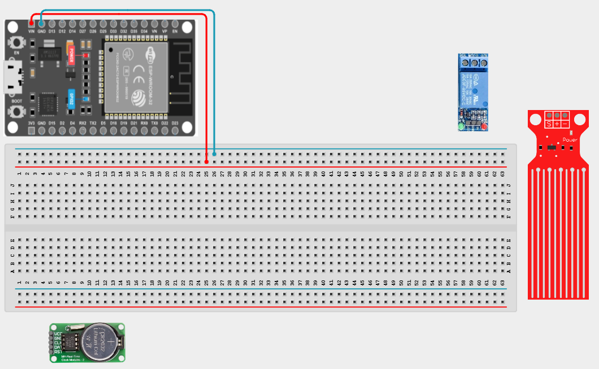
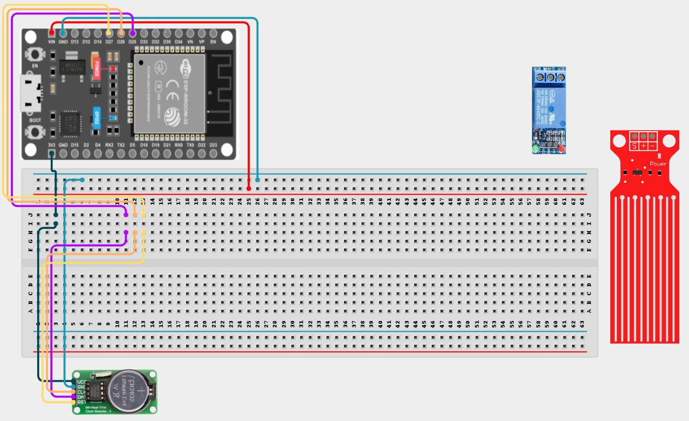
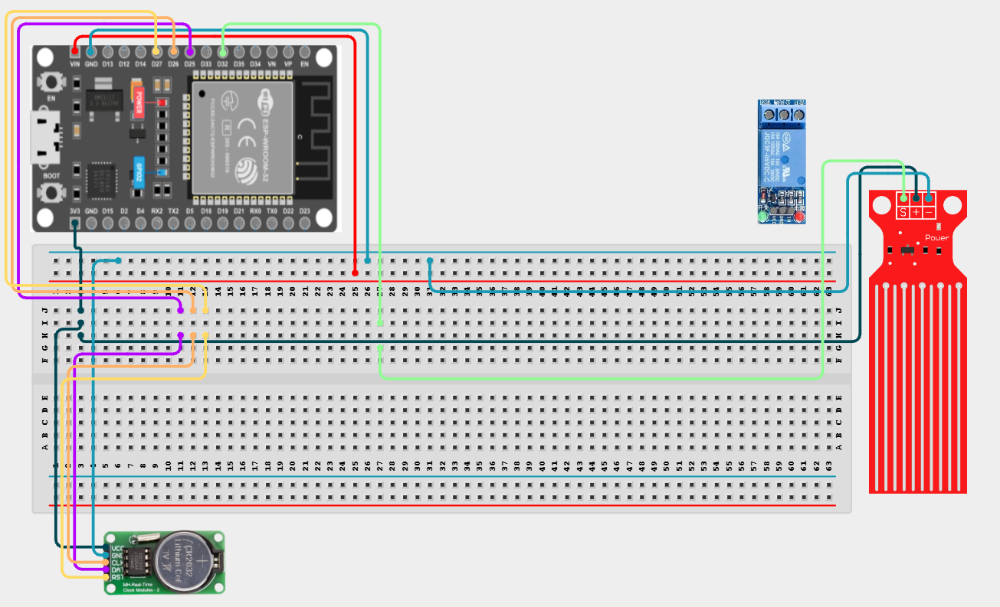
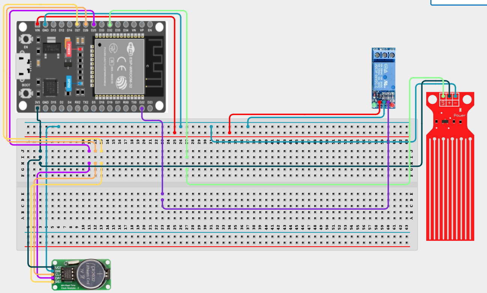

# 4.3.5. Scheduled Irrigation System with Rain Lockout

| **Description** | In Project 125, learners build a scheduled irrigation controller using a DS1302 RTC, a water/rain sensor, and a 1-channel relay. The relay runs a low-voltage water pump at the scheduled time only when the sensor indicates dry conditions. |
|------------------|----------------------------------------------------------------|
| **Use case**     | This project demonstrates RTC scheduling, analog rain detection, and relay control for a low-voltage irrigation prototype. |

## Components (Things You will need)

|  |  |  |  |  |  |  |
| --- | --- | --- | --- | --- | --- | --- |

## Building the circuit

> **Tip:** Use the [ESP32 Pinout Guide](../../Components/ESP32%20Pinout%20and%20Pin%20Assignment%20Guide.md) to locate the correct GPIO pins.


Things Needed:

- ESP32 board = 1
- DS1302 RTC module with backup battery = 1
- Water test/rain sensor module = 1
- 1-channel relay module = 1
- Low-voltage DC water pump and matching external supply = 1
- Breadboard, jumper wires, and USB cable


## Mounting the components

**Step 1:** With the ESP32 disconnected from USB, place the ESP32, DS1302 RTC, water/rain sensor, and relay on an insulated surface. Keep the pump and its external supply disconnected while assembling the control circuit.



## Wiring the circuit

**Step 2:** Connect the DS1302 RTC:

- Connect RTC **VCC** to **3.3V** if supported by the module, and connect RTC **GND** to ESP32 **GND**.
- If the module requires **5V**, connect **VCC** to the ESP32 board's **5V** pin (called **VIN** on some board versions). Verify that **DAT**, **CLK**, and **RST** signals remain at **3.3V or below** before connecting them directly; otherwise, do not connect them directly to the ESP32.
- Connect RTC **DAT** to **GPIO 25**.
- Connect RTC **CLK** to **GPIO 26**.
- Connect RTC **RST** to **GPIO 27**.
- Match the module labels exactly. The DS1302 uses a 3-wire interface, not I2C.



**Step 3:** Connect the water/rain sensor:

- Connect sensor **VCC** to ESP32 **3.3V**.
- Connect sensor **GND** to ESP32 **GND**.
- Connect sensor **S/SIG** to **GPIO 32 (ADC1)**.
- The sensor output must stay between **0V and 3.3V**. Calibrate the code's rain threshold by reading the sensor while dry and wet.



**Step 4:** Connect the relay module:

- The kit's relay module has **VCC**, **GND**, and **IN** control pins. If it is marked for a **5V coil**, connect **VCC** to the ESP32 board's **5V** pin (called **VIN** on some board versions).
- Connect relay **GND** to ESP32 **GND**.
- Connect relay **IN** to **GPIO 22** only if the module accepts 3.3V ESP32 logic. The sketch assumes an active-low input; confirm the module's trigger polarity and set `relayActiveLow` to `false` if it is active-high.
- Use a low-voltage DC pump with a separate supply rated for the pump. For normally-off operation, connect the pump supply **+** to relay **COM**, relay **NO** to pump **+**, and pump **-** to the pump supply **-**.
- Keep the pump supply disconnected during initial testing. Do not use mains voltage or place mains wiring on a breadboard.



**Step 5:** Connect the USB programming cable:

- Check the RTC pins, sensor output voltage, relay polarity, and pump wiring. Keep the pump's external supply disconnected until the sketch is uploaded and the control side has been tested.

## PROGRAMMING

**Step 1:** Open your Arduino IDE. See [Getting Started](<../../Getting Started/Arduino_IDE_Setup.md>) for setup instructions.

**Step 2:** Install **Rtc by Makuna** from the Arduino IDE Library Manager, then enter this program. It schedules up to one minute of watering at **08:00** each day, unless the sensor detects rain. Rain detected during watering stops the pump.

```cpp
#include <ThreeWire.h>
#include <RtcDS1302.h>

constexpr uint8_t rtcDatPin = 25;
constexpr uint8_t rtcClkPin = 26;
constexpr uint8_t rtcRstPin = 27;
constexpr uint8_t rainSensorPin = 32;
constexpr uint8_t relayPin = 22;
constexpr uint16_t rainThreshold = 500;
constexpr uint8_t wateringHour = 8;
constexpr uint8_t wateringMinute = 0;
constexpr bool relayActiveLow = true;
constexpr bool setRtcToCompileTime = false;
constexpr uint32_t wateringDurationMs = 60000UL;

ThreeWire rtcWire(rtcDatPin, rtcClkPin, rtcRstPin);
RtcDS1302<ThreeWire> rtc(rtcWire);

bool watering = false;
uint32_t wateringStartedAt = 0;
int32_t lastScheduledDate = -1;

void setPump(bool on) {
  digitalWrite(relayPin, (on != relayActiveLow) ? HIGH : LOW);
}

void setup() {
  Serial.begin(115200);
  digitalWrite(relayPin, HIGH);
  pinMode(relayPin, OUTPUT);
  setPump(false);

  analogSetAttenuation(ADC_11db);

  rtc.Begin();
  if (!rtc.IsDateTimeValid() || setRtcToCompileTime) {
    rtc.SetDateTime(RtcDateTime(__DATE__, __TIME__));
    Serial.println("RTC set to sketch compile time.");
  }
  if (!rtc.GetIsRunning()) {
    rtc.SetIsRunning(true);
  }
}

void loop() {
  const uint32_t nowMs = millis();
  const RtcDateTime now = rtc.GetDateTime();
  const int rainValue = analogRead(rainSensorPin);
  const bool isRaining = rainValue >= rainThreshold;
  const int32_t today = static_cast<int32_t>(now.Year()) * 10000
                      + static_cast<int32_t>(now.Month()) * 100
                      + now.Day();

  if (!watering && today != lastScheduledDate &&
      now.Hour() == wateringHour && now.Minute() == wateringMinute) {
    lastScheduledDate = today;
    if (isRaining) {
      Serial.println("Irrigation skipped: rain detected.");
    } else {
      watering = true;
      wateringStartedAt = nowMs;
      setPump(true);
      Serial.println("Irrigation started.");
    }
  }

  if (watering &&
      (isRaining || nowMs - wateringStartedAt >= wateringDurationMs)) {
    watering = false;
    setPump(false);
    Serial.println(isRaining ? "Irrigation stopped: rain detected."
                             : "Irrigation complete.");
  }

  Serial.print("Time: ");
  Serial.print(now.Hour());
  Serial.print(':');
  Serial.print(now.Minute());
  Serial.print(':');
  Serial.print(now.Second());
  Serial.print(" | Rain sensor: ");
  Serial.println(rainValue);

  delay(1000);
}
```

**Step 3:** Save the sketch.

**Step 4:** Select the ESP32 board and its USB port in the Arduino IDE.

**Step 5:** Upload the sketch.

**Step 6:** Set the RTC and calibrate the rain threshold:

- Install the RTC backup battery.
- To set the RTC to the computer's current time, temporarily change `setRtcToCompileTime` to `true`, upload the sketch, then change it back to `false` and upload again.
- With the pump supply disconnected, observe the rain sensor reading in the Serial Monitor while the sensor is dry and wet. Adjust `rainThreshold` so wet readings are at or above the threshold; the sensor's output increases when wet.
- Verify that the relay remains off outside the schedule and that rain prevents or stops watering. Keep the pump disconnected until this control test is complete.

## CONCLUSION

At **08:00** each day, the controller runs a low-voltage pump for up to **60 seconds** if the sensor reports dry conditions. It skips watering if rain is detected at the scheduled time and stops an active watering cycle if rain begins.
