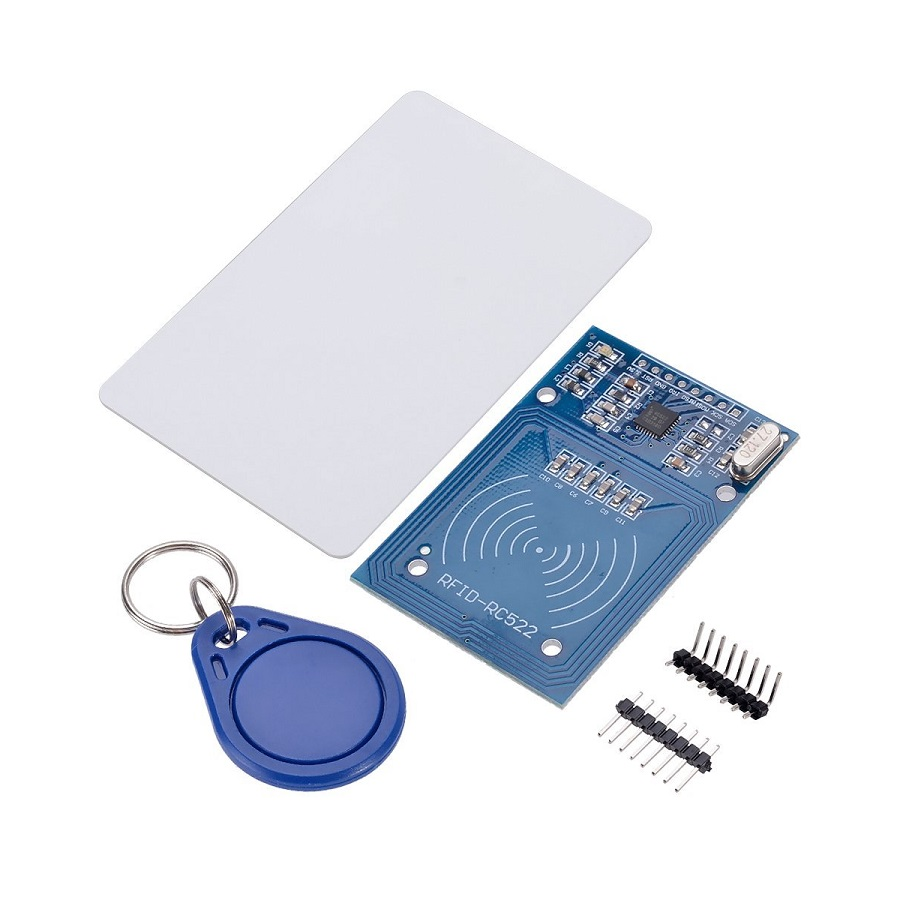
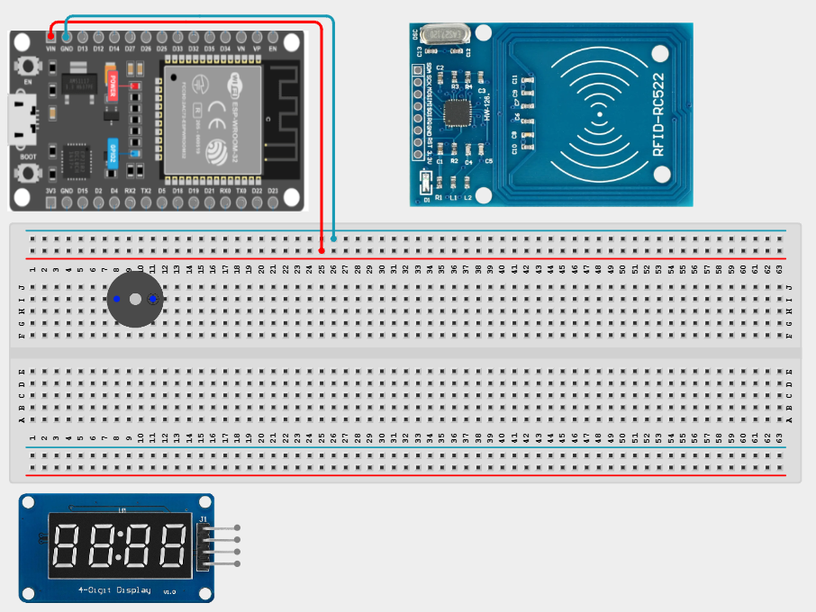
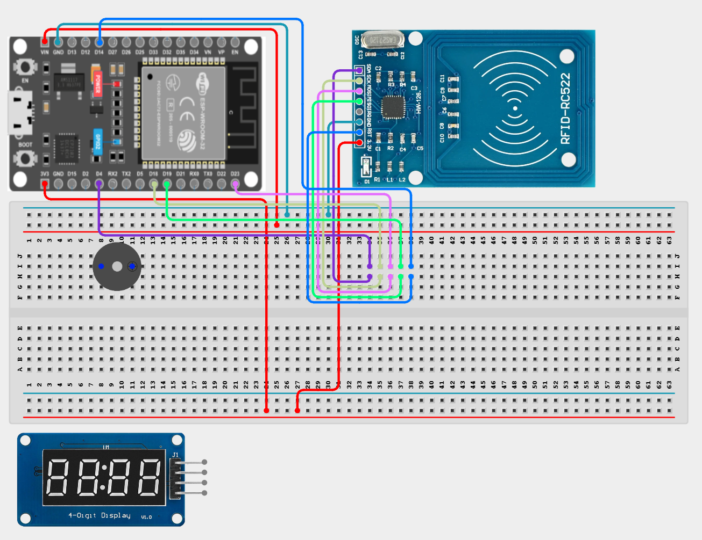
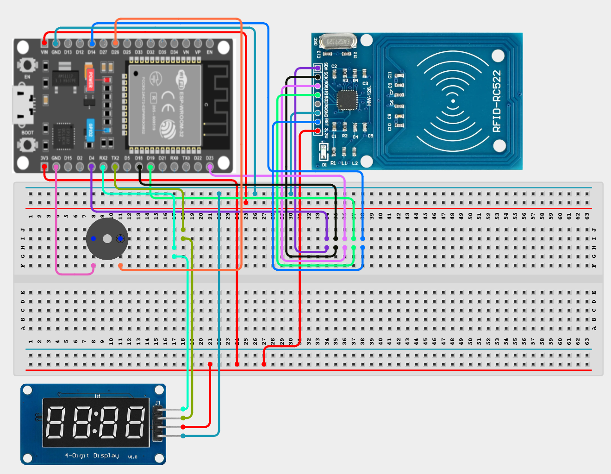

# 4.3.6. RFID Employee Attendance Counter

| **Description** | In Project 126, learners build an RFID scan counter using an RC522 reader, a TM1637 4-digit display, and an active buzzer. Each successful card scan increments the displayed count; the count is not saved when power is removed. |
|------------------|----------------------------------------------------------------|
| **Use case**     | This low-voltage prototype demonstrates RFID card scanning, scan counting, and audible feedback. It does not store employee identities or attendance records. |

## Components (Things You will need)

|  |  |  |  |  |  | TM1637 4-digit module (additional part; photo not available) |
| --- | --- | --- | --- | --- | --- | --- |

## Building the circuit

> **Tip:** Use the [ESP32 Pinout Guide](../../Components/ESP32%20Pinout%20and%20Pin%20Assignment%20Guide.md) to locate the correct GPIO pins.


Things Needed:

- ESP32 board = 1
- RC522 RFID reader = 1
- TM1637 4-digit display module = 1 (additional part; a bare 12-pin display is not compatible with this wiring)
- 2-pin active buzzer that operates at **3.3V** and draws no more than **12mA** = 1
- Breadboard, jumper wires, and USB cable


## Mounting the components

**Step 1:** With the ESP32 disconnected from USB, place the ESP32, RC522 reader, TM1637 display module, and active buzzer on an insulated surface.



## Wiring the circuit

**Step 2:** Connect the RC522 RFID reader:

- Connect **VCC** to **3.3V** on the ESP32 board.
- Connect **GND** to an ESP32 **GND** pin.
- Connect RC522 **SCK** to **GPIO 18 (SCK)**.
- Connect RC522 **MISO** to **GPIO 19 (MISO)**.
- Connect RC522 **MOSI** to **GPIO 23 (MOSI)**.
- Connect RC522 **SDA/SS** to **GPIO 4 (SS)**. On the RC522, **SDA/SS is the SPI chip-select pin, not I2C SDA**.
- Connect RC522 **RST** to **GPIO 14 (RST)**.
- Leave **IRQ** unconnected.



**Step 3:** Connect the TM1637 4-digit display:

- Use a **4-pin TM1637 display module**; a bare 12-pin 4-digit display cannot be wired directly as shown.
- Connect **VCC** to **3.3V** if supported by the module. If it requires **5V**, connect **VCC** to the ESP32 board's **5V** pin (called **VIN** on some board versions) and verify that **CLK/DIO** are safe with 3.3V ESP32 logic.
- Connect **GND** to ESP32 **GND**.
- Connect **CLK** to **GPIO 16**.
- Connect **DIO** to **GPIO 17**.
- Do not connect **CLK/DIO** directly if the module can pull them above **3.3V** or does not recognize 3.3V as HIGH.


**Step 4:** Connect the active buzzer:

- Connect buzzer **positive (+)** to **GPIO 26**.
- Connect buzzer **negative (-)** to ESP32 **GND**.
- The kit buzzer draws about **10mA at 3.3V**, which is suitable for direct GPIO drive. Do not connect its **5V** supply to a GPIO pin.
- If your buzzer draws more than **12mA at 3.3V** or requires 5V to operate, do not connect it directly to the GPIO.



**Step 5:** Connect the USB programming cable:

- Check the RC522 wiring and display logic compatibility, then connect USB to the ESP32.

## PROGRAMMING

**Step 1:** Open your Arduino IDE. See [Getting Started](<../../Getting Started/Arduino_IDE_Setup.md>) for setup instructions.

**Step 2:** Install the **MFRC522** and **TM1637Display** libraries from the Arduino IDE Library Manager, then enter this program:

```cpp
#include <SPI.h>
#include <MFRC522.h>
#include <TM1637Display.h>

constexpr uint8_t ssPin = 4;
constexpr uint8_t rstPin = 14;
constexpr uint8_t buzzerPin = 26;
constexpr uint8_t displayClkPin = 16;
constexpr uint8_t displayDioPin = 17;

MFRC522 mfrc522(ssPin, rstPin);
TM1637Display display(displayClkPin, displayDioPin);

uint16_t attendanceCount = 0;

void setup() {
  Serial.begin(115200);
  SPI.begin(18, 19, 23, ssPin);
  mfrc522.PCD_Init();
  pinMode(buzzerPin, OUTPUT);
  digitalWrite(buzzerPin, LOW);
  display.setBrightness(0x0f);
  display.showNumberDec(attendanceCount);
}

void loop() {
  if (!mfrc522.PICC_IsNewCardPresent()) return;
  if (!mfrc522.PICC_ReadCardSerial()) return;

  if (attendanceCount < 9999) {
    attendanceCount++;
  }
  display.showNumberDec(attendanceCount);

  Serial.print("Attendance scans: ");
  Serial.println(attendanceCount);

  digitalWrite(buzzerPin, HIGH);
  delay(200);
  digitalWrite(buzzerPin, LOW);

  mfrc522.PICC_HaltA();
  mfrc522.PCD_StopCrypto1();
}
```

**Step 3:** Save the sketch.

**Step 4:** Select the ESP32 board and its USB port in the Arduino IDE.

**Step 5:** Upload the sketch.

## CONCLUSION

Each successful RFID card scan increments the count shown on the TM1637 display and triggers a short buzzer beep. The count resets when the ESP32 loses power; the sketch does not identify employees or save attendance records.
