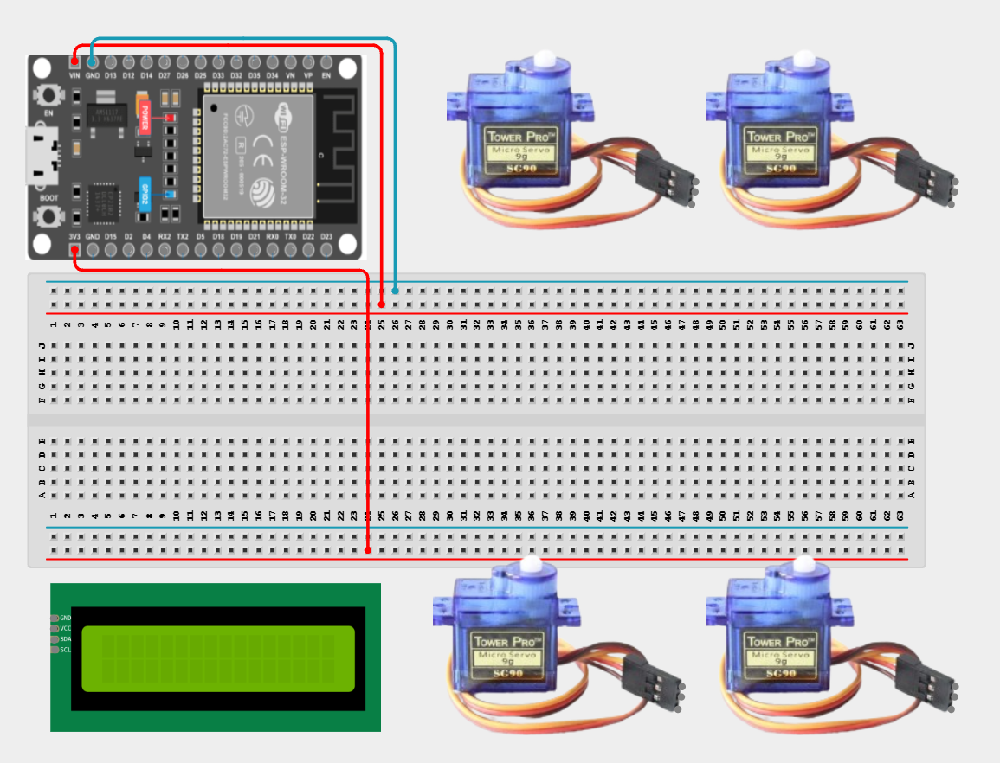
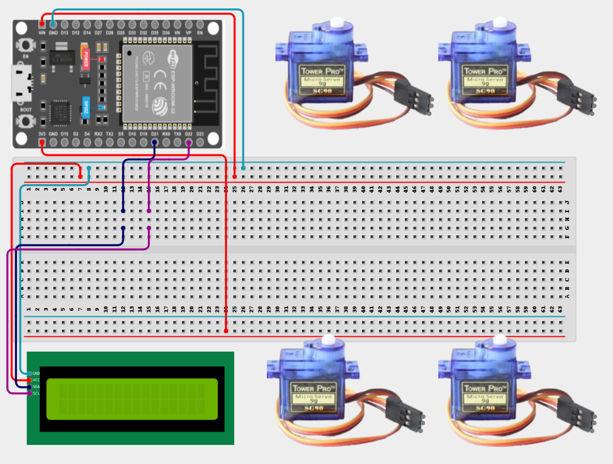
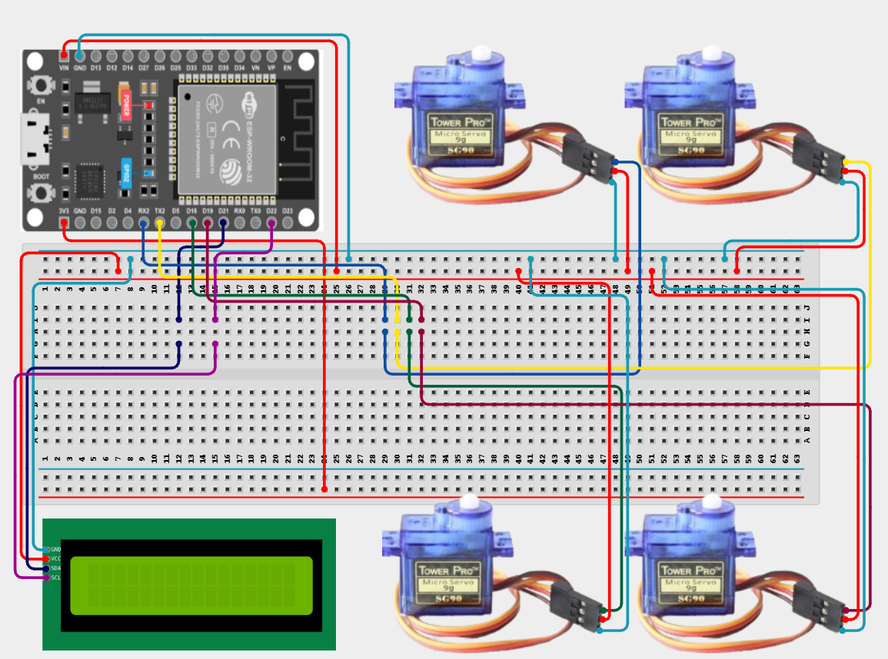

# 4.3.7. Wireless Bluetooth Industrial Robot Arm Drive

| **Description** | In Project 127, learners control a four-servo robot arm using the ESP32's built-in Bluetooth Classic. A phone sends simple commands, and an I2C LCD displays the selected action. |
|------------------|----------------------------------------------------------------|
| **Use case**     | This low-voltage prototype demonstrates wireless command input, multi-servo positioning, and local status display. |

## Components (Things You will need)

|  |  |  |  |  |  |
| --- | --- | --- | --- | --- | --- |

## Building the circuit

> **Tip:** Use the [ESP32 Pinout Guide](../../Components/ESP32%20Pinout%20and%20Pin%20Assignment%20Guide.md) to locate the correct GPIO pins.


Things Needed:

- ESP32 board = 1
- 4 SG90 servo motors = 4
- I2C 16x2 LCD = 1
- Regulated external **5V** servo supply rated for the combined stall current (at least **3A** for four servos rated at 650mA each)
- Breadboard, jumper wires, and USB cable


## Mounting the components

**Step 1:** With the ESP32 disconnected from USB and the servo supply off, place the ESP32, four SG90 servos, and I2C LCD on an insulated surface. Secure the arm joints and make sure they can move freely.



## Wiring the circuit

**Step 2:** The ESP32 uses built-in Bluetooth Classic; no external Bluetooth module or signal wires are needed.

**Step 3:** Verify the I2C LCD is safe to connect directly to the ESP32 before wiring it:

ESP32 GPIO pins use **3.3V logic** and are not 5V-tolerant. Before direct connection, verify from the exact LCD/backpack documentation that, while the LCD is powered at **5V**, its **SDA/SCL** signals never rise above **3.3V** and its I2C inputs recognize **3.3V** as HIGH. The kit's LCD documentation says its backpack pull-ups connect to 5V, so do **not** connect that version directly unless you confirm your actual module is different and 3.3V-I2C-compatible. If you cannot verify both requirements, do not connect it directly; use a compatible LCD/interface.

- Once verified, connect LCD **VCC** to the ESP32 board's **5V** pin (called **VIN** on some board versions) and LCD **GND** to ESP32 **GND**.
- Connect LCD **SDA** to **GPIO 21 (SDA)**.
- Connect LCD **SCL** to **GPIO 22 (SCL)**.
- The sketch expects LCD I2C address **0x27**. If the backpack uses **0x3F**, change the address in the `LiquidCrystal_I2C` declaration.



**Step 4:** Connect the four SG90 servos:

- Connect servo 1 **signal** (orange/yellow) to **GPIO 16**.
- Connect servo 2 **signal** (orange/yellow) to **GPIO 17**.
- Connect servo 3 **signal** (orange/yellow) to **GPIO 18**.
- Connect servo 4 **signal** (orange/yellow) to **GPIO 19**.
- Connect all four servo **V+** (red) wires to the positive output of the separate regulated **5V** supply.
- Connect all four servo **GND** (brown/black) wires to that supply's **GND**, then connect the supply **GND** to ESP32 **GND**.
- Do not connect the external supply's positive output to ESP32 **5V/VIN** while the ESP32 is USB-powered. Do not power the servos from ESP32 GPIO, 3.3V, or USB; four servos can draw several amps when starting or stalled.



**Step 5:** Connect the USB programming cable:

- Check the LCD logic compatibility, servo signal pins, supply rating, and common ground. Leave the servo supply off, then connect USB to the ESP32.

## PROGRAMMING

**Step 1:** Open your Arduino IDE. See [Getting Started](<../../Getting Started/Arduino_IDE_Setup.md>) for setup instructions.

**Step 2:** Install **ESP32Servo** and **LiquidCrystal_I2C** from the Arduino IDE Library Manager. `BluetoothSerial` is included with the ESP32 Arduino core. Enter this program:

```cpp
#include <ESP32Servo.h>
#include <BluetoothSerial.h>
#include <Wire.h>
#include <LiquidCrystal_I2C.h>

BluetoothSerial SerialBT;
LiquidCrystal_I2C lcd(0x27, 16, 2);

constexpr uint8_t servoPins[] = {16, 17, 18, 19};
Servo servos[4];

void setup() {
  Serial.begin(115200);
  Wire.begin(21, 22);
  lcd.init();
  lcd.backlight();

  for (uint8_t i = 0; i < 4; i++) {
    servos[i].attach(servoPins[i]);
    servos[i].write(0);
  }

  lcd.print("Robot Arm Ready");
  SerialBT.begin("ESP32 Robot Arm");
}

void loop() {
  if (SerialBT.available()) {
    const char cmd = SerialBT.read();
    if (cmd == '\r' || cmd == '\n') return;

    lcd.clear();
    lcd.setCursor(0, 0);

    if (cmd >= '1' && cmd <= '4') {
      const uint8_t servoIndex = static_cast<uint8_t>(cmd - '1');
      servos[servoIndex].write(90);
      lcd.print("Servo ");
      lcd.print(servoIndex + 1);
      lcd.print(": 90 deg");
      SerialBT.println("Servo moved to 90 degrees.");
    } else if (cmd == '0') {
      for (Servo &servo : servos) {
        servo.write(0);
      }
      lcd.print("Reset Position");
      SerialBT.println("All servos reset.");
    } else {
      lcd.print("Use 1-4 or 0");
      SerialBT.println("Send 1-4 to move a servo, or 0 to reset all.");
    }
  }
}
```

**Step 3:** Save the sketch.

**Step 4:** Select the ESP32 board and its USB port in the Arduino IDE.

**Step 5:** Upload the sketch.

**Step 6:** Pair and control the arm:

- Wait for upload to finish and the ESP32 to restart.
- Use a phone and terminal app that support **Bluetooth Classic Serial Port Profile (SPP)**; a BLE-only app will not work with `BluetoothSerial`.
- Scan for and connect to **ESP32 Robot Arm** using the terminal app's Bluetooth Classic/SPP option.
- Send **1**, **2**, **3**, or **4** to move the corresponding servo to 90 degrees. Send **0** to return all servos to 0 degrees.
- Once the low-voltage control test is successful, power the servos from their separate supply. Keep hands clear of moving joints.

## CONCLUSION

The ESP32 receives commands over its built-in Bluetooth Classic connection. Commands **1–4** move individual servos to 90 degrees, and **0** resets them. Servo position is not saved when power is removed.
