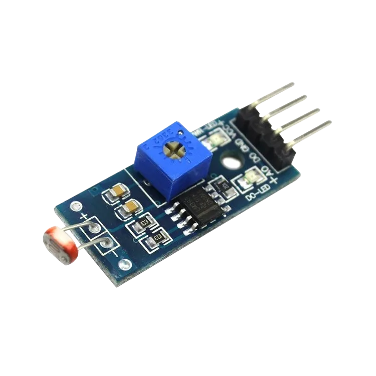
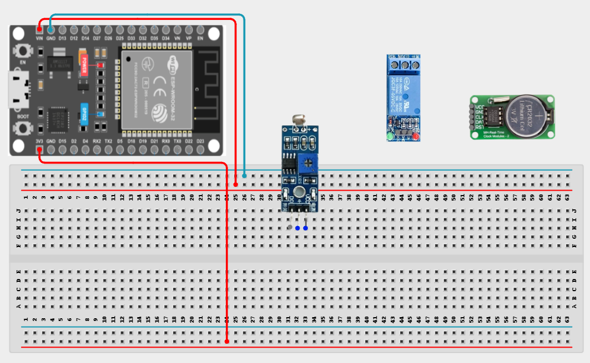
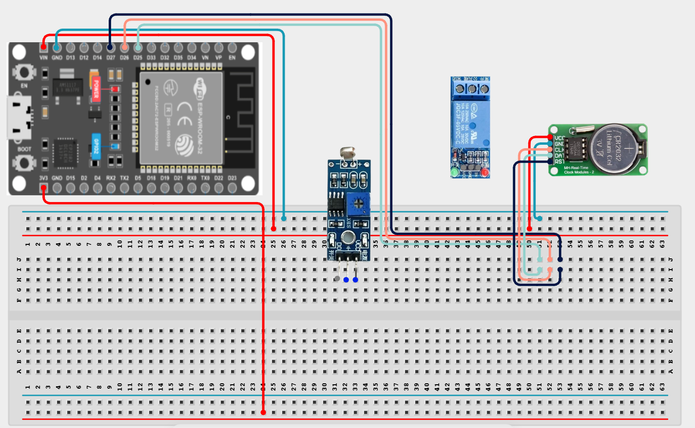
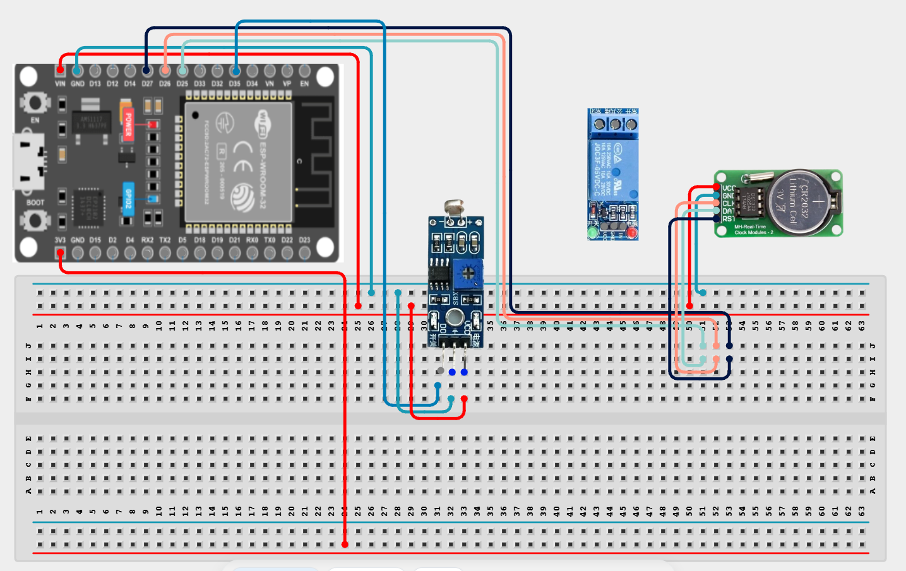
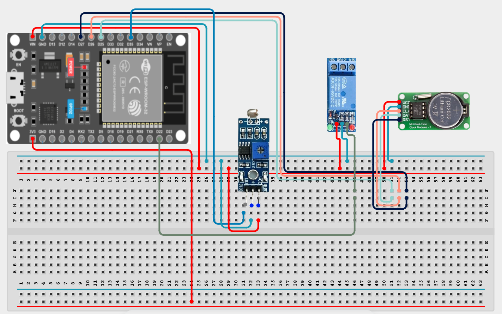

# 4.3.8. Real Time Clock Night Light Controller

| **Description** | In Project 128, learners build a night-light controller using a DS1302 RTC, an LDR sensor module, and a 1-channel relay. The relay switches a low-voltage light on only when it is dark during the scheduled night hours. |
|------------------|----------------------------------------------------------------|
| **Use case**     | This low-voltage prototype demonstrates time-based lighting control with an ambient-light override. |

## Components (Things You will need)

|  |  |  |  |  |  |  |
| --- | --- | --- | --- | --- | --- | --- |

The low-voltage night-light and its matching supply are load-side parts and are not pictured.

## Building the circuit

> **Tip:** Use the [ESP32 Pinout Guide](../../Components/ESP32%20Pinout%20and%20Pin%20Assignment%20Guide.md) to locate the correct GPIO pins.


Things Needed:

- ESP32 board = 1
- DS1302 RTC module with backup battery = 1
- 4-pin LDR sensor module with analog output (AO) = 1
- 1-channel relay module = 1
- Low-voltage DC night-light and matching external supply = 1
- Breadboard, jumper wires, and USB cable


## Mounting the components

**Step 1:** With the ESP32 disconnected from USB, place the ESP32, DS1302 RTC, LDR module, and relay on an insulated surface. Keep the night-light and its supply disconnected while assembling the control circuit.



## Wiring the circuit

**Step 2:** Connect the DS1302 RTC:

- Connect RTC **VCC** to **3.3V** if supported by the module, and connect RTC **GND** to ESP32 **GND**.
- If the module requires **5V**, connect **VCC** to the ESP32 board's **5V** pin (called **VIN** on some board versions). Verify that **DAT**, **CLK**, and **RST** signals remain at **3.3V or below** before connecting them directly; otherwise, do not connect them directly to the ESP32.
- Connect RTC **DAT** to **GPIO 25**.
- Connect RTC **CLK** to **GPIO 26**.
- Connect RTC **RST** to **GPIO 27**.
- Match the module labels exactly. The DS1302 uses a 3-wire interface, not I2C.



**Step 3:** Connect the LDR module:

- Connect LDR module **VCC** to ESP32 **3.3V** and **GND** to ESP32 **GND**.
- Connect analog output **AO** to **GPIO 35 (ADC1)**.
- Leave **DO** unconnected; the sketch reads the analog output.
- Keep the analog output between **0V and 3.3V**.



**Step 4:** Connect the relay module:

- The kit's relay module has **VCC**, **GND**, and **IN** control pins. If it is marked for a **5V coil**, connect **VCC** to the ESP32 board's **5V** pin (called **VIN** on some board versions).
- Connect relay **GND** to ESP32 **GND**.
- Connect relay **IN** to **GPIO 22** only if the module accepts 3.3V ESP32 logic. The sketch assumes an active-low input; confirm the module's trigger polarity and set `relayActiveLow` to `false` if it is active-high.
- For normally-off operation, connect the night-light supply **+** to relay **COM**, relay **NO** to the light **+**, and light **-** to the supply **-**.
- Use only a low-voltage DC light and matching supply. Keep the load disconnected during initial testing; do not use mains voltage or place mains wiring on a breadboard.

 

**Step 5:** Connect the USB programming cable:

- Check the RTC pins, LDR output voltage, relay polarity, and light wiring. Keep the light's external supply disconnected until the sketch is uploaded and the control side has been tested.

## PROGRAMMING

**Step 1:** Open your Arduino IDE. See [Getting Started](<../../Getting Started/Arduino_IDE_Setup.md>) for setup instructions.

**Step 2:** Install **Rtc by Makuna** from the Arduino IDE Library Manager, then enter this program. The light turns on only between **20:00 and 06:00** when the LDR reports darkness.

```cpp
#include <ThreeWire.h>
#include <RtcDS1302.h>

constexpr uint8_t rtcDatPin = 25;
constexpr uint8_t rtcClkPin = 26;
constexpr uint8_t rtcRstPin = 27;
constexpr uint8_t ldrPin = 35;
constexpr uint8_t relayPin = 22;
constexpr uint8_t nightStartHour = 20;
constexpr uint8_t nightEndHour = 6;
constexpr uint16_t darkThreshold = 400;
constexpr uint16_t brightThreshold = 500;
constexpr bool relayActiveLow = true;
constexpr bool setRtcToCompileTime = false;

ThreeWire rtcWire(rtcDatPin, rtcClkPin, rtcRstPin);
RtcDS1302<ThreeWire> rtc(rtcWire);

bool isDark = false;
bool nightLightOn = false;

void setRelay(bool on) {
  digitalWrite(relayPin, (on != relayActiveLow) ? HIGH : LOW);
}

void setup() {
  Serial.begin(115200);
  digitalWrite(relayPin, HIGH);
  pinMode(relayPin, OUTPUT);
  setRelay(false);

  analogSetAttenuation(ADC_11db);

  rtc.Begin();
  if (!rtc.IsDateTimeValid() || setRtcToCompileTime) {
    rtc.SetDateTime(RtcDateTime(__DATE__, __TIME__));
    Serial.println("RTC set to sketch compile time.");
  }
  if (!rtc.GetIsRunning()) {
    rtc.SetIsRunning(true);
  }

  isDark = analogRead(ldrPin) <= darkThreshold;
}

void loop() {
  const RtcDateTime now = rtc.GetDateTime();
  const int ldrValue = analogRead(ldrPin);

  if (ldrValue <= darkThreshold) {
    isDark = true;
  } else if (ldrValue >= brightThreshold) {
    isDark = false;
  }

  const bool isNightTime = now.Hour() >= nightStartHour ||
                           now.Hour() < nightEndHour;
  const bool shouldTurnOn = isNightTime && isDark;
  if (shouldTurnOn != nightLightOn) {
    nightLightOn = shouldTurnOn;
    setRelay(nightLightOn);
    Serial.println(nightLightOn ? "Night light ON." : "Night light OFF.");
  }

  Serial.print("Time: ");
  Serial.print(now.Hour());
  Serial.print(':');
  Serial.print(now.Minute());
  Serial.print(':');
  Serial.print(now.Second());
  Serial.print(" | LDR ADC: ");
  Serial.println(ldrValue);

  delay(1000);
}
```

**Step 3:** Save the sketch.

**Step 4:** Select the ESP32 board and its USB port in the Arduino IDE.

**Step 5:** Upload the sketch.

**Step 6:** Set the RTC and calibrate the light thresholds:

- Install the RTC backup battery.
- To set the RTC to the computer's current time, temporarily change `setRtcToCompileTime` to `true`, upload the sketch, then change it back to `false` and upload again.
- Open the Serial Monitor at **115200 baud** and compare the LDR reading in bright light and darkness.
- Adjust `darkThreshold` and `brightThreshold` so the dark reading is at or below `darkThreshold` and the bright reading is at or above `brightThreshold`. Keep `brightThreshold` higher than `darkThreshold`. If the readings behave in the opposite direction, reverse the comparisons in the code.
- With the light supply disconnected, verify the relay turns on only at night when dark and turns off in daylight or bright conditions.

## CONCLUSION

The controller uses the DS1302 time and LDR reading to switch a low-voltage night-light on between **20:00 and 06:00** only when it is dark.
