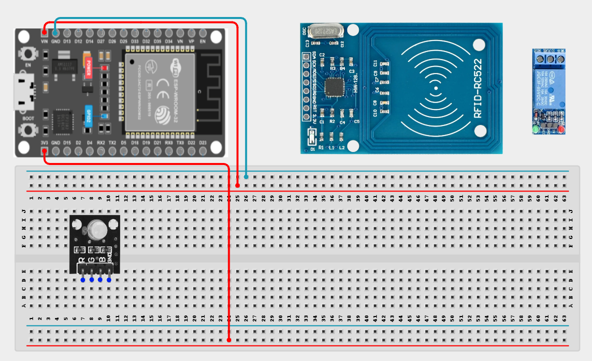
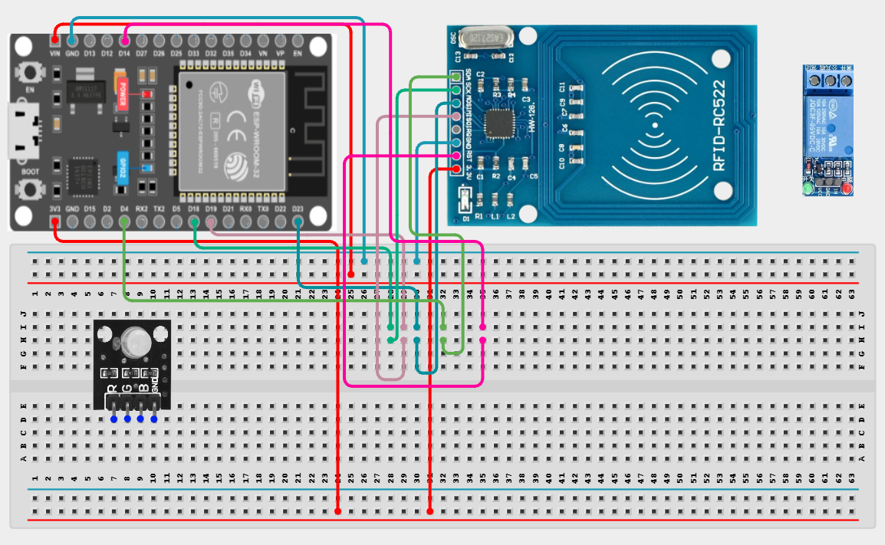
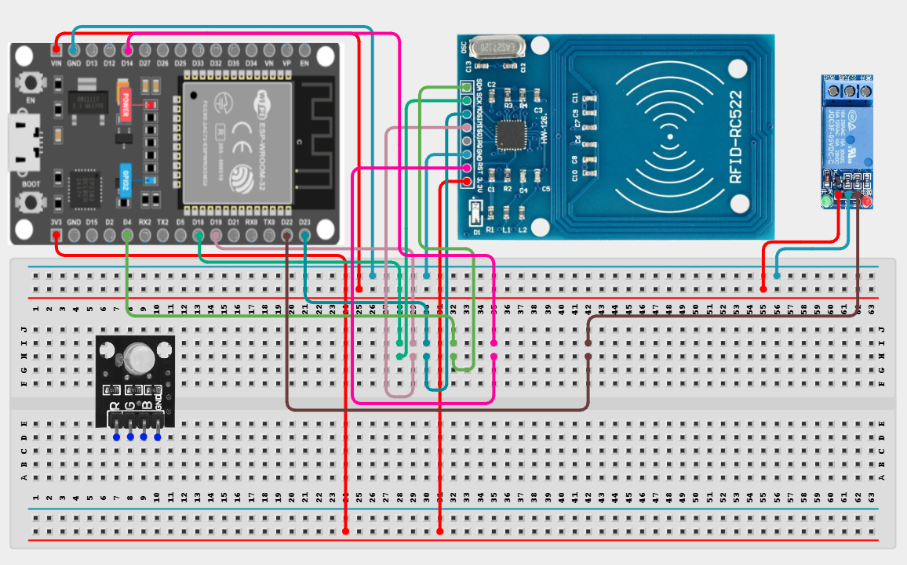
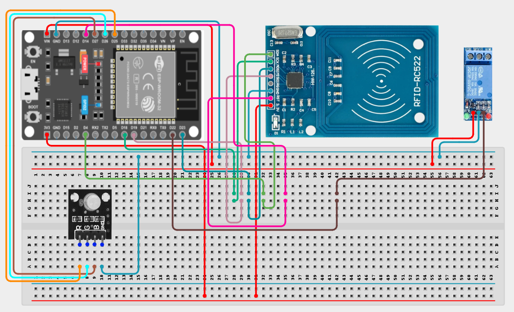

# 4.3.9. Smart RFID Door Access Control Gate

| **Description** | In Project 129, learners build an RFID access-control prototype using an RC522 reader, a 1-channel relay, a low-voltage solenoid lock, and an RGB status LED. A configured card UID unlocks the demonstration lock briefly. |
|------------------|----------------------------------------------------------------|
| **Use case**     | This low-voltage classroom prototype demonstrates RFID card checks, relay control, and status indication. UID-only card checks are not suitable for securing a real door. |

## Components (Things You will need)

|  |  |  |  |  |  |  |
| --- | --- | --- | --- | --- | --- | --- |

The low-voltage solenoid lock and its matching supply are load-side parts and are not pictured.

## Building the circuit

> **Tip:** Use the [ESP32 Pinout Guide](../../Components/ESP32%20Pinout%20and%20Pin%20Assignment%20Guide.md) to locate the correct GPIO pins.


Things Needed:

- ESP32 board = 1
- RC522 RFID reader = 1
- 1-channel relay module = 1
- Low-voltage DC solenoid lock and matching external supply = 1
- KY-016 RGB LED module = 1
- Breadboard, jumper wires, and USB cable


## Mounting the components

**Step 1:** With the ESP32 disconnected from USB and the solenoid supply off, place the ESP32, RC522 reader, relay module, and RGB LED module on an insulated surface. Keep the solenoid and its supply disconnected while assembling the control circuit.



## Wiring the circuit

**Step 2:** Connect the RC522 RFID reader:

- Connect **VCC** to ESP32 **3.3V**; do not use 5V.
- Connect **GND** to ESP32 **GND**.
- Connect RC522 **SCK** to **GPIO 18 (SCK)**.
- Connect RC522 **MISO** to **GPIO 19 (MISO)**.
- Connect RC522 **MOSI** to **GPIO 23 (MOSI)**.
- Connect RC522 **SDA/SS** to **GPIO 4 (SS)**. On the RC522, **SDA/SS is the SPI chip-select pin, not I2C SDA**.
- Connect RC522 **RST** to **GPIO 14 (RST)**.
- Leave **IRQ** unconnected.



**Step 3:** Connect the relay module:

- The kit's relay module has **VCC**, **GND**, and **IN** control pins. If it is marked for a **5V coil**, connect **VCC** to the ESP32 board's **5V** pin (called **VIN** on some board versions).
- Connect relay **GND** to ESP32 **GND**.
- Connect relay **IN** to **GPIO 22** only if the module accepts 3.3V ESP32 logic. The sketch assumes an active-low input; confirm the module's trigger polarity.
- For a fail-secure DC solenoid that unlocks when energized, connect the solenoid supply **+** to relay **COM**, relay **NO** to solenoid **+**, and solenoid **-** to the supply **-**. Follow the lock manufacturer's wiring/suppression instructions.
- Keep the solenoid supply disconnected during initial testing. Use only a low-voltage DC lock; do not use mains voltage or place mains wiring on a breadboard.



**Step 4:** Connect the RGB LED module:

- Connect RGB module **R** to **GPIO 25**.
- Connect RGB module **G** to **GPIO 26**.
- Connect RGB module **B** to **GPIO 27**.
- Connect RGB module **- / GND** (common cathode) to ESP32 **GND**.
- The pictured KY-016 module has onboard current-limiting resistors. If using a bare RGB LED instead, add the correct series resistor to each color channel.



**Step 5:** Connect the USB programming cable:

- Check the RC522 wiring, relay input compatibility, and shared ground. Keep the solenoid supply disconnected, then connect USB to the ESP32.

## PROGRAMMING

**Step 1:** Open your Arduino IDE. See how to set up here: [Getting Started](../../Getting Started/Arduino_IDE_Setup.md).

**Step 2:** Install the **MFRC522** library through Arduino IDE's Library Manager, then enter this sketch. It uses the Arduino-ESP32 Core 3.x LEDC API. On the first upload, leave the example UID in place so the Serial Monitor can show your card's UID.

```cpp
#include <SPI.h>
#include <MFRC522.h>

const byte SS_PIN = 4;
const byte RST_PIN = 14;
const byte RELAY_PIN = 22;
const byte RED_PIN = 25;
const byte GREEN_PIN = 26;
const byte BLUE_PIN = 27;

MFRC522 mfrc522(SS_PIN, RST_PIN);
// Replace these example bytes with the complete UID printed for your card.
const byte authorizedUID[] = {0xDE, 0xAD, 0xBE, 0xEF};
const bool RELAY_ACTIVE_LOW = true;

void setup() {
  Serial.begin(115200);

  digitalWrite(RELAY_PIN, RELAY_ACTIVE_LOW ? HIGH : LOW);
  pinMode(RELAY_PIN, OUTPUT);

  SPI.begin(18, 19, 23, SS_PIN); // SCK, MISO, MOSI, SS
  mfrc522.PCD_Init();

  if (!ledcAttach(RED_PIN, 5000, 8) ||
      !ledcAttach(GREEN_PIN, 5000, 8) ||
      !ledcAttach(BLUE_PIN, 5000, 8)) {
    Serial.println("Could not initialize RGB LED PWM.");
    while (true) delay(1000);
  }

  setLED(255, 255, 0);
  Serial.println("RFID access prototype ready. Scan a card.");
}

void loop() {
  if (!mfrc522.PICC_IsNewCardPresent() || !mfrc522.PICC_ReadCardSerial()) return;

  Serial.print("Card UID:");
  for (byte i = 0; i < mfrc522.uid.size; i++) {
    Serial.printf(" %02X", mfrc522.uid.uidByte[i]);
  }
  Serial.println();

  bool accessGranted = mfrc522.uid.size == sizeof(authorizedUID);
  for (byte i = 0; accessGranted && i < sizeof(authorizedUID); i++) {
    accessGranted = mfrc522.uid.uidByte[i] == authorizedUID[i];
  }
  Serial.println(accessGranted ? "Access granted." : "Access denied.");

  if (accessGranted) {
    setLED(0, 255, 0);
    setRelay(true);
    delay(3000);
    setRelay(false);
  } else {
    setLED(255, 0, 0);
    delay(2000);
  }

  setLED(255, 255, 0);
  mfrc522.PICC_HaltA();
  mfrc522.PCD_StopCrypto1();
}

void setRelay(bool energized) {
  digitalWrite(RELAY_PIN, energized == RELAY_ACTIVE_LOW ? LOW : HIGH);
}

void setLED(byte red, byte green, byte blue) {
  ledcWrite(RED_PIN, red);
  ledcWrite(GREEN_PIN, green);
  ledcWrite(BLUE_PIN, blue);
}
```

**Step 3:** Save the sketch. _See the [Getting Started](../../Getting Started/Arduino_IDE_Setup.md) section._

**Step 4:** Select the ESP32 board and port. _See [Getting Started](../../Getting%20Started/Arduino_IDE_Setup.md)._

**Step 5:** Upload the sketch, open Serial Monitor at **115200 baud**, and scan your card. Copy every byte printed after `Card UID:` into `authorizedUID` (preserving the `0x` hexadecimal format), then upload the edited sketch again. The UID array length must match the complete card UID.

**Step 6:** With the solenoid supply still disconnected, scan the configured card and check that the RGB LED turns green and the relay switches briefly. An unconfigured card should turn the LED red. Connect and test the low-voltage lock only after confirming the relay module's 3.3V input compatibility and the lock's supply requirements.

## CONCLUSION

This project demonstrates reading an RFID card UID, comparing it with a configured value, indicating the result with an RGB LED, and briefly switching a low-voltage solenoid through a relay. UID-only identification can be copied or emulated, so this demonstration must not be used as the sole security mechanism for a real door.
